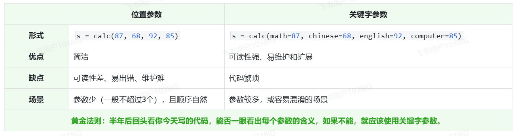
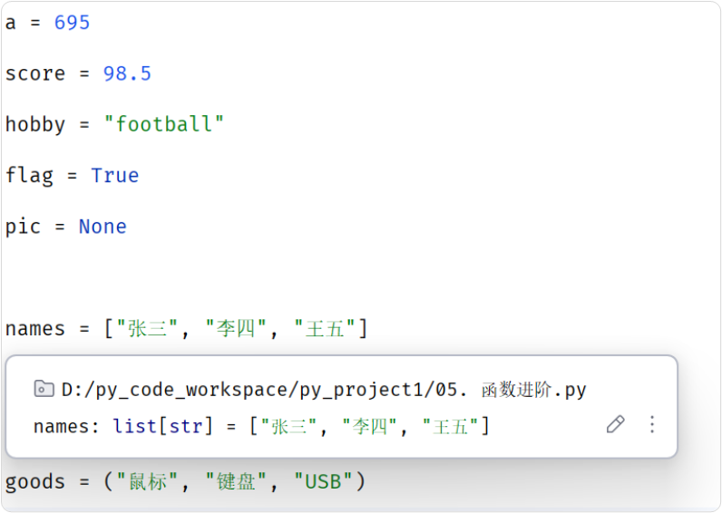
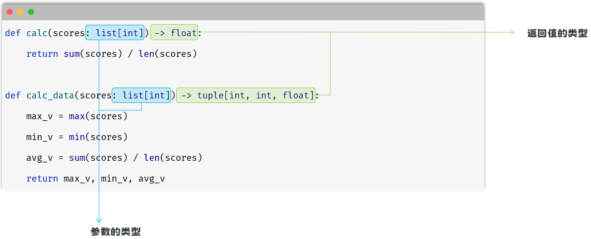

---
tags:
  - 函数
date: 2026-11-15
cover: false
title: "03-函数"
---
## 函数基础

### 定义

```Python
# 定义函数
def 函数名(参数列表):
    函数体
    ......
    return 返回值
    

# 调用函数
函数名(参数)
```

- 函数必须先定义，在调用
- 函数定义时的参数列表与返回值语句是可有可无的(由需求确定)

### 参数列表与返回值（形参和实参）
```Python
# 定义函数
def 函数名(形参列表):
    函数体
    ......
    return 返回值1,2,3

# 调用函数
v = 函数名(实参)
```

- 函数定义时如果有多个参数，多个参数之间使用逗号（,）分隔 。
    
- `return`语句只有返回功能，而没有输出打印的功能，如果要输出，需要结合`print()`函数来实现
    
- 函数是可以定义多个返回值的，多个返回值会封装到一个<mark style="background:#d3f8b6">元组中</mark>。

### 函数的说明文档

```Python
# 函数2: 计算长方形的面积 -- 长, 宽
def rectangle_area(l,w):
    """
    根据长方形的长度和宽度, 计算长方形的面积
    :param l: 长度
    :param w: 宽度
    :return: 长方形的面积
    """
    area = l * w
    return area

print(rectangle_area(20, 10))
help(rectangle_area)
```

- `:param` ：描述函数的参数
- `:return`：描述函数的返回值

### 查看函数说明文档

方式一：help函数，`help(函数名)`
方式二：在PyCharm中，鼠标悬浮在函数上，自动展示。

### 嵌套调用

函数支持嵌套调用、不支持嵌套定义

# 函数进阶

### 变量作用域

#### 全局变量

在函数、推导式之外定义的变量，称之为全局变量，在整个文件中（包括函数内）都可以使用（通常定义在文件的顶部）

#### 局部变量

在函数、推导式内部定义的变量，称之为局部变量，只能在该函数内部使用，外部无法访问(执行完毕后，会自动销毁其内部局部变量) 。

#### 优先级

在使用变量时，优先在当前作用范围内查找，如果未查询到，再到上一层作用域查询。

#### global关键字

作用：`global`关键字用于明确的告诉Python解释器，在函数中要使用全局变量，使得可以在函数内部修改全局变量的值。


> [!NOTE] 注意
> - 在基于global声明全局变量时，要先声明，再使用。
> - 尽量避免在函数中修改全局变量，因为会使代码难以维护和调试


###  参数详解

#### 传参方式

概述：传参方式指的是，在调用函数时，传递实参的方式

主要分为两类：
- 位置参数：调用函数时根据函数定义时的位置来传递参数。
- 关键字参数：调用函数时以函数定义时形参名称作为关键字，以 "键=值" 的形式来传递参数(<mark style="background:#d3f8b6">不要求顺序</mark>)。

<span style="color:#d83931">要求：如果位置参数与关键字参数混用, 关键字参数必须在位置参数之后(关键字参数之间,没有顺序要求)。</span>

#### 总结



### 默认参数

**默认参数**也称为**缺省参数**
- 用于在<mark style="background:#d3f8b6">定义函数</mark>时，为参数提供默认值
- <mark style="background:#d3f8b6">调用函数</mark>时，可以不传递有默认值的参数


> [!NOTE] 注意：
> - 函数调用时，如果为默认参数传递了值，则会使用传递进来的值；如果没有传递该参数，则直接使用默认值。
> - 默认参数必须放在没有默认值的参数列表的后面，一个函数在定义时是可以设置多个默认参数的。

### 不定长参数

- 参数的个数是不固定的，就可以通过**不定长参数**来实现。
- **不定长参数**也叫**可变参数**，用于函数定义及调用时参数个数不确定（0个或多个）的场景。
- 对于不定长参数，根据传参方式的不同，又分为两类：位置参数 与 关键字参数。
#### 不定长位置参数（\*args）

#### 介绍

- 不定长位置参数的可变参数会被封装到一个tuple元组中
- `args` 只是约定俗成的变量名，并不是关键字


#### 不定长关键字参数（\*\*kwargs）

##### 概念

通过关键字参数形式传递进来的，长度不确定的参数

##### 实现

- 写法是 `**kwargs`
- 以 `"键=值"` 形式传递的关键字参数
- `"键= 值"` 参数都会被`kwargs`接收，并合并封装为一个<mark style="background:#d3f8b6">字典类型 。</mark>

##### 总结

> [!NOTE] 注意
> - `*args`：不定长位置参数，函数调用时，通过位置参数传递多个参数封装到一个<mark style="background:#d3f8b6">元组(tuple)</mark>中
> - `**kwargs`：不定长关键字参数，函数调用时，通过关键字参数传递多个参数封装到一个<mark style="background:#d3f8b6">字典(dict)</mark>

### 参数类型

**概念**：在定义函数时，关于函数的参数类型可以是普通参数，也可以是特殊参数。

**分类**：

- **普通参数**，比较常见的就是：float、int、bool、str、list、set、tuple、dict等。
- **特殊参数**：比如：函数

示例

```Python
# 函数的参数类型
# 加
def add(x, y):
    return x + y
# 减
def subtract(x, y):
    return x - y
# 乘
def multiply(x, y):
    return x * y
# 除
def divide(x, y):
    return x / y
# 计算
def calc(x, y, oper):
    return oper(x, y)

print(calc(10, 20, multiply))
```
### 匿名函数

概念：匿名函数指的是没有名称的函数，需要通过lambda表达式来声明函数，可以简化简单函数的编写（单行表达式）。

语法对比：

```Python
# 定义命名函数
def 函数名(参数列表):
    函数体...
```

```Python
# 定义匿名函数
lambda 参数列表 : 函数体
```

> [!NOTE] 命名函数与匿名函数的选择？
> - 建议使用匿名函数的情况：函数逻辑简单，只在一个地方调用（常作为高阶函数的参数）
> - 建议使用命名函数的情况：函数逻辑复杂，需要多步操作，需要多个地方重复使用或需要加文档说明的场景
> 
> <mark style="background:#d3f8b6">记住：代码的可读性和可维护性比简洁性更重要</mark>

### 类型注解（Type Hints）

- 类型注解是Python中的一种语法特性，用于明确标识变量、函数参数和返回值的数据类型，从而使代码更清晰、更安全、更易维护。

代码示例：

```Python
# 定义变量
a: int = 695
score: float = 98.5
hobby: str = "Python"
flag: bool = True
pic: None = None

names: list[str] = ["A", "C", "E"]
phones: set[str] = {"13309091111", "15209109121"}
options: dict[str, int] = {"count": 0, "total": 0}
goods: tuple[str,int,int] = ("手机", 5999, 1)
```

<span style="color:#d83931">注意：Python是动态类型语言，添加的类型注解只是提示，并不是强制约束!!!</span>

#### 类型推断

- 类型推断是指Python解释器自动推断出变量、表达式或函数返回值的数据类型的能力，而无需开发者显式声明。



#### 总结

> [!NOTE] 注意
> 1. 类型注解的写法？
>       变量: 数据类型 (如 `a: int`)
>       
> 2. 常见类型的写法
>     1. `int`、`float`、`bool`、`str`、`None`、`list`、`set`、`tuple`、`dict`
>     2. `str | int`
> 
> 3. 为什么要使用类型注解，有什么好处呢？
>     1. 代码结构更清晰、代码逻辑更安全、易维护
>     2. 提前发现代码潜在问题
> 
> 4. 注意事项
>     <span style="color:#d83931">1. Python是动态类型语言,添加的类型注解只是提示,并不是强制约束!!!</span>
>     <mark style="background:#d3f8b6">1. 如果对变量直接赋值、变量运算等场景， Python会自动进行类型推断，此时无需指定变量的类型</mark>

#### 函数类型注解

**概念**：函数拥有 <mark style="background:#d3f8b6">参数列表</mark>和<mark style="background:#d3f8b6">返回值</mark>，可以在定义函数时，指定参数和返回值的类型

```Python
# 函数类型注解
def get_count(s:str,num:str)->int:
    return s.count(num)
```




##### 补充使用 | 进行多个注解
```py
def filter_data(*args:int, **kwargs: int | str | bool) -> list[int]:
```
