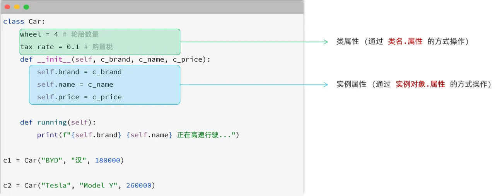
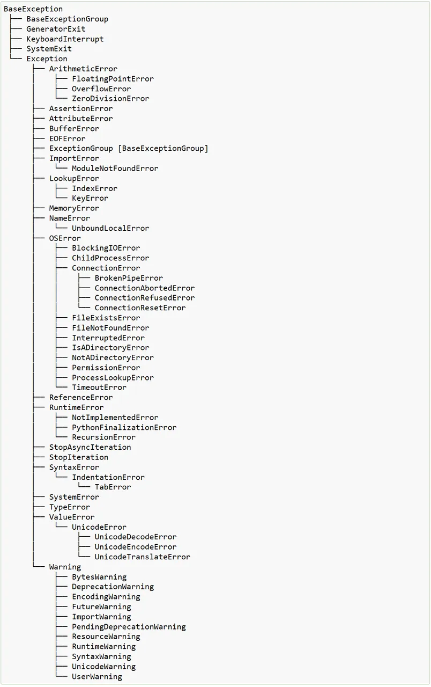

---
tags:
  - 面向对象
date: 2026-11-18
cover: false
title: "05-面向对象"
---
**对象**：具体的事物

**类**：对具有相同特征和功能的事物的统称

## 面向对象基础

### 语法
```Python
# 定义类
class 类名:
	# pass是空语句，作用：占位，保证语法正确；代表此处暂时不写任何代码，什么都不执行
    pass

# 创建对象
对象名 = 类名()
对象名.属性名1 = 属性值1
对象名.属性名2 = 属性值2
```

### 构造方法 `__init__`
创建对象时自动调用，用于初始化对象属性
self：代表<mark style="background:#d3f8b6">当前实例对象</mark>，谁调用这个方法，self就指向谁
参数name/age/hobby：接收外部传入的数据，给当前对象的属性赋值

```py
def __init__(self,name,age,hobby):
    self.name = name
    self.age = age
    self.hobby = hobby
```


> [!tip] 提示
> 说明1：定义在类的外面定义的函数，称之为函数，定义在类中的函数称之为方法 。
> 说明2：类名的命名规范，遵循大驼峰命名法，每个单词的首字母都是大写，单词之间没有分隔符，比如：UserInfo，UserAccount 。   
> 说明3:`__dict__`是Python中用户自定义类实例的一个特殊属性，用于<span style="color:#d83931">以字典</span>形式输出对象的<span style="color:#d83931">属性 </span>。

```py
print(per1.__dict__)
# 以字典的形式输出对象的属性
```


## 实例方法

就是属于 "对象/实例"的方法，必须通过对象来调用。

```py
class Person:
    # 构造方法，初始化属性
    def __init__(self,name,age):
        self.name = name
        self.age = age

    # 实例方法：第一个参数固定为self，代表当前对象
    def say(self, msg):
        print(f"{self.name}说：{msg}")

# 调用实例方法：对象.方法()
p = Person("小明",18)
p.say("你好")
```

## 魔法方法

魔法方法是 Python 提供的以双下划线开头、双下划线结尾的特殊方法，用于实现<span style="color:#d83931">类的内置行为</span>，如构造方法`__init__`。魔法方法不需要程序员手动调用，Python 会在满足对应条件时<span style="color:#d83931">自动调用</span>。


*（图片缺失：file-20261118200705803.png）*

<span style="color:#d83931">提示：当 `__str__` 未定义时， 会降级使用 `__repr__`</span>


## 属性详解
### 实例/对象属性
### 类属性



<span style="color:#d83931">说明：通过实例查找属性时，会先查找实例属性，实例属性不存在时，再查找类属性 。</span>

## 面向对象进阶

### 三大特性：封装、继承、多态

#### 封装

将数据（属性）和操作数据的函数（方法）打包封装到类中，成为一个独立整体； 隐藏类内部的实现细节，仅对外提供开放的访问接口。

- 实现方式：在属性、方法名称前加 `__` 双下划线，定义私有成员
- 特点：私有属性、私有方法**仅能在当前类内部访问**，类外部无法直接访问
- 优点：保护数据，提升数据安全性

##### 知识小拓展：【了解】


> [!NOTE] 拓展
> Python 中以**双下划线 `__` 开头**的属性、方法，并不是真正意义上的私有，只是 Python 自动做了**名称改写（name mangling）**，让我们无法直接用原名称访问调用。
> 
> 改写规则：`_类名 + 原私有名`
> - 私有属性：`__xxx` → `_类名__xxx`
> - 私有方法：`__func()` → `_类名__func()`
> 
> 示例：
> `__owner` → `_Car__owner`
> `__control_fuel()` → `_Car__control_fuel()`
> 
> > 补充提示：这只是语法层面的改名防护，不是安全隔离，拿到改写后的名字依旧可以访问。

#### 继承

- 语法：
```py
class 子类（父类）：
	pass
```

- 特点：子类继承父类，就可以直接使用父类的属性和方法(非私有)
- 好处：提高代码复用性、可维护性

- 子类中继承父类属性值：`super().__init__()`

##### 方法的重写

- 重新定义一个与父类同名的方法，用子类自己的实现来替换父类的实现

- 子类中调用父类中的内容：super().父类的方法/属性或`父类名.方法名(self)`


##### 多继承

```Python
class 子类名(父类名1, 父类名2, 父类名3, ...):
    代码
    ...
```
如果多个父类中定义了相同的方法,子类继承后,会按照继承的顺序使用


`
#### 多态
- 介绍：调用同一个父类方法，在不同的子类里重写后，呈现出不同的形态、行为、表现。
- 语法：使用父类的类型变量，接收子类的对象
- 好处：提升方法的扩展性
- 示例：
```py
class Animal:
    def speak(self):
        pass

class Dog(Animal):
    def speak(self):
        print("汪汪汪")

class Cat(Animal):
    def speak(self):
        print("喵喵喵")

def make_speak(animal: Animal):
    animal.speak()

make_speak(Dog())
make_speak(Cat())
```


##### 鸭子类型（Duck Typing） 【了解】
```py
鸭子类型（Duck Typing）【了解】
- 核心思想：不看对象属于哪个类，只看对象有没有对应的方法/属性。
- 通俗描述：如果它走起路来像鸭子、叫起来像鸭子，那它就是鸭子。
- Python特点：Python的多态依靠鸭子类型，不强制要求继承同一个父类，只要方法名一致就可以实现多态效果。
- 示例：
class Duck:
    def speak(self):
        print("嘎嘎嘎")

class Person:
    def speak(self):
        print("你好")

def make_speak(obj):
    obj.speak()

make_speak(Duck())
make_speak(Person())
```

#### 抽象类

- 介绍：含有抽象方法的类叫做抽象类，抽象方法只有方法声明，没有具体实现
- 特点：
  1. 抽象类<mark style="background:#d3f8b6">不能实例化</mark>（不能直接创建对象）
  2. 子类继承抽象类后，**必须<mark style="background:#d3f8b6">重写全部抽象方法</mark>**，否则子类也还是抽象类，无法实例化
- 作用：规范子类<mark style="background:#d3f8b6">必须实现哪些方法</mark>，做标准约束
- 实现方式：需要导入 abc 模块，使用 @abstractmethod 装饰器定义抽象方法
- 定义了抽象方法的类 ，需要继承ABC父类
- 示例：
```py
from abc import ABC, abstractmethod

class Animal(ABC):
    @abstractmethod
    def speak(self):
        pass

class Dog(Animal):
    def speak(self):
        print("汪汪汪")
```

## 异常
- 介绍：程序运行过程中出现的错误，会中断程序正常执行
- 作用：捕获异常，防止程序直接崩溃，给程序容错能力
- 基础语法：
```py
try:
    可能出错的代码
except 异常类型:
    捕获到异常后的处理代码
else:
    没有异常才执行的代码
finally:
    无论是否异常，一定会执行的代码
- 常用写法：
try:
    num = int(input("输入数字："))
except ValueError:
    print("输入不是数字！")
```
- try、except、else、finally 可以按需组合、分开使用，不是必须全部写

### 多异常处理

- 一段try中的代码可能抛出多种不同异常，可以设置多个except分别捕获处理
- 只要出现 Exception 异常,或者Exception 子类异常, 都会被Exception 捕获处理
### Python中的异常体系结构如下
官方文档：https://docs.python.org/zh-cn/3.14/library/exceptions.html



## 文件操作
### 读
- 文件操作三步：打开、读/写、关闭
- 读操作三步骤：
  1. 打开文件：f = open("文件地址" , "r" , encoding = "utf-8")
  2. 读取内容：
     - content = f.read() 【读取全部】
     - content_list = f.readlines() 【按行读取，读取全部行】
  3. 关闭文件：f.close()

> [!NOTE] 注意
> 
> "r"：操作模式，r 代表 read，只读文件
> encoding：指定文件编码
> - 编码：把字符（文字、数字、符号）转为计算机可识别数字代码的规则体系，常见：ASCII、GBK、UTF-8
>   - ASCII：基础西文编码，仅支持数字、字母、符号，不支持中文、日韩文字
>   - GBK：国内汉字编码标准，兼容ASCII，不支持韩文、日文
>   - UTF-8：互联网主流编码，兼容ASCII、支持全球文字，是目前推荐使用的编码
### 写
- 写操作三步骤：
    - **打开文件** ：f = open("文件地址", "w", encoding="utf-8")
    - **写内容**：f.write(写入的内容)
    - **关闭文件**：f.close()


### 释放资源
- 说明：文件打开后会占用系统资源，操作完成后需要关闭文件，释放资源
- 方式1：手动关闭
  f.close()
- 方式2：with 语句（自动释放，推荐）
  - 特点：代码执行结束，会自动关闭文件，不用写 close()，就算出现异常也能正常释放资源
  - 示例：
```py
with open("文件地址", "r", encoding="utf-8") as f:
    content = f.read()
```
### 路径写法

- 相对路径：相对于当前代码文件所在位置去找文件
  示例：test.txt 、data/test.txt
- 绝对路径：从电脑根目录开始的完整路径
  Windows示例：C:\\files\\test.txt  或者 r"C:\files\test.txt"
  Linux/Mac示例：/home/xxx/test.txt
- 注意：
  1. Windows直接写\会被当成转义符，两种解决办法：双反斜杠 \\ 或者原始字符串 r""
  2. 推荐优先使用相对路径，移植性更好

#### 相对路径语法
- .  代表当前目录（代码所在目录）
- .. 代表上一级目录（父目录）
- 示例：
  ./test.txt      当前目录下的 test.txt
  ../test.txt     上一级目录下的 test.txt
  ./data/1.txt    当前目录里 data 文件夹下的 1.txt
  ../img/2.jpg    上一级目录里 img 文件夹下的 2.jpg
### 操作模式

- r：read 只读，文件不存在则报错，不能写入
- w：write 只写，文件不存在就新建；文件存在会清空原有内容再写入
- a：append 追加，文件不存在就新建；文件存在，在文件末尾新增内容，不会清空


### json操作

- 介绍：JSON 是一种轻量级数据格式，Python中用json模块实现字典和json字符串互转、读写json文件
- 导入模块：import json
- 常用方法：
  1. json.dumps()：Python字典 → JSON字符串
  2. json.loads()：JSON字符串 → Python字典
  3. json.dump()：Python字典 → 写入JSON文件（配合文件对象）
  4. json.load()：读取JSON文件 → Python字典
- 示例：
```py
# 字典转json字符串
json_str = json.dumps(dict_data, ensure_ascii=False, indent=2)
# json字符串转字典
data = json.loads(json_str)
# 字典写入json文件
with open("test.json", "w", encoding="utf-8") as f:
    json.dump(dict_data, f, ensure_ascii=False, indent=2)
# 读取json文件转为字典
with open("test.json", "r", encoding="utf-8") as f:
    data = json.load(f)
- 参数说明：
  - ensure_ascii=False：正常显示中文，不转义
  - indent=2：格式化缩进，方便阅读
```

### 序列化、反序列化

- 序列化：Python对象（字典/列表） → JSON字符串
- 反序列化：JSON字符串 → Python对象（字典/列表）
  对应方法：json.loads() / json.load()
- 区分：
  dumps / loads：和字符串之间转换
  dump / load：直接读写json文件
