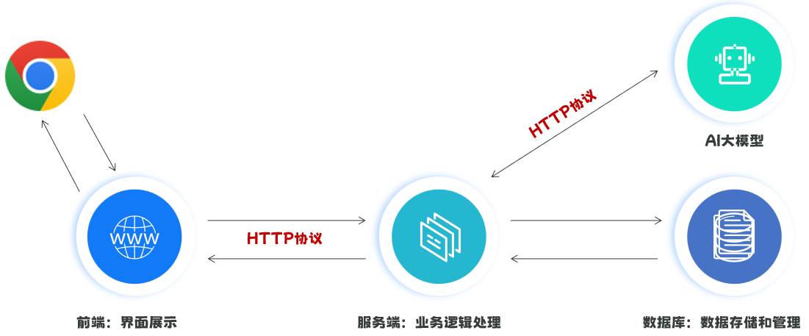
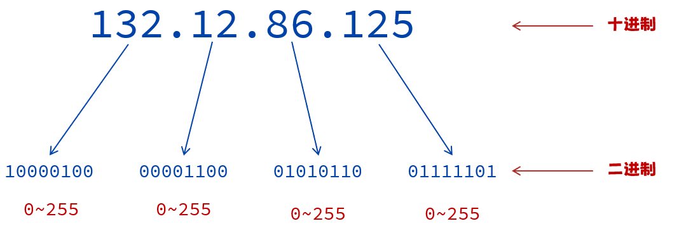
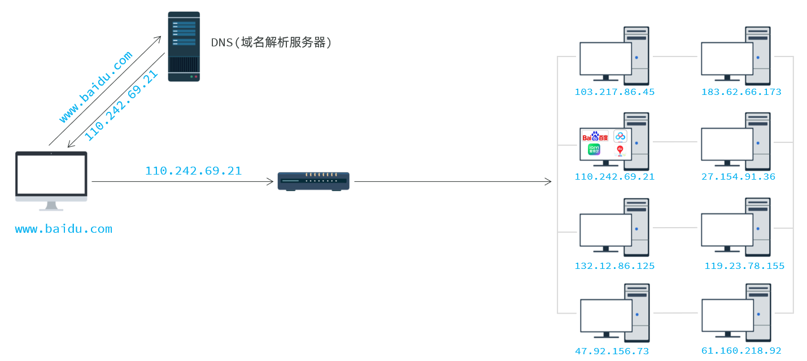
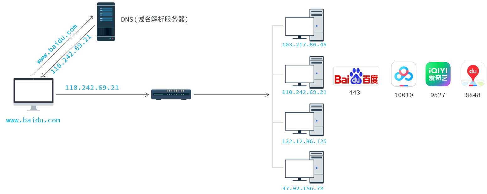

# Web 应用由三个核心部分组成

- 前端程序：负责页面布局、数据渲染、用户交互
- 服务端程序：负责业务逻辑处理
- 数据库：负责数据存储与管理

- 前端程序：负责页面布局与数据展示。网页由 HTML（结构）、CSS（表现）、JavaScript（动作）三部分组成；这部分基于 VibeCoding 即可轻松搞定
- 服务端程序：可用 Python 的 Django、Flask 或 **FastAPI** 框架开发，大幅简化代码、提高效率；企业项目中最流行的是 FastAPI，本课即采用 FastAPI
- 数据库：MySQL
- HTTP 协议：规定客户端与服务端之间数据传输的规则
- AI 大模型：DeepSeek

# 网络协议（HTTP）

**网络（互联网，Internet）**：由若干网络设备连接而成、实现资源共享的系统。

# IP

**分类与格式**

- **IPv4**
  - 32 位二进制，日常以十进制四段表示，例：`132.12.86.125`
  - 每段取值 `0~255`，四段组合成完整 IP 地址
- **IPv6**
  - 128 位二进制，为解决 IPv4 地址资源不足而设计
  - 日常开发与上网仍以 IPv4 为主

**特殊 IP 地址**

- `127.0.0.1`：本地回环地址（本机地址），代表当前电脑自身，本地开发调试高频使用
- `localhost`：本机域名，作用与 `127.0.0.1` 完全一致，均可访问本机服务

# 域名

- **域名（Domain Name）**：由一串用点分隔的英文字母组成的地址。IP 地址不便记忆，因此设计了域名，并通过 DNS（域名解析服务器）将域名与 IP 相互映射，便于记忆与访问。

1. 浏览器地址栏输入 `www.baidu.com` 并回车，首先访问 DNS（域名解析服务器），其中记录着域名与 IP 的对应关系，据此找到对应 IP，例如 `110.242.69.21`
2. 再根据 `110.242.69.21` 找到对应服务器，访问其中的服务

# 端口

- **端口号（Port）**：整数，取值 `0-65535`，用于标识计算机设备中正在运行的程序

- HTTP 协议默认端口 `80`
- HTTPS 协议默认端口 `443`

> [!tip] 总结
> - **IP**：唯一定位互联网上的一台设备（`127.0.0.1` 为本机地址）
> - **域名**：降低 IP 地址的书写与记忆成本（`localhost` 为本机域名）
> - **端口**：每个程序运行后都会占用一个端口（`0-65535`；HTTP 默认 `80`，HTTPS 默认 `443`）

# HTTP 协议

### 介绍

![[day08-Python-AI应用实战(准备工作)-cqRfFnLe.png]]

- **概念**：`Hyper Text Transfer Protocol`，超文本传输协议，规定客户端与服务器之间数据传输的规则。只有请求与响应都遵循同一套规则，服务端才能读懂请求、客户端才能解析响应

### 请求数据格式

- **请求协议**：浏览器按请求格式把数据发给服务器，包含**请求行、请求头、请求体**

![[day08-Python-AI应用实战(准备工作)-cP5cUn6d.png]]

- **请求行**（图中黄色部分）
  - 请求数据的第一行：请求方式 + 资源路径 + 协议
  - 请求方式：GET、POST
    - GET：参数在请求行中，无请求体。如 `/api/courses?name=Python&status=1`，`?` 之后的 `name=Python&status=1` 即请求参数，`name`、`status` 为参数名，`Python`、`1` 为参数值，格式 `key=value&key=value`；GET 参数长度受浏览器与服务器限制
    - POST：参数在请求体中，没有协议层面的大小限制，实际仍受服务器配置约束
  - 资源路径：`/api/courses`，不含协议、IP、端口
- **请求头**（图中绿色部分）【了解】
  - 从第二行开始，格式为 `key: value`
  - HTTP 是无状态协议，故请求头携带浏览器自身信息与期望的响应形式，服务器据此知道「是谁、想干什么」

| 请求头 | 含义 |
| --- | --- |
| Host | 请求的主机名 |
| User-Agent | 浏览器版本，如 Chrome 形如 `Mozilla/5.0 ...Chrome/79`，IE 形如 `Mozilla/5.0 (Windows NT ...)like Gecko` |
| Accept | 能接收的资源类型，如 `text/*`、`image/*`，`*/*` 表示全部 |
| Accept-Language | 偏好的语言，服务器可据此返回不同语言网页 |
| Accept-Encoding | 支持的压缩类型，如 gzip、deflate |
| Content-Type | 请求主体的数据类型 |
| Content-Length | 请求主体大小（字节） |

- **请求体**（图中蓝色部分）
  - 存储请求参数
  - GET 参数在请求行中，故无需请求体
  - 请求体与请求头之间有一个空行，用于标记请求头结束

### 响应数据格式

- **响应协议**：服务器按响应格式把数据返回给浏览器，包含**响应行、响应头、响应体**

![[day08-Python-AI应用实战(准备工作)-cPefvnyh.png]]

- **响应行**（图中黄色部分）
  - 响应数据的第一行：协议及版本 + 响应状态码 + 状态码描述，如 `HTTP/1.1 200 OK`
  - 常见状态码：200 请求成功｜400 请求参数错误｜404 资源不存在（URL 有误或资源被删除）｜500 服务器发生不可预期的错误
- **响应头**（图中绿色部分）【了解】
  - 从第二行开始，格式为 `key: value`；HTTP 无状态，故请求头与响应头都靠这些字段传递「我是谁、我想干什么」
  - `Content-Type`：响应内容类型，如 `text/html`、`image/jpeg`
  - `Content-Length`：响应内容长度（字节）
  - `Content-Encoding`：响应压缩算法，如 gzip
  - `Cache-Control`：缓存策略，如 `max-age=300` 表示最多缓存 300 秒
  - `Set-Cookie`：告诉浏览器为当前域的当前页面设置 cookie
- **响应体**（图中蓝色部分）
  - 响应数据的最后一部分，存储响应内容
  - 与响应头之间有一个空行，用于标记响应头结束