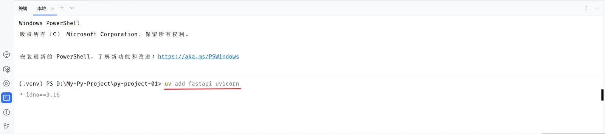
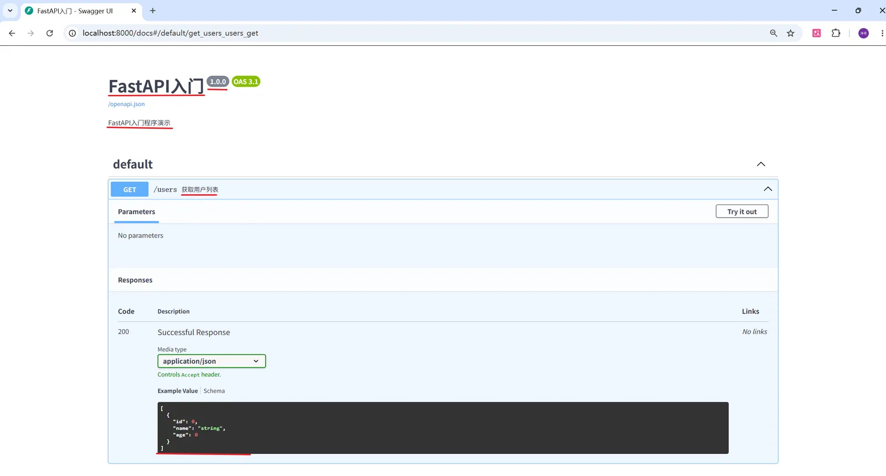

# 介绍

- **FastAPI**：一个现代、快速、高性能的 Web 框架，基于标准的 Python 类型提示（Type Hints）构建 API 接口服务
- 官网：`https://fastapi.tiangolo.com`（中文版 `https://fastapi.tiangolo.com/zh/`）
- 第三方中文镜像：`https://fastapi.org.cn`

# 入门程序

- **需求**：开发一个 API 接口，访问路径 `http://localhost:8000/users`，用于查询所有用户信息

**步骤：**

1. **安装 FastAPI 库**：`uv add fastapi uvicorn`
   - **uvicorn**：专为现代 Python Web 框架（FastAPI、Starlette）设计的高性能服务器



2. **导入 FastAPI，创建实例、定义路由、启动服务**：完整代码如下

```python
from fastapi import FastAPI
import uvicorn

app = FastAPI()                      # 创建 FastAPI 实例

@app.get("/")                        # 装饰器绑定函数与访问路径
def read_root():
    print("访问了根路由")
    return {"message": "Hello, World!"}

if __name__ == "__main__":
    uvicorn.run(app, host="0.0.0.0", port=8000)   # 也可右键运行项目【推荐】
```

3. **运行 FastAPI 服务**：`uvicorn 模块名:实例名 --reload`，本项目命令为 `uvicorn FastAPI-Demo:app --reload`

- **装饰器（Decorator）**：`@` 写法在 Python 中叫装饰器，能在不修改原函数代码的前提下给函数动态添加额外功能
- 此处装饰器用于绑定函数与访问路径：`app` 是 FastAPI 实例名，`get` 是请求方式

# Pydantic 模型

## Pydantic 模型定义

> [!tip] 🍀 Pydantic
> Python 数据验证库：把数据的结构定义为带属性的类，每个属性指定类型；<span style="color:#d83931">创建实例时自动完成数据验证、转换、序列化与反序列化</span>，广泛用于 FastAPI 等框架，确保数据类型安全与数据完整性。

定义 Pydantic 模型：继承 `BaseModel` 父类，再用**类型注解**的方式逐个定义属性。

```python
from fastapi import FastAPI
from pydantic import BaseModel

app = FastAPI()

# 定义 Pydantic 模型
class User(BaseModel):
    id: int
    name: str
    age: int

# 可选属性：设置默认值后，构造对象时该属性可以不传
class UserOptional(BaseModel):
    id: int
    name: str
    age: int | None = None

@app.get("/users")
def get_users():
    print("获取用户列表...")
    return [
        User(id=1, name="Alice", age=18),      # 只能关键字传参
        User(id=2, name="Bob", age=20),
        User(id=3, name="Charlie", age=25)
    ]

if __name__ == "__main__":
    import uvicorn
    uvicorn.run(app, host="0.0.0.0", port=8000)
```

> [!danger] 注意
> - Pydantic 模型创建对象时**必须用关键字参数**传值，代码更易读、易维护
> - 继承 `BaseModel` 后，继承下来的 `__init__` 要求属性以**关键字形式**传入

**提示：** 用 Pydantic 模型封装数据后，FastAPI 会自动对数据做**校验、转换**，检查属性值是否符合定义时指定的类型；属性若可有可无，就给它设默认值（见上方 `UserOptional`）。


### Swagger 接口文档

**概述：** Swagger 自动生成在线接口文档，支持直接在页面上调试请求。

**作用：** 无需手写文档，接口文档随代码自动更新；可在文档页直接试调接口、查看参数与响应结构。

**定义方式：** FastAPI 基于 OpenAPI 规范内置自动生成，不用额外配置；文档内容由 `FastAPI(title, description, version)` 与各路由装饰器的 `summary`、`description`、`response_model`、`tags` 决定。

**访问路径：** `http://localhost:8000/docs`

**实例：**

```python
from fastapi import FastAPI
from pydantic import BaseModel

# 用 Pydantic 定义类型，类中声明对象将存储的属性；必须继承父类 BaseModel
class User(BaseModel):
    id: int
    name: str
    hobby: str

# 创建 FastAPI 实例（title/description/version 显示在接口文档首页）
app = FastAPI(title="FastAPI 入门", description="这是一个FastAPI入门示例", version="0.1.0")

@app.get("/", summary="欢迎功能", description="这是一个欢迎的功能，可以返回一个欢迎字符串", response_model=str, tags=["欢迎"])
def hello():
    print("你好,欢迎进入后端系统")
    return "你好,这是我给你响应的数据"

@app.get("/list", summary="用户列表", description="这是一个返回用户列表的接口", response_model=list[User], tags=["用户查询"])
def user_list():
    return [
        # 构建 User 对象时必须关键字传参
        User(id=1001, name="Alice", hobby="coding"),
        User(id=1002, name="Bob", hobby="sports")
    ]

if __name__ == "__main__":
    import uvicorn
    uvicorn.run(app, host="0.0.0.0", port=8000)
```

访问接口文档后，即可看到项目描述与每个接口的详细说明。




## 异步编程

### 同步与异步

**思考：** 当有多件任务需要处理时，有哪些执行方案？

- **同步（Synchronous）**：做完一件事再开始下一件，前一件没完成就只能等着。
- 特点：**阻塞、等待、串行**，性能较低，不能充分利用资源

- **异步（Asynchronous）**：发起一件事后直接继续做其他事，无需原地等待。
- 特点：**非阻塞、不等待、并发**，性能较高，可以充分利用资源


解法就是：**进程、线程、协程**。

- **进程（Process）**：每个运行的程序（微信、Chrome、百度网盘）就是一个进程，操作系统给每个进程分配独立的内存等资源
- **线程（Thread）**：每个进程内部可包含多个线程，线程才是真正干活的最小单位。比如 Chrome 一个线程渲染网页、一个线程下载文件、一个线程播放视频——它们可以**同时**进行
- **协程（Coroutine）**：线程内更小的执行单位，可在执行过程中暂停并让出控制权，稍后再从暂停处继续；属于**用户态**的轻量级异步任务，多个协程在同一线程内协作式调度，遇到 I/O 等待时主动让出控制权

### 异步编程

FastAPI 原生支持异步编程：用 `async def` 定义路径操作函数，配合 `await` 调用异步操作，即可实现高性能的异步请求处理。

```python
import asyncio
import time
from fastapi import FastAPI

app = FastAPI(title="异步编程演示")

# 同步操作演示
def mock_io_task():
    print("开始查询数据...")
    time.sleep(3)          # 固定等待 3 秒
    print("数据查询完成...")

@app.get("/sync_demo")
def sync_handle():
    t1 = time.time()
    mock_io_task()         # 依次等待，3 次共约 9 秒
    mock_io_task()
    mock_io_task()
    t2 = time.time()
    cost = round(t2 - t1, 2)
    return {"模式": "同步串行", "执行耗时(秒)": cost}

# 异步操作演示
async def mock_async_task():
    print("开始查询数据...")
    await asyncio.sleep(3)
    print("数据查询完成...")

@app.get("/async_demo")
async def async_handle():
    t1 = time.time()
    # 一次性调度 3 个任务，同时启动并发执行，全部完成后再往下走
    await asyncio.gather(
        mock_async_task(),
        mock_async_task(),
        mock_async_task()
    )
    t2 = time.time()
    cost = round(t2 - t1, 2)
    return {"模式": "异步并发", "执行耗时(秒)": cost}

if __name__ == "__main__":
    import uvicorn
    uvicorn.run(app, host="0.0.0.0", port=8000)
```

请求地址：

- 同步操作：`http://localhost:8000/sync_demo`
- 异步操作：`http://localhost:8000/async_demo`

两者任务逻辑一致，但耗时差别很大：同步约 9 秒（3×3），异步约 3 秒（三个任务并发等待）。

> [!danger] 注意
> - `async def` 修饰的函数叫**协程函数**，直接调用返回的是**协程对象**
> - `await` 的作用是暂停当前协程（挂起），把控制权交回事件循环
> - `await` 后面必须跟**可等待对象**（协程 / 任务），且 `await` 只能写在 `async def` 函数内

**结论：**

- 调用 `async def` 定义的函数必须 `await`（或交给 `asyncio.gather` / `create_task` 调度），否则只拿到协程对象，函数体根本不执行
- 函数体内只要用了 `await`，该函数就必须定义成 `async def`