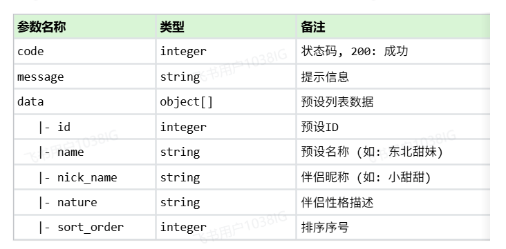

---
tags:
  - Python
  - FastAPI
  - AI
date: 2026-11-22
cover: false
title: "09-AI智能伴侣功能实现"
---
## 项目介绍

**《AI智能伴侣》**：基于大模型的**情感陪伴应用**。用户可以给 AI 伴侣设置**昵称**和**性格**，它以对应人设进行自然对话。


## 环境准备

整体分前端、服务端两部分：


### 前端环境（Nginx）

把 `nginx-ai-partner.zip` 解压到**没有中文、不带空格**的目录：


- **启动**：双击 `nginx.exe`，占用 <span style="color:#d83931">88</span> 端口（端口在 `conf/nginx.conf` 里配置）
- **停止**：
  - 方式一：Nginx 目录下开 cmd，执行 `nginx.exe -s stop`
  - 方式二：任务管理器找到 nginx 进程，右键结束


> [!warning] 坑
> Nginx 不会开机自启，**每次关机重开都要手动启动**。

启动后浏览器访问 `http://localhost:88` 就是项目页面：

### 服务端环境（FastAPI）

1. 新建名为 `ai_partner` 的项目


选 `FastAPI` 模板时，IDE 会自动装好 `fastapi`、`uvicorn`，并生成实例和样例代码：


2. 把资料里的 `data` 目录拷到项目目录下（存放基础数据）


3. 改实例描述信息 + 加启动代码

```python
from fastapi import FastAPI

app = FastAPI(title="AI智能伴侣", description="一款基于人工智能的情感陪伴应用", version="1.0.0")

if __name__ == "__main__":
    import uvicorn
    uvicorn.run(app, host="0.0.0.0", port=8000)
```

## 前后端交互流程

1. 浏览器请求 `http://localhost:88`，路径后没写资源 → 默认返回 `index.html`
2. 浏览器解析、渲染页面
3. 页面加载完，前端自动请求 `http://localhost:88/api/presets` 拿伴侣预设
4. `conf/nginx.conf` 里配了规则：`/api` 开头的请求转发给 `http://localhost:8000`
5. 服务端处理完把结果给 Nginx，Nginx 再回给前端渲染


> [!tip] 两个入口别混
> 访问完整项目走前端 `http://localhost:88/`；单独测接口走服务端 `http://localhost:8000/`。

## 接口一：预设伴侣信息加载

`GET /api/presets`，无请求参数，前端用来渲染预设下拉框。


- 数据源：`data/companion_presets.json`


响应示例：
```json
{
    "code": 200,
    "message": "获取预设列表成功",
    "data": [
        {
            "id": 1,
            "name": "东北甜妹",
            "nick_name": "小甜甜",
            "nature": "活泼开朗的东北姑娘……",
            "sort_order": 1
        }
    ]
}
```

写完先用 Swagger（`http://localhost:8000/docs`）自测，再开前端页面联调：

## 接口二：新建会话

`POST /api/sessions`，访问项目时若没有会话，前端自动发起，把伴侣昵称、性格传过来。


- 请求体：`{"nick_name": "小甜甜", "nature": "活泼开朗的东北姑娘……"}`
- 响应：`{"code": 200, "message": "创建会话成功", "data": "2026-05-29_15-30-00"}`
- **存储设计**：一个会话一个文件，文件名 = `%Y-%m-%d_%H-%M-%S`，全部放在 `sessions` 目录，文件内容：

```json
{
  "nick_name": "小甜甜",
  "nature": "活泼开朗的东北姑娘……",
  "session_name": "2026-05-25_10-47-15",
  "messages": []
}
```

## 接口三：与 AI 交互

`POST /api/chat`，服务端自动加载该会话历史，调 DeepSeek 生成回复，并把这一轮对话写回会话文件。

- 请求体 4 个字段：`session_name`、`message`、`nick_name`、`nature`
- 响应：`{"code": 200, "message": "请求成功", "data": "咋滴啦大兄弟？……"}`

**处理思路（四步）**
1. 定义接收请求体的类
2. 用 `nick_name` + `nature` 拼系统提示词（固定 8 条规则 + 性格）
3. 读会话文件 → 取出历史 `messages` → 追加本轮 `user` 消息（<span style="color:#d83931">消息滚雪球</span>，会话记忆靠这个实现）
4. 组装 `system + 历史 + 本轮` 调模型，取 `choices[0].message.content`
5. 把 `assistant` 回复追加进历史，整份 json 回写文件

**系统提示词模板**

```python
SYSTEM_PROMPT_TEMPLATE = """你叫 %s，现在是用户的真实伴侣，请完全代入伴侣角色。
    规则：
        1. 每次只回1条消息
        2. 禁止任何场景或状态描述性文字
        3. 匹配用户的语言
        4. 回复简短，像微信聊天一样
        5. 有需要的话可以用❤️🌸等emoji表情
        6. 用符合伴侣性格的方式对话
        7. 回复的内容, 要充分体现伴侣的性格特征
        8. 不要太肉麻（比如想你之类的，就日常聊天）
    伴侣性格：
        - %s
    你必须严格遵守上述规则来回复用户。
    """
```


## 完整代码

```python
import json
import os
from datetime import datetime
from typing import Any
from fastapi import FastAPI
from openai import OpenAI
from pydantic import BaseModel

app = FastAPI(title="AI智能伴侣", description="一款基于人工智能的情感陪伴应用", version="1.0.0")

# 调用大模型的客户端
client = OpenAI(
    api_key=os.environ.get('DEEPSEEK_API_KEY'),
    base_url="https://api.deepseek.com")

PRESETS_FILE_PATH = "data/companion_presets.json"

# 会话文件目录，不存在则创建
SESSIONS_DIR = "sessions"
if not os.path.exists(SESSIONS_DIR):
    os.mkdir(SESSIONS_DIR)

def get_session_path(session_name: str) -> str:
    """会话名 → 文件路径"""
    return f"{SESSIONS_DIR}/{session_name}.json"

SYSTEM_PROMPT_TEMPLATE = """你叫 %s，现在是用户的真实伴侣，请完全代入伴侣角色。
    规则：
        1. 每次只回1条消息
        2. 禁止任何场景或状态描述性文字
        3. 匹配用户的语言
        4. 回复简短，像微信聊天一样
        5. 有需要的话可以用❤️🌸等emoji表情
        6. 用符合伴侣性格的方式对话
        7. 回复的内容, 要充分体现伴侣的性格特征
        8. 不要太肉麻（比如想你之类的，就日常聊天）
    伴侣性格：
        - %s
    你必须严格遵守上述规则来回复用户。
    """

# 统一响应结构
class ApiResponse(BaseModel):
    code: int
    message: str
    data: Any = None

# 新建会话的请求体
class CreateSessionRequest(BaseModel):
    nick_name: str
    nature: str

# 对话的请求体
class ChatRequest(BaseModel):
    session_name: str
    message: str
    nick_name: str
    nature: str

# ========== 接口一：预设列表 ==========
@app.get("/api/presets")
def get_presets():
    print("获取伴侣的预设列表")
    if not os.path.exists(PRESETS_FILE_PATH):
        return ApiResponse(code=500, message="预设信息不存在")
    with open(PRESETS_FILE_PATH, "r", encoding="utf-8") as f:
        data = json.load(f)
    return ApiResponse(code=200, message="获取伴侣预设信息成功", data=data)

# ========== 接口二：新建会话 ==========
@app.post("/api/sessions")
def create_session(request: CreateSessionRequest):
    print("新建一个会话~")
    # 会话名用当前时间
    session_name = datetime.now().strftime("%Y-%m-%d_%H-%M-%S")
    session_data = {
        "session_name": session_name,
        "nick_name": request.nick_name,
        "nature": request.nature,
        "messages": []
    }
    # 一个会话一个 json 文件
    with open(get_session_path(session_name), "w", encoding="utf-8") as f:
        json.dump(session_data, f, ensure_ascii=False, indent=2)
    return ApiResponse(code=200, message="新建会话成功", data=session_name)

# ========== 接口三：与 AI 交互 ==========
@app.post("/api/chat")
def chat(request: ChatRequest):
    print(f"发送消息成功~{request.session_name},{request.nick_name},{request.message},{request.nature}")
    # 1. 拼系统提示词
    sys_temp = SYSTEM_PROMPT_TEMPLATE % (request.nick_name, request.nature)
    # 2. 读出该会话的历史消息
    with open(get_session_path(request.session_name), "r", encoding="utf-8") as f:
        session_data = json.load(f)
    session_data_messages = session_data.get("messages")
    session_data_messages.append({"role": "user", "content": request.message})
    # 3. system + 全部历史（滚雪球 = 会话记忆）
    send_messages = [{"role": "system", "content": sys_temp}]
    for s in session_data_messages:
        send_messages.append(s)
    # 4. 调模型
    response = client.chat.completions.create(
        model="deepseek-v4-pro",
        messages=send_messages,
        stream=False,
        reasoning_effort="high",
        extra_body={"thinking": {"type": "disabled"}}
    )
    result = response.choices[0].message.content
    # 5. 把回复也存进历史，整份回写文件
    session_data_messages.append({"role": "assistant", "content": result})
    session_data["nick_name"] = request.nick_name
    session_data["nature"] = request.nature
    with open(get_session_path(request.session_name), "w", encoding="utf-8") as f:
        json.dump(session_data, f, ensure_ascii=False, indent=2)
    return ApiResponse(code=200, message="回复成功", data=result)

if __name__ == '__main__':
    import uvicorn
    uvicorn.run(app, host="0.0.0.0", port=8000)
```


