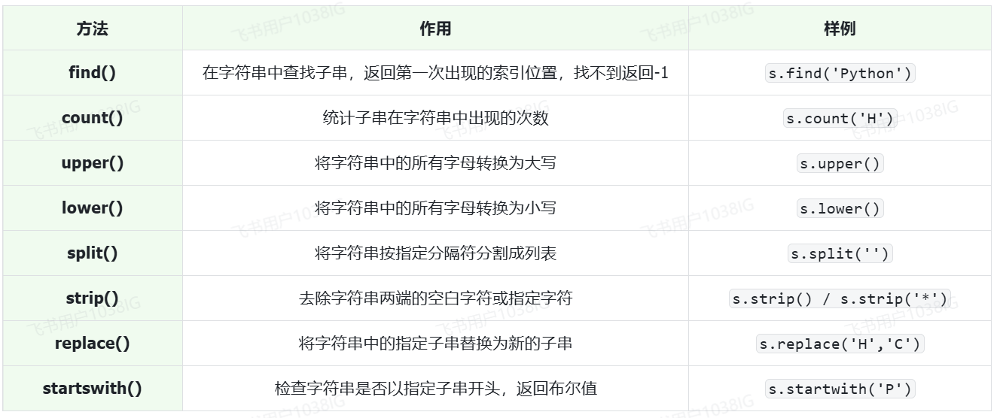
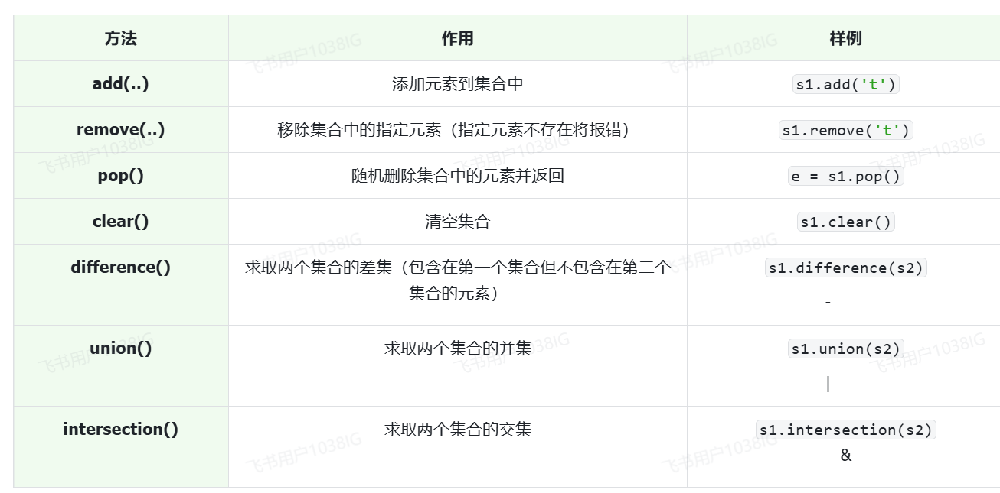

- 数据容器
	- 列表（List）
		- 定义
			- 列表名称 = [元素1，元素2，元素3，元素4，元素5...]
		- 特点
			- 可以存储不同类型的元素
			- 有序、可重复、元素可修改
		- 操作
			- 增：`lst.append("c")`
			- 删：`lst.remove("x")`
			- 改：`lst[0] = "z"`
			- 查：`lst[0]`
			- 同时获取索引和值：`for i, e in enumerate(list01)`
		- 切片
			- 语法
				- 名称[start,end,step]
		- 常用方法
			- append() 列表追加
			- insert() 指定索引插入
			- remove() 删除第一个匹配的值
			- pop() 删除指定索引元素返回
			- sort()  排序（需要类型一致）
			- reverse() 翻转列表
			- coount() 获取元素次数
		- 四个函数
			- min()
			- max()
			- sum()
			- len()
		- 合并列表
			- +
			- 解包+组包
				- \*列表名
				- 新列表[*列表]
		- in运算符
			- if 元素 in 列表
			- 元素是否在该列表中
		- 列表推导式
			- 新列表=[要插入的值 for i in 容器 if 条件表达式]
	- 字符串（str）
		- 特点
			- 不可修改
		- 常用方法
			- 
	- 元组（tuple）
		- 特点
			- 不可修改
			- 可以存储不同类型的元素
		- 定义
			- 元组名称=tuple()
			- 元组名称=(元素1,元素2,....)
			- 元组名称=元素1,元素2,....
			- 元组名称 = () 
		- 常用方法
			- count()
			- index() 返回该元素的索引
		- 注意事项
			- ()
			- ,
			- 存储固定不变的值
		- 常见的组包解包方式
			- 
	- 集合（srt）
		- 特点
			- 无序
			- 不重复
			- 可修改
		- 定义
			- s1={元素,....}
			- s2=set()
		- 注意事项
			- 空集合的定义不可以使用{}
			- {}表示的是空字典
		- 常用方法
			- 空集合的定义不可以使用{}，{}表示的是空字典；
			- 
	- 总结
		- 列表
			- 可修改
			- 可重复
			- 有序
			- 可切片
		- 字符串
		- 元组
			- 有序
			- 可切片
			- 不可修改
			- 可重复
		- 集合
			- 无序
			- 不可重复
			- 可修改
			- 无索引