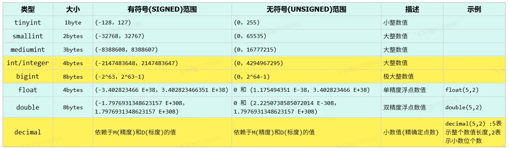
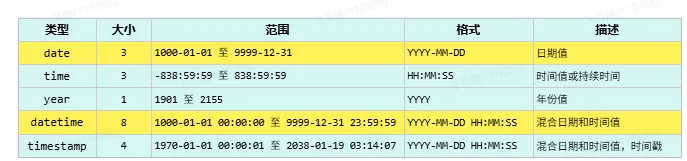

图片位置：

- DDL
	- 主要分类
		- 数值
			- 
			- 小扩展
				- 有符号(可正可负)
				- 无符号（只可正）
			- 常用
				- int
				- bigint
				- decimal(精度,标度)
		- 字符串
			- 
			- varchar
				- 定义的是最大限制长度
				- 定多少存多少
			- char
				- 定多少分配多少空间
			- text
				- 长文本数据
		- 日期
			- 
			- 常用
				- data
				- datatime
	- 对库中的表操作
		- 查看表
			- show tables --查询所有
			- desc 表名; -- 查看指定的表结构
			- show create table 表名; --查询指定表的建表语句
		- 修改表结构
			- 添加字段：alter table 表名 add 字段名 类型(长度) [comment 注释]  [约束];
			- 修改字段类型
				- alter table 表名 modify 字段名 新数据类型(长度);
			- 修改字段名，字段类型
				- alter table 表名 change 旧字段名 新字段名 类型(长度) [comment 注释] [约束];