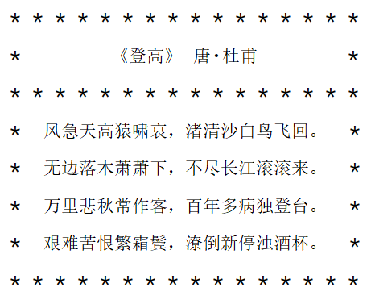

## 控制台输出

**需求1：**在控制台中输出一首古诗，分为8行输出，其最终输出的形式为：



**需求2：**使用字符串语法，打印如下格式内容（保留换行、制表缩进效果）：

```python
名言:
  人生苦短，我用"Python"
```

## 变量交换

现有三个变量，分别为：a=100，b = 200，c = 300，现需要将这三个变量值进行交换，将a, b, c的值分别赋值给c, a, b，并将其输出到控制台 ，最终a 的值为 200，b 的值为 300，c 的值为 100 。

## 实现计算器功能

**需求：**根据用户输入的两个数字，计算两个数相加、相减、相除、相乘的结果，并将其输出到控制台。

## 运算符练习

- **需求1：**要求输入梯形的上底、下底、高，然后计算梯形的面积

- **需求2：**要求输入圆的半径，然后计算圆的周长和面积 (周长: 2πr，面积：πr²)

- **需求3：**身体质量指数BMI的计算（BMI = 体重(kg) / 身高(m)²）
  1. 输入体重(单位kg)
  2. 输入身高(单位m)
  3. 计算身体质量指数BMI并输出

- **需求4：** 输入一个秒数，把它转换成小时 + 分钟 + 秒输出。 例如输入 130 → 输出：0 小时 2 分 10 秒

- **需求5：** 输入苹果单价、购买重量，计算总价，并输出一句话： “苹果单价 X 元，购买 X 斤，总价 X 元”

- **需求6：**输入语文、数学、英语三科成绩，计算总分和平均分，并输出。

- **需求7：**接收用户输入一个整数，判断该数字是否大于 10 并且 小于 50，打印最终判断结果（True/False）。

- **需求8：**接收用户输入一个整数，判断该数字是否小于等于 10 或者 大于等于 50，打印最终判断结果（如果满足条件输出True，不满足输出False）。

- **需求9：** 输入语文、数学成绩，判断是否至少有一科分数大于 90 分，输出结果（如果有输出True，没有输出False）。

- **需求10：**
  - 模拟成绩统计与评优：
    1. 输入姓名、语文成绩、英语成绩；
    2. 计算两科总分与平均分；
    3. 评优规则：两科分数都大于 85 分 或者 总分大于 180 分，评为优秀；
    4. 输出结果：姓名、总分、平均分、是否评为优秀 。 具体格式为：`姓名：王林，总分：192，平均分：96，是否评为优秀：True`

## 上述作业做完了，今天的内容没问题了，可以预习一下明天的内容。