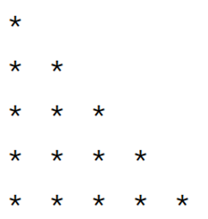

## 完成如下条件判断的需求

- 需求1：根据用户输入的数字，判断该数字是奇数还是偶数。

- 需求2：根据用户输入的年龄，判断该用户是否已经成年（>=18，成年；否则，未成年）。

- 需求3：根据用户输入的数字，判断该数字是正数还是负数还是0 。

- 需求4：根据用户输入的考试分数，判断该分数是否及格了（大于等于60就是及格了, 否则就是不及格）。

## 完成如下需求

1. 根据输入的考试成绩，判断成绩等级。
  1. 大于等于85分为优秀
  2. 60-85分为及格
  3. 否则就是不及格

## 接收用户输入百分制分数（整数），按照规则判定等级并输出：

1. 90 ~ 100：优秀
2. 80 ~ 89：良好
3. 70 ~ 79：中等
4. 60 ~ 69：及格
5. 0 ~ 59：不及格
6. 分数小于 0 或 大于 100：输出「分数输入有误」

## 购物折扣计算

根据输入的购物车的商品总额，以及如下的折扣规则，计算实际应付的金额。

- 金额 >= 500: 8折
- 300 <= 金额 < 500: 9折  
- 100 <= 金额 < 300: 95折
- 金额 < 100: 无折扣

## 北京市居民年度用电电费计算：根据输入的用电度数，计算电费

北京市居民电费采用阶梯电价计价方式，所谓阶梯电价是指按照用户消费的电量分段定价，用电价格随用电量增加呈阶梯状逐级递增的一种电价定价机制。

阶梯电价规则：

## 接收用户输入的月份（1-12），判断该月份所属的季节

- 春季：3、4、5
- 夏季：6、7、8
- 秋季：9、10、11
- 冬季：12、1、2

要求使用 `match-case` 实现，输入非1-12的数字时提示“月份输入有误”。

## 简单游戏指令系统开发【选做】

- 请你编写一个游戏角色移动控制系统，根据玩家输入的不同指令，控制游戏角色执行相应的动作(输出控制台)。

- 具体规则：

| **玩家输入** | **对应动作** |
| --- | --- |
| 上 /   w /W | 角色向上移动 |
| 下 /   s / S | 角色向下移动 |
| 左 /   a / A | 角色向左移动 |
| 右 /   d / D | 角色向右移动 |
| 跳   / " "(空格) | 角色跳跃 |
| 攻击   / j / J | 角色发动攻击 |
| 退出   / esc / ESC | 角色退出游戏 |

## 基于循环语句完成如下需求

- 需求1：根据输入的直角边的边长，打印等腰直角三角形 （如下为直角边为5的等腰直角三角形）

## 根据用户名密码登录

需求：用户名密码登录，正确的用户名和密码为admin/666888 、zhangsan/123456、taoge/888666, 5次登录机会，输入错误五次，不允许再操作了。

## 将1-1000之间（含1000）所有的5的倍数的数字累加起来。

## 统计字符串 "akiwksjakdiklowiqaamnvbamvaxnsjdsjkaaxkjd" 字符串中有多少个a和k。 【选做】

## 模拟银行取款机  【选做】

初始余额为 10000 元，循环显示菜单：

1. 查询余额

2. 存款

3. 取款

4. 退出

根据用户选择执行操作，取款金额不能超过余额，存款为正数，退出时输出“感谢使用”。