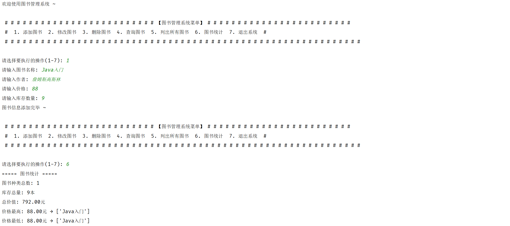
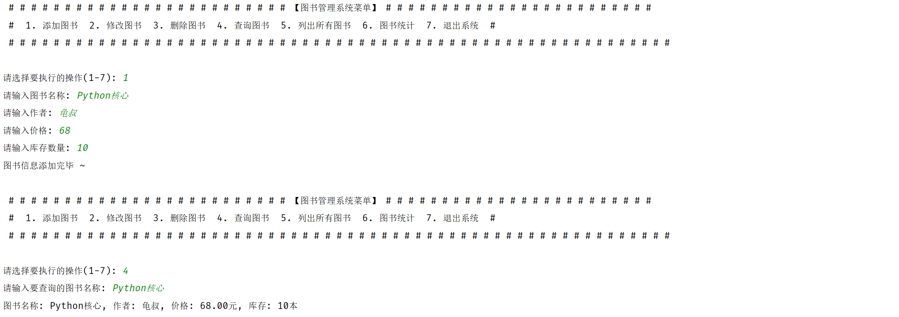
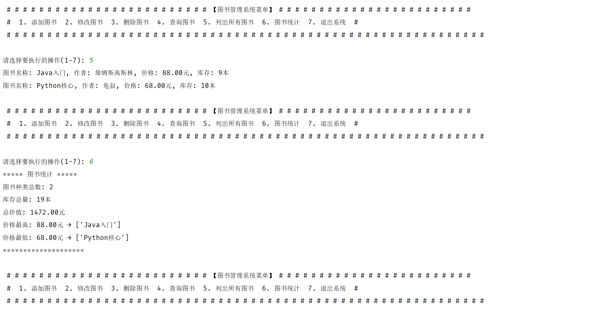

# 题目一：图书管理系统开发 【必做】

**需求描述：**

开发一个图书管理系统，在该系统中可以维护和管理图书信息，具体需求如下：

1. 添加图书信息：根据提示录入图书名称、作者、价格、库存数量，录入完成保存到系统中。

2. 修改图书信息：输入要修改的图书名称，然后再提示输入新的作者、价格、库存数量，输入完成后修改图书信息。

3. 删除图书信息：输入要删除的图书名称，根据名称删除图书信息。

4. 查询图书信息：输入要查询的图书名称，根据名称查询图书信息并输出。

5. 列出所有图书：遍历所有图书信息并输出。

6. 图书统计：统计图书种类数、库存总量、总价值（每本书价格×库存之和）、价格最高和最低的图书名称。

7. 退出系统。

```python
dict1 = {
    "钢铁是怎样炼成的":{"price":20,"author":"斯基"，"num":4}
}

"""
    案例：图书管理系统
    1. 添加图书信息：根据提示录入图书名称、作者、价格、库存数量，录入完成保存到系统中。
    2. 修改图书信息：输入要修改的图书名称，然后再提示输入新的作者、价格、库存数量，输入完成后修改图书信息。
    3. 删除图书信息：输入要删除的图书名称，根据名称删除图书信息。
    4. 查询图书信息：输入要查询的图书名称，根据名称查询图书信息并输出。
    5. 列出所有图书：遍历所有图书信息并输出。
    6. 图书统计：统计图书总数、库存总量、总价值、价格最高和最低的图书名称。
    7. 退出系统。
"""

menu = """
# # # # # # # # # # # # # # # # # # # # # # # 【图书管理系统菜单】 # # # # # # # # # # # # # # # # # #
#       1. 添加图书  2. 修改图书  3. 删除图书  4. 查询图书  5. 列出所有图书  6. 图书统计  7. 退出系统        #
# # # # # # # # # # # # # # # # # # # # # # # # # # # # # # # # # # # # # # # # # # # # # # # # #
"""
print("欢迎使用图书管理系统 ~")
```

最终效果如下：







# 题目二：函数基础 【必做】

```python
# ----------------------------------------------------------
# 需求1：定义一个函数 is_leap_year，接收一个年份 year（整数），
#       判断该年份是否为闰年，返回 True 或 False。
#
#       闰年规则：
#         - 能被 400 整除的是闰年
#         - 能被 4 整除但不能被 100 整除的也是闰年
#         - 其余不是闰年
#
#       调用该函数，分别判断 2000年、2024年、1900年、2025年 是否为闰年。
# ----------------------------------------------------------

# ----------------------------------------------------------
# 需求2：定义一个函数 count_case，接收一个字符串参数，
#       统计其中大写字母和小写字母的个数，返回两个结果。
#       （提示：可用字符串的 .isupper()判断是否为大写字母 和 .islower() 方法判断该字母是否为小写字母）
#
#       调用该函数，传入字符串 "Hello World! Python3 编程"，
#       用解包方式接收并打印大写字母个数和小写字母个数。
# ----------------------------------------------------------
```