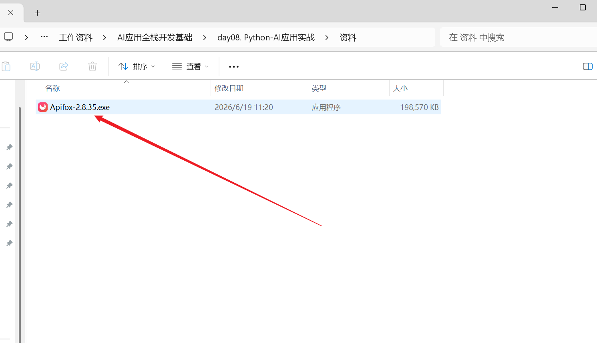

# 课堂代码搞明白【必做】

# 员工工资计算系统

```python
"""
员工工资计算系统
    需求说明: 某公司有三种类型的员工，基本工资相同，但奖金计算方式不同。使用抽象类规范工资计算方法。
    技术要求:
        创建抽象类 Employee
        属性：emp_id（工号）、name（姓名）、base_salary（基本工资，默认5000） ---> 参数设置默认值
        抽象方法：calculate_bonus()（计算奖金），子类必须实现
        普通方法：total_salary()（总工资 = 基本工资 + 奖金）
        普通方法：show_info()（展示员工信息）
    创建三个子类:
        Salesman（销售员）：奖金 = 销售额 × 提成比例（5%） ---> 扩充属性: 销售金额 sales_amount
        Manager（经理）：奖金固定为 3000
        Programmer（程序员）：奖金 = 完成项目数 × 500  -----> 扩充属性: 完成项目数 projects_completed
    测试程序:
        创建不同类型的员工
        计算并展示每个员工的总工资

测试代码:
# 测试代码
if __name__ == "__main__":
    employees = [
        Salesman("S001", "张三", 5000),
        Manager("M001", "李四"),
        Programmer("P001", "王五", 3)
    ]

    print("=" * 70)
    print("员工工资表")
    print("=" * 70)
    for emp in employees:
        emp.show_info()
    print("=" * 70)
"""
```

运行结果的预期格式：

```python
======================================================================
员工工资表
======================================================================
工号：S001 | 姓名：张三 | 基本工资：5000 | 奖金：250.0 | 总工资：5250.0
工号：M001 | 姓名：李四 | 基本工资：5000 | 奖金：3000 | 总工资：8000
工号：P001 | 姓名：王五 | 基本工资：5000 | 奖金：1500 | 总工资：6500
======================================================================
```

# 通讯录管理系统 【选做-参考答案】

```python
"""
>> 通讯录管理系统

1.需求说明：开发一个简单的通讯录管理系统，使用 TXT 文件存储联系人信息

2.数据存储格式（contacts.txt）：
张三|13800138001|zhangsan@example.com
李四|13800138002|lisi@example.com
王五|13800138003|wangwu@example.com
   
3.功能要求：
    添加联系人：输入姓名、电话、邮箱，追加到文件末尾
    查看所有联系人：读取并格式化展示所有联系人
    搜索联系人：根据姓名搜索联系人
    使用 with 上下文管理器操作文件
    
4.在下方的代码基础上，完成上述要求
"""

def add_contact():
    """添加联系人"""
    print("\n【添加联系人】")
    name = input("请输入姓名：").strip()
    phone = input("请输入手机号：").strip()
    email = input("请输入邮箱：").strip()

    # TODO: 验证手机号是否为11位数字 -> isdigit() 可判定是否为数字
    # TODO: 以追加模式(模式不要用 "w", 用 "a")写入 contacts.txt，格式：姓名|电话|邮箱 
    
    print("联系人添加成功！")

def show_all_contacts():
    """查看所有联系人"""
    print("\n【所有联系人】")

    # TODO: 读取 contacts.txt 文件
    # TODO: 格式化展示：姓名、电话、邮箱
    # 如果文件不存在或为空，提示"暂无联系人"
    
    

def search_contact():
    """搜索联系人"""
    print("\n【搜索联系人】")
    keyword = input("请输入要搜索的姓名：").strip()

    # TODO: 读取文件，查找包含关键字的联系人
    # TODO: 展示匹配结果
   

def run():
    while True:
        print("\n===== 通讯录管理系统 =====")
        print("1. 添加联系人")
        print("2. 查看所有联系人")
        print("3. 搜索联系人")
        print("4. 退出")

        choice = input("请选择操作(1-4): ").strip()

        if choice == "1":
            add_contact()
        elif choice == "2":
            show_all_contacts()
        elif choice == "3":
            search_contact()
        elif choice == "4":
            print("再见！")
            break
        else:
            print("无效选项！")

if __name__ == "__main__":
    run()
```

> [!tip] 提示
> TODO：表示待办事项，是需要大家填空的地方。

# 安装一个软件(预习)

**1). Apifox**

将同步的资料中的 Apifox 软件，双击后下一步，下一步的安装一下。



安装后，可以使用手机，微信扫码登录一下。