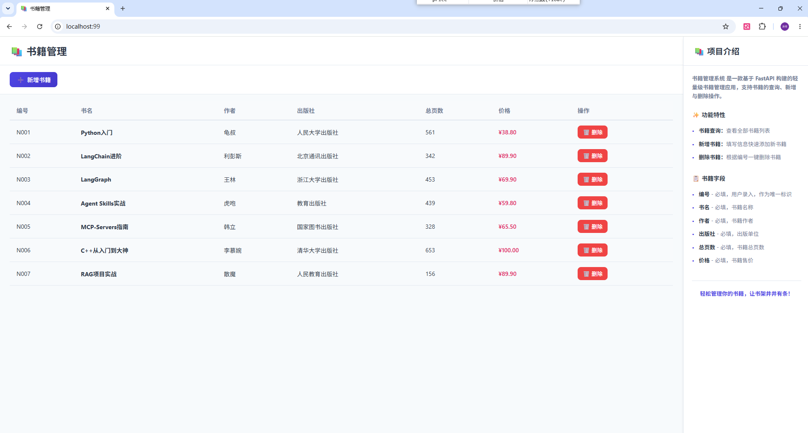

# 作业一：优先完成课程中案例的所有代码【必做】

# 作业二: 预习day10   MYSQL的安装

# 作业三：基于FastAPI完成书籍管理系统开发【选做】

## 需求

- **需求说明：**开发一个书籍管理系统，使用 Python + FastAPI 搭建后端服务，配合着前端页面（nginx部署）完成页面展示。书籍数据存储在本地 JSON 文件中 。

- **最终效果**：浏览器访问 `http://localhost:99`，可以看到书籍列表，可以新增书籍、删除书籍。



- **目录说明：**

```python
book-project/
  ├── data/                # 数据存储目录
  │   └── books.json       # 书籍数据文件
  └── main.py              # 后端核心代码（所有接口写在这一个文件里）
```

## 准备

- 将如下nginx**解压到一个没有中文，不带空格**的目录下。

> 不支持的块类型 33（v1 跳过）

- 书籍信息，记录在如下json文件中，创建python项目后，将如下json文件下载并导入。

> 不支持的块类型 33（v1 跳过）

- 在新项目中，安装`fastapi`相关依赖，执行命令：`uv add fastapi uvicorn`

## **需要实现的功能**

> [!tip] 🍀
> **如下功能，请严格根据提供的接口文档进行开发。**

### **功能一：查询全部书籍列表**

- **接口地址**: `/api/books`

- **请求方式**: `GET`

- **接口描述**: 读取 JSON 文件，返回全部书籍，不需要查询条件

- **请求参数**: 无

- **请求示例**: `/api/books`

- **响应参数**: 
| 参数名称 | 类型 | 备注 |
| --- | --- | --- |
| code | integer | 状态码, 200: 成功 |
| message | string | 提示信息 |
| data | object[] | 预设列表数据 |
| \|- id | string | 图书编号 |
| \|- title | string | 书名 |
| \|- author | string | 作者 |
| \|- publisher | string | 出版社 |
| \|- total_pages | integer | 总页数 |
| \|- price | float | 价格 |

- **响应示例**:
```json
{
  "code": 200,
  "message": "请求成功",
  "data": [
    {
      "id": "N001",
      "title": "Python入门",
      "author": "龟叔",
      "publisher": "人民大学出版社",
      "total_pages": 561,
      "price": 38.8
    },
    {
      "id": "N002",
      "title": "LangChain进阶",
      "author": "利彭斯",
      "publisher": "北京通讯出版社",
      "total_pages": 342,
      "price": 89.9
    }
  ]
}
```

  响应中的 `data` 是一个数组，每个元素是一条书籍记录。

### **功能二：新增书籍**

- **接口地址**: `/api/books`

- **请求方式**: `POST`

- **接口描述**:  新增一本图书信息，编号由用户录入

- **请求参数**: 无

| 参数名称 | 参数说明 | 是否必须 | 数据类型 |
| --- | --- | --- | --- |
| id | 编号 | 是 | string |
| title | 书名 | 是 | string |
| author | 作者 | 是 | string |
| publisher | 出版社 | 是 | string |
| total_pages | 总页数 | 是 | integer |
| price | 价格 | 是 | float |

- **请求示例：**

```json
{
    "id": "BK003",
    "title": "百年孤独",
    "author": "加西亚·马尔克斯",
    "publisher": "南海出版公司",
    "total_pages": 360,
    "price": 39.50
}
```

- **响应参数**:

```python
{
    "code": 200,
    "message": "新增成功",
    "data": null
}
```

> [!tip] 提示
> **逻辑分为三步：**
>
> - 先查询出来，查询出来的是一个列表，列表中是一个一个的字典对象；
> - 然后把接收到的书籍对象，转为字典追加到列表尾部；
> - 再将列表数据写入json文件；

### **功能三：根据编号删除书籍 **

- **接口地址**: `/api/books/{book_id}`

- **请求方式**: `DELETE`

- **接口描述**: 根据编号删除指定的书籍

- **请求参数**:

| 参数名称 | 参数说明 | 是否必须 | 数据类型 |
| --- | --- | --- | --- |
| book_id | 书籍编号 | 是 | string |

- **请求示例**: `DELETE /api/books/N001`

- **响应参数**:

| 参数名称 | 类型 | 备注 |
| --- | --- | --- |
| code | integer | 状态码, 200: 成功 |
| message | string | 提示信息 |
| data | null | 无返回数据 |

- **响应示例**:

```python
{
    "code": 200,
    "message": "删除成功",
    "data": null
}
```

```python
{
    "code": 200,
    "message": "对不起，你要删除的图书不存在",
    "data": null
}
```

> [!tip] 提示
> **逻辑分为三步：**
>
> - 先查询出来，查询出来的是一个列表，列表中是一个一个的字典对象；
> - 然后，遍历比对，如果id一致，就执行删除操作； 
> - 然后再将删除后的列表数据，写入json文件；