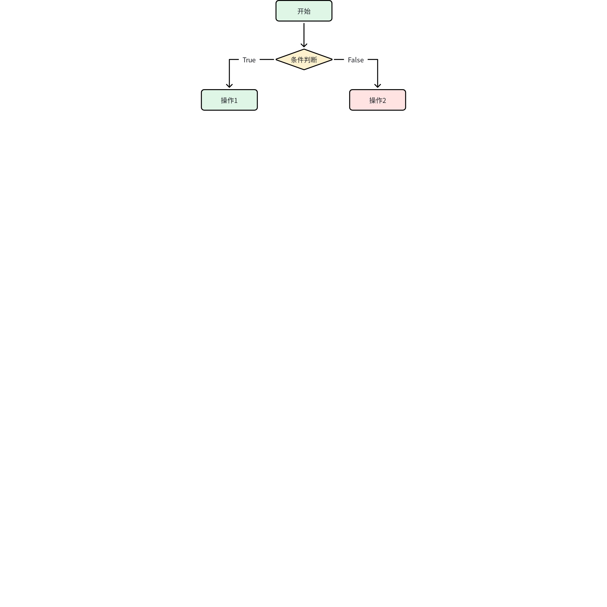
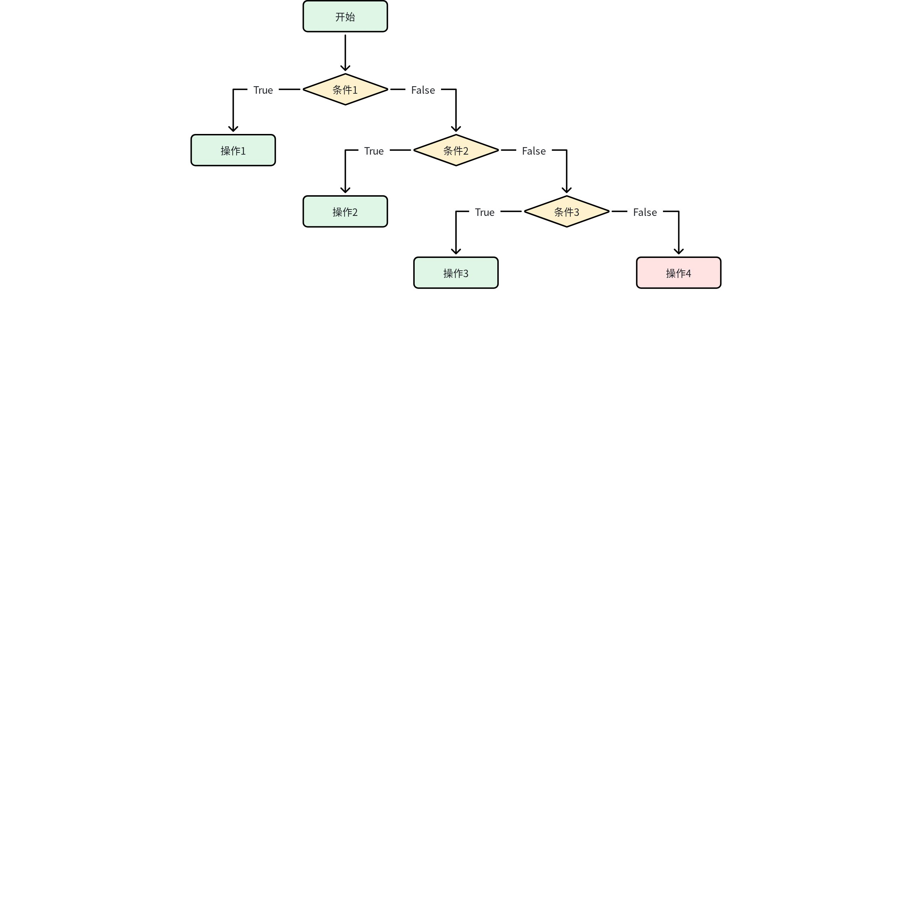
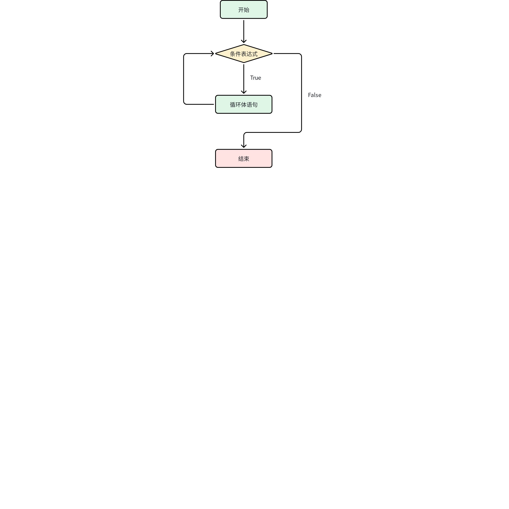
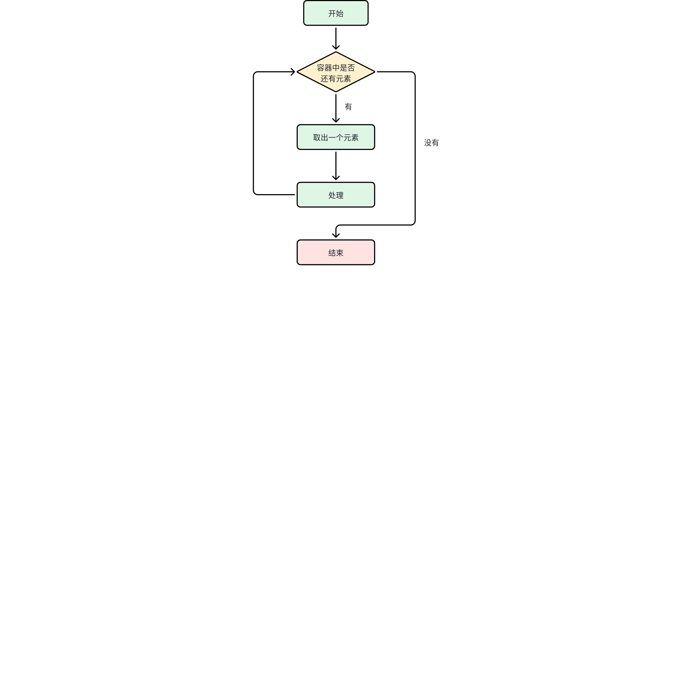
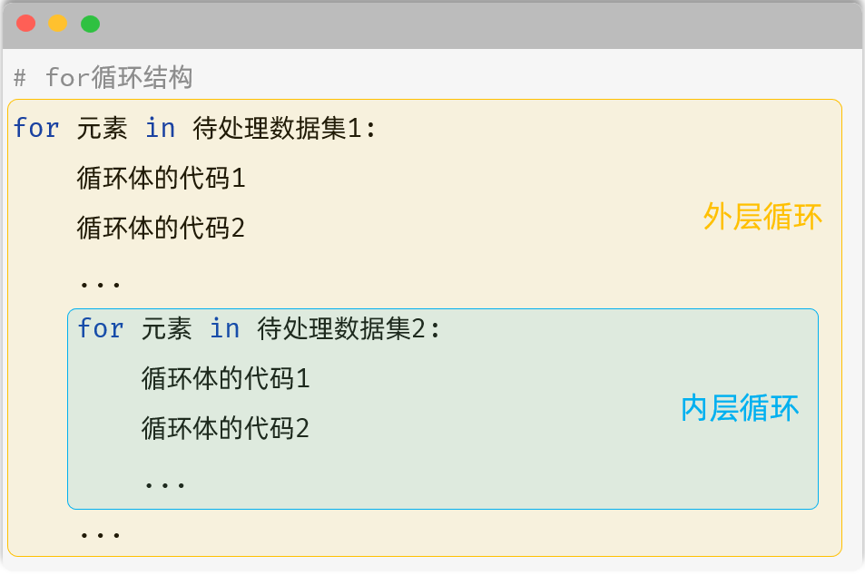
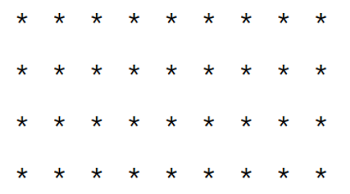

# 流程控制

**概念**：控制代码执行的顺序
**分类：**


**思考：如下页面的轮播图，每一个图片轮播一遍后，就停止了吗？**

*（图片已跳过：day02-Python-流程控制-cwPBvnjc.gif，超过大小上限）*

# 条件判断

## if基本格式

- **场景：**只有满足指定条件，才会执行对应的代码逻辑。

- **语法：**

```python
if 要判断的条件:
    条件成立时, 要执行的操作
```

**执行流程**：判断语句的结果，必须是布尔类型True或False。如果为 True 则会执行if内的代码，False则不会执行。

- **样例：**

```python
# 键盘录入一个人的年龄，判断这个人的年龄是否成年，如果成年，则输出，你已经成年了
"""
语法：
    if 条件:
        要执行的代码段
注意事项：
    1、if后面一定要跟条件，条件的结果要么胃true，要么为false
    2、条件的后面一定要跟冒号
    3、if控制的代码段，一定要缩进
    4、if控制的代码段，可以是多行内容
    5、if控制的代码，如果没有加缩进，是不受控制

"""
age = int(input("请录入你的年龄："))
# 如果条件满足为真，则执行后续的代码段
# 如果条件为假，则不执行if控制的代码段
if age >= 18:
    print("恭喜你，已经成年了！")
    print("恭喜你，已经成年了！")
    print("恭喜你，已经成年了！")
    print("恭喜你，已经成年了！")

# 注意：这段代码没有缩进，不受if的控制
print("哈哈哈，你控制不了我")
```

> [!danger] 🔔
> **注意：**
>
> - Python中是通过缩进来描述代码的归属的，归属于if代码块的语句，需要在前方缩进空格。（按Tab键，PyCharm会自动转为空格）
> - 同一个if语句中的代码块，前面缩进的空格数量一致。

- **案例：输入账号密码后登录B站**


需求：结合前面学习的输入输出及if条件判断的知识，完成B站登录功能的实现（正确账号和密码为 18888888888/666888）。

1. 提示用户输入账号和密码。

2. 判断账号和密码是否正确，如果账号和密码都正确，则登录成功，进入B站首页。

3. 如果账号和密码有一个错误，则登录失败，提示错误信息。

代码实现：

```python
# 需求：结合前面学习的输入输出及if条件判断的知识，完成B站登录功能的实现（正确账号和密码为 18888888888/666888）。
# 1. 提示用户输入账号和密码。
# 2. 判断账号和密码是否正确，如果账号和密码都正确，则登录成功，进入B站首页。
# 3. 如果账号和密码有一个错误，则登录失败，提示错误信息。

user_no_ok = 18888888888
password_ok = 666888

user_no = int(input("请输入您的账号："))
password = int(input("请输入您的密码："))

# 判断用户录入的和正确的信息是否相同
# 如果用户名和密码都相同，则登录成功
if user_no == user_no_ok and password == password_ok:
    print("登录成功，进入B站首页")

# 如果用户名和密码，有一个不同，就登录失败
if user_no != user_no_ok or password != password_ok:
    print("登录失败，请重新登录！")
```

## if语句进阶

### if...else

- **场景：**如果条件成立，则执行操作1；否则，就执行操作2

- **语法：**

```python
if 要判断的条件:
    条件成立时, 要执行的操作1
else:
    条件不成立时, 要执行的操作2
```

- **流程：**



- **演示：**

```python
# if案例: 结合前面学习的输入输出及if条件判断的知识，完成B站登录功能的实现（正确账号和密码为 18888888888/666888）
# 正确的账号和密码
ok_account = "18888888888"
ok_password = "666888"

# 1. 接收用户输入的账号和密码
account = input("请输入您的B站账号: ")
password = input("请输入您的B站密码: ")

# 2. 判断账号和密码是否全部正确, 如果都正确, 则登录成功, 进入B站首页
if account == ok_account and password == ok_password:
    print("登录成功 ~")
    print("进入B站首页 ~")
else：# 登录失败, 提示错误信息
    print("登录失败 !")
    print("账号或密码错误 !")
```

```python
# 键盘录入一个人的年龄，如果年龄到达18，则输出已成年，否则输出未成年
age = int(input("请输入您的年龄："))

# 如果条件为真，就执行if后面的代码段
if age >= 18:
    print("恭喜你，你已经成年了，可以观看此影片！！！")
#如果if后面的条件为假，就执行else后的代码段
else:
    print("你还没有成年，再等两年吧！！！")

#不受if...else的控制
print("你猜一下，我会不会执行！！！")
```

- **案例：**

1. 需求：根据用户输入的年份，判断这一年是闰年还是平年。
  1. 非整百年份，且能被4整除的年份是闰年
  2. 整百年份（如1900年、2000年）必须能被400整除才是闰年

```python
# 案例1: 根据用户输入的年份, 判断这一年是闰年还是平年(非整百年份, 且能被4整除的年份是闰年; 整百年份(如 1900、2000) 必须被400整除才是闰年)
year = int(input("请输入需要判定的年份: "))

# 如果是 非整百年份, 且能被4整除 就是闰年 ; 整百年份, 必须被400整除 也是闰年
if (year % 100 != 0 and year % 4 == 0) or (year % 400 == 0):
    print(f"{year} 是闰年")
else:
    print(f"{year} 是平年")
```

- **思考：**根据用户输入的数字，判断数字是正数，负数，还是0 ？ 思考一下这个需求，通过if...else...还能直接实现吗 ?
  - 如果 数字 > 0，则为正数 。
  - 如果 数字 < 0，则为负数 。
  - 否则为 0 。

### if...elif...else

- 场景：涉及到多个分支条件判断时使用。

- 语法：

```python
# if...elif...else 结构
if 要判断的条件1:
    条件成立时, 要执行的操作1
elif 要判断的条件2:
    条件成立时，要执行的操作2    
elif 要判断的条件3:
    条件成立时，要执行的操作3   
else:
    所有条件不成立时, 要执行的操作4
```

- 流程：



> [!tip] 🍀
> **提示：**
>
> - elif 必须出现在if之后，不能独立存在。 if 之后可以有elif，也可以没有，也可以有多个elif。 最后的else，也是可有可无的。
> - 满足第1个条件，就不会判断后面的条件了；第1个条件不成立，才会判断第2个条件；第2个不成立，才会判断第3个条件；前面所有的条件，都不成立，才会进入else。

- **样例代码：**

```python
"""
格式:
    if 要判断的条件1:
        条件成立时, 要执行的操作1
    elif 要判断的条件2:
        条件成立时，要执行的操作2
    elif 要判断的条件3:
        条件成立时，要执行的操作3
    else:
        所有条件不成立时, 要执行的操作4
流程:
    1、先判断条件1，如果条件1为真，执行条件1对应的代码段
       条件1对应的代码段，执行完成后，后续代码不再执行
    2、如果条件1为假，条件1对应的代码段不执行，继续判断条件2
    3、如果条件2为真，执行条件2对应的代码段，后续代码不再执行
    4、如果条件2为假，继续判断条件3
      。。。
    5、如果条件都为假，就默认执行else后的代码段
"""
number = int(input("请录入一个数字:"))

if number > 0:
    print("正数")
elif number == 0:
    print("为0")
else:
    print("负数")
```

## 案例


三角形类型判断：根据输入的三个边的边长(正整数)，判定是等边三角形、等腰三角形、普通三角形 ，还是不能构成三角形。

- 构成三角形的条件：两边之和大于第三边

- 三角形判定规则：
  - 三个边都相等: 等边三角形
  - 两个边相等: 等腰三角形  
  - 三个边都不相等: 普通三角形

代码实现：

- **思考：根据输入的数字，判断今天是星期几?**
```python
# 工作日程安排
day = input("请输入星期几(1-7)：")

if day == "1":
    print("周一：工作会议日")
elif day == "2":
    print("周二：学习培训日")
elif day == "3":
    print("周三：项目开发日")
elif day == "4":
    print("周四：代码审查日")
elif day == "5":
    print("周五：总结规划日")
elif day == "6" or day == "7":
    print("周末：休息放松")
else:
    print("输入错误")
```

# 模式匹配

- **介绍：**结构模式匹配就是用一个清晰的 **模板** 去精准的匹配数据的结构和内容，匹配成功则执行相应的操作。

- **语法：**
```python
match 表达式的值:
    case 值1:
        如果表达式的值为值1, 执行操作1
    case 值2:
        如果表达式的值为值2, 执行操作2
    case 值3:
        如果表达式的值为值3, 执行操作3
    case 值4 | 值5 | 值  6:
        如果表达式的值为值4, 执行操作4
    case _:
        如果前面都没有匹配上, 执行该操作
```

  - **执行流程：**
    - 首先计算 match 指定的表达式的值
    - 从上到下依次和case后面的值进行匹配，匹配正确，就执行对应的语句
    - 如果前面所有的case都没有匹配上，就会执行默认的case _
  - **符号解读：**
    - 其中的 | 表示 或 的关系，匹配多个值中的任意一个。
    - case _ 是用来匹配其他所有情况的。

- **代码演示：**
```python
# 根据输入的数字，判断今天是星期几?
# 录入一个数字
number = int(input("请输入一个数字："))
"""
语法：
    match 表达式的值:
     case 值1:
         如果表达式的值为值1, 执行操作1
     case 值2:
         如果表达式的值为值2, 执行操作2
     case 值3:
         如果表达式的值为值3, 执行操作3
     case 值4 | 值5 | 值  6:
         如果表达式的值为值4, 执行操作4
     case _:
         如果前面都没有匹配上, 执行该操作 

执行流程：
    1、先通过match获取表达式的值
    2、将match获取的值，依次和case后面的数据做比较，比较是否相等
    3、如果相等，就执行case对应的代码段。执行对应的代码段之后，后面的代码不再执行
    4、如果不相等，再比较后续的数据
    5、如果和case的每一个值都不相等，执行case_对应的代码
"""
match number:
    case 1:
        print("星期一")
    case 2:
        print("星期二")
    case 3:
        print("星期三")
    case 4:
        print("星期四")
    case 5:
        print("星期五")
    case 6 | 7:
        print("放假了")
    case _:
        print("你是外星人吧！！！！")
```

- **案例：**简易计算器

需求：实现一个计算器，可以实现+ - * / 运算，用户输入需要运算的两个数及运算符之后，就可以进行计算。

> [!tip] 提示
> **总结：**
>
> - match模式匹配的语法？
>
> match 表达式:
>     case 值1:
>         如果表达式的值为值1, 执行操作1
>     case 值2:
>         如果表达式的值为值2, 执行操作2
>     case 值3:
>         如果表达式的值为值3, 执行操作3
>     case 值4 | 值5 | 值6:
>         如果表达式的值为值4, 执行操作4
>     case _:
>         如果前面都没有匹配上, 执行该操作
>
> - match模式匹配的应用场景?
>   - match：基于某个变量的多个固定值进行分支判断时，可以使用match模式匹配
>   - if：条件判断涉范围比较及组合条件时

# 循环

什么是循环？


## while循环

### 介绍

- **语法1：**
```python
# while语法结构
while 条件表达式: 
    循环体语句1
    循环体语句2
    ......
```

while循环是通过条件表达式，来控制是否要进行下一次循环的。如果条件表达式为True，则执行循环体中的语句；如果条件表达式为False，则结束循环。

- **流程：**


- **语法2：**
```python
# while语法结构

while 条件表达式: 
    循环体语句1
    循环体语句2
    ......
else:
    条件为False，循环正常结束时执行
```

- **代码演示：**
  打印 5 遍 "人生苦短，我用Python ~"

```python
# while 循环 : 打印5遍 "人生苦短, 我用Python~"
i = 0
while i < 5:
    print("人生苦短, 我用Python~")
    i += 1
else:
    print("循环正常结束")
```

  - 紫色部分：循环的条件
  - 绿色部分：条件成立时，执行的循环体的逻辑
  - 红色部分：条件不成立循环结束时，执行的代码

> [!tip] 提示
> **总结：**
>
> 1. while循环的语法格式
>   while 条件表达式:       循环体语句1      循环体语句2      ......  else:      条件为False，循环正常结束时执行
> 2. while循环的注意事项
>   1. 条件表达式的结果为布尔类型
>   2. 通过空格缩进表述层级关系
>   3. 规划好循环终止的条件，否则将无限循环（死循环）

### 案例

- 需求：计算1-100之间所有偶数的累加之和。

- 思考：
  - 思考1：如何获取到1-100之间的偶数 ？ 
    - 
  - 思考2：累加运算使用什么运算符 ？ 
    -

- 代码实现：

```python

"""
需求：计算1-100之间所有偶数的累加之和。
思路：
   一、如何使用代码来获取1-100之间的偶数
        1、先获取1-100之间的每一个整数
        2、判断获取的这个整数是否是一个偶数，如果是偶数

   二、如何将获取的偶数，累加
        1、需要定义一个变量，来存储和
        2、让获取的偶数和 sum相加，相加结果再赋值给sum

"""
#定义sum变量，用来存储每一个偶数和
sum = 0
#获取1-100之间的偶数和，所以num从1开始记录
num = 1
#通过循环，来获取1-100之间的每一个数字，所以条件到100结束
while num <= 100:
    #获取到num之后，要判断这个数字是否是偶数，如果是偶数，再使用
    if num % 2 == 0:
        #获取到每一个偶数后，和之前的数字求和
        sum += num
    #变量的自增
    num+=1

print(sum)

# 简化版本：
# 从2开始获取，每次递增2，获取的每一个数字都是偶数，直接求和即可
sum2 = 0
num2 = 2
while num2 <= 100:
    sum2 += num2
    num2 += 2

print(sum2)
```

## for循环

### 介绍

for循环，本质是一种轮询遍历机制，可以对一批内容进行逐个处理。


- **处理流程：**



- **语法：**

```python
# for循环结构
for 元素 in 待处理数据集:
    循环体代码(对元素进行处理)
else:                    
    循环结束时, 执行的代码 
```

```python
"""
for 元素 in 待处理数据集:
    循环体代码(对元素进行处理)

执行流程：
    1、判断容器中是否有数据
    2、如果容器中有数据，就获取该数据，将该数据赋值给变量x
    3、数据赋值之后，就可以对变量做处理
    4、对数据处理后，判断是否还有下一个数据，如果有，再将下一个数据赋值给x，做相同的处理
    5、处理完该数据后，继续判断....
    6、如果容器中没有数据了，for循环就结束了！
"""
# 有一个字符串: "hello world" ,依次打印这个字符串中的每一个字符
str_demo = "hello world"
#对字符串中的每一个字符做打印的操作，可以使用for循环依次获取每一个字符，然后打印
for x in str_demo:
    print(x)

#不受for循环的控制
print("for循环结束")
```

### 案例 【要求使用for完成】

- 案例1： 计算 1 - 100 之间的所有奇数之和。

```python
# - 案例1： 计算 1 - 100 之间的所有奇数之和。

#1、需要定义一个变量，来存储奇数的和
sum = 0
#2、获取1-100之间的每一个数字
#   要使用for来获取1-100之间的每一个数字，需要有一个容器，容器中存储的有1-100之间的每一个数字
#   容器：range(start,end) ：容器中有start -----end-1  之间的每一个数字/整数

#3 使用for循环获取容器中的每一个数字
for num in range(1,101):
    # 4. 要判断获取的这个数字是否是奇数
    if num % 2 != 0:
        # 5.拿到每一个奇数后,求和到sum中即可
        sum += num

#等循环结束后,再打印最终的和
print(sum)
```

- 案例2：计算 100 - 500 之间所有3的倍数的数字之和。

```python
# - 案例2：计算 100 - 500 之间所有3的倍数的数字之和。

#1、定义一个变量存储和
sum = 0
#2、使用for循环依次获取100-500之间的每一个数字 【使用range来获取存储每一个数字的容器】
for x in range(100,501):
    #3、判断获取的这个数字是否是3的倍数
    if x % 3 == 0:
        #4、如果是3的倍数，就将这个数字加到sum中
        sum += x

#5、循环结束后，打印sum的值
print(sum)
```

> [!tip] 🍀
> **range语句总结：**
>
> - **作用：**内置函数 `range()` 用于生成等差数列；(指一组按特定规律排列的数字)
> - **用法1：**`range(end)` -> 获取一个从0开始，到end结束的数字序列（不含end本身）
>   `range(5)`获取的数据就是 0,1,2,3,4 这样一个数字序列
> - **用法2：**`range(start,end)`-> 获取一个从start开始，到end结束的数字序列（不含end本身）
>   `range(2,8)`获取的数据就是 2,3,4,5,6,7 这样一个数字序列
> - **用法3：**`range(start,end,step)` -> 获取一个从start开始，到end结束的数字序列，step步长（不含end本身）
>   `range(0,10,2)` 获取的数据就是 0,2,4,6,8 这样一个数字序列
>
>    0,2,4,6,8
>
>   `range(1,10,2)` 获取的数据就是 1,3,5,7,9 这样一个数字序列
>
>   1,3,5,7,9,
>
>      5-20之间5的倍数
>
>     range(5,21,5)   5,10,15,20

## 嵌套循环

循环嵌套： 在一个循环中，嵌套使用另一个循环

- **语法：**

```python
# for循环结构
for 元素 in 待处理数据集1:    #range(5)
    循环体的代码1            
    循环体的代码2            
    ...                    
    for 元素 in 待处理数据集2:  #range(1,9)
        循环体的代码1
        循环体的代码2
        ...
    ...
```



- **代码演示：**

需求：打印一个长度为m，宽度为n的长方形



```python

m = int(input("请录入一个长度："))
n = int(input("请录入一个宽度："))

# 总结：外层循环，控制行；内层循环，控制列
# 总结：外层循环，每循环一次，内层循环循环m次
for x in range(n):
    for y in range(m):
        #打印完一次星星之后，不换行
        print("*",end="")
    #执行print()，表示换行操作
    print()
```

> [!tip] 🍀
> **说明：**
>
> `print("*", end="  ")` 中`end`参数的作用是指定`print()`函数在输出完内容后，结尾添加什么字符，默认为 `\n`，表示输出完毕后换行，如果不想换行，就可以自己指定`end`参数 （比如每一次输出后，结尾增加两个空格）。

## 案例1

- 需求：根据输入的用户名密码执行登录操作

- 细节：
  1. 正确的用户名和密码为admin/666888
  2. 输入用户名和密码进行登录，直到登录成功，程序结束运行; 如果登录失败，则继续输入用户名和密码进行登录
  3. 输入的用户名和密码不能为空！
  4. 登录成功：输出 "登录成功，进入B站首页~"
  5. 登录失败：输出 "用户名或密码错误, 请重新输入!"

- 代码实现：
```python
# - 需求：根据输入的用户名密码执行登录操作
# - 细节：
#   1. 正确的用户名和密码为admin/666888
#   2. 输入用户名和密码进行登录，直到登录成功，程序结束运行; 如果登录失败，则继续输入用户名和密码进行登录
#   3. 输入的用户名和密码不能为空！
#   4. 登录成功：输出 "登录成功，进入B站首页~"
#   5. 登录失败：输出 "用户名或密码错误, 请重新输入!"

username = "admin"
password = "666888"

# 总结1:如果不知道代码要循环多少次，使用无限循环
# 总结2:当需要结束循环时,使用break来结束循环
while True:
    username_input = input("请输入用户名：")
    password_input = input("请输入密码：")
    if username_input == username and password_input == password:
        print("登录成功，进入B站首页~")

        #一旦执行break,循环就会被直接结束
        break
    else:
        print("用户名或密码错误, 请重新输入!")
```

> [!tip] 提示
> **总结：**
>
> - break关键字的作用 ?
>   不能够单独书写，只能出现循环中，表示结束、跳出的意思。
>
>   break一旦执行,循环直接结束
> - continue关键字的作用 ?
>   不能够单独书写，只能出现循环中，表示中断本次循环，直接进入下一次循环。

## 案例2

- **需求：猜数字小游戏**
  1. 系统随机生成一个随机数 
  2. 用户根据提示猜数字，并将所猜的数字输入系统
  3. 如果猜错，系统给出提示是猜大了，还是猜小了，然后继续输入猜的数字
  4. 如果猜对，系统自动退出，游戏结束

这里我们需要随机生成一个数字，可以使用random这个模块来生成，基于如下代码，就可以生成一个指定区间范围内的随机数。

```python
import random
random_number = random.randint(1, 100)
```

最终完整代码如下:

```python

#先获取一个1-100之间的随机数
import random
number = random.randint(1,100)

#让用户猜数字
print("随机数已经生成,请开始猜数字:")

while True:
    num_input = int(input("请录入您猜的数字:"))
    if num_input == number:
        print("恭喜您，猜对了！奖励法拉利一辆!!!")
        break
    elif num_input > number:
        print("猜大了")
    else:
        print("猜小了")
```