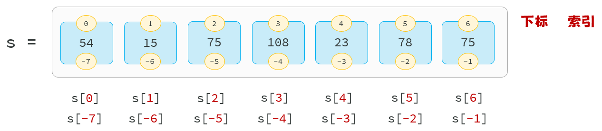
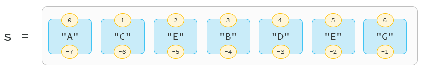
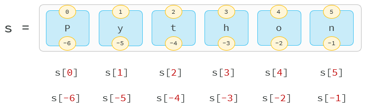
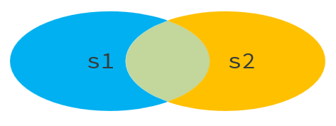

# 前言

**思考**：想要存储会话消息如何做？


**目前方式：**

```python
# 定义变量
msg1 = "你好"
msg2 = "哎呀,你终于来啦,想我没"
msg3 = "没"
msg4 = "你可真行!晚上锅包肉没你的份"
msg5 = "我不吃"
msg6 = "那更好,我自己吃,馋死你!"
msg7 = "你叫什么"
msg8 = "我叫小丽呀,你不是早都知道了吗"
msg9 = "忘记了"
msg10 = "这都能忘..."
......
```

**优化后方式：更加简洁，更加优雅。**

```python
# 定义变量
msg_list = [
    "你好", 
    "哎呀,你终于来啦,想我没", 
    "没", 
    "你可真行!晚上锅包肉没你的份", 
    "我不吃", 
    "那更好,我自己吃,馋死你!", 
    "你叫什么", 
    "我叫小丽呀,你不是早都知道了吗", 
    "忘记了", "这都能忘...", 
    ...
]
```

- **数据容器：**指的是一种可以容纳多份数据的数据类型（容器）。

- **五类数据容器**：
  - 列表（list）
  - 字符串（str）
  - 元组（tuple）
  - 集合（set）
  - 字典（dict）

# 列表（list）

## 介绍

- **列表：**是数据容器中的一类，是一次性可以存储多个数据（元素）的。

- **定义：**`列表名称 = [元素1，元素2，元素3，元素4，元素5...]`

- **样例：**`s = [54, 15, 75, 108, 23, 78, 75]`

- **访问：**使用索引



> [!tip] 🍀
> **提示：**从前向后（正向索引），下标从0开始；从后向前（反向索引），下标从-1开始。

- **特点：**
  - 可以存储不同类型的元素【不推荐】
  - 元素有序(元素存储和取出的顺序一致)、可以重复、元素可以修改

**其他操作：**
       1、修改：列表名[索引] = 新值
       2、删除：del 列表名[索引]

- **代码演示：**

```python
"""
- 列表：是数据容器中的一类，是一次性可以存储多个数据（元素）的。
- 定义：列表名称 = [元素1，元素2，元素3，元素4，元素5...]
- 索引：元素在列表中的位置/下标/坐标
       范围 0 - 元素个数-1
       ["刘亦菲","迪丽热巴","欧阳娜娜","李斐斐"]
          0        1        2        3
         -4       -3        -2       -1
- 访问方式：列表名称[索引]
- 特点：
  - 可以存储不同类型的元素【不推荐】
  - 元素有序（元素存储的顺序，和取出的顺序一致）、可以重复、元素可以修改
"""
# 需求：存储多个人的姓名
names = ["刘亦菲","迪丽热巴","欧阳娜娜","李斐斐","刘亦菲"]
#获取列表中的某一个元素
print(names[1])
print(names[-3])
#打印列表中的所有元素
print(names)
#修改列表中的某一个元素
names[2] = "古力娜扎"
print(names)

# 删除最后一个刘亦菲
del names[-1]
print(names)

# 遍历列表中的每一个元素
for name in names:
    print(name)

# 遍历列表中的每一个元素,以及该元素对应的索引  ['刘亦菲', '迪丽热巴', '古力娜扎', '李斐斐']
#注意事项：for后面的第一个变量固定是索引，第二个变量固定是元素值
#        enumerate(列表名)
for index,name in enumerate(names):
    print(f"{index} {name}")
```

> [!tip] 🍀
> - 正常遍历列表中的元素，直接使用for循环即可，比如 `for item in list01`
> - 如果在遍历列表（字符串、元组等）中的元素时，如果需要获取到元素的索引，可以使用enumerate语句，比如：`for i, e in enumerate(list01)` ---> `i` 表示索引，`e` 表示遍历出来的元素

> [!tip] 🍀
> **序列类型：**容器中的元素按特定顺存储的、可通过索引访问并支持顺序遍历的容器类型称之为序列。

## 切片



- **介绍：**切片是指截取容器中的一部分数据。列表、字符串、元组都支持切片操作。

- **语法：**容器名`[开始索引:结束索引:步长]`
  - 不包含结束索引位置对应的元素
  - 索引采用正向、反向索引都可以
  - 步长是选取间隔，默认步长为1

- **样例：**
  - `s[0:5:1]` 切片后的结果为 `["A", "C", "E", "B", "D"]`
  - `s[0:5:2]`切片后的结果为`["A", "E", "D"]`

- **代码演示：**
```python
"""
- 介绍：切片是指截取容器中的一部分数据。列表、字符串、元组都支持切片操作。
- 语法：容器名[开始索引:结束索引:步长]
- 特点:
    1、开始索引包含，结束索引对应的元素不包含
    2、步长可以省略不写，如果不写，默认为1
    3、开始索引可以省略不写，如果不写，默认从0索引开始截取
    4、结束索引也可以省略不写，如果不写，截取到最后一个元素
"""
names = ["张三","李四","王五","赵六","周七","郭八"]
#截取李四-赵六
names1 = names[1:4]
print(names1)
#从0所以开始截取，截取到3索引前的元素
names2 = names[:3]
print(names2)
#从2索引开始截取，截取到最后
names3 = names[2:]
print(names3)
#从0索引开始截取，截取到最后
names4 = names[::]
print(names4)
#从0索引开始截取，截取到5索引前的元素，步长为2（两个元素之间要走两步）
names5 = names[0:5:2]
print(names5)
#从1索引开始截取，截取到6索引前的元素，每个元素之间要走4步
names6 = names[1:6:4]
print(names6)
#通过方向索引截取元素
names7 = names[-5:-2:1]
print(names7)
```

## 常见方法

- **列表常见方法：**

| **方法** | **作用** | **样例** |
| --- | --- | --- |
| **append()** | 在列表的尾部追加元素 | `s.append(10086)` |
| **insert()** | 在指定索引处，插入该元素 | `s.insert(0, 92)` |
| **remove()** | 移除列表中第一个匹配到的值 | `s.remove(75)` |
| **pop()** | 删除列表中指定索引位置的元素（如果未指定索引，默认删最后一个） | `s.pop(2) / s.pop()` |
| **sort()** | 对列表进行排序（列表元素的数据类型一致，才可以进行排序） | `s.sort()` |
| **reverse()** | 反转列表元素 | `s.reverse()` |
| **  count()** | 获取某个元素在列表中的出现的次数 |  |

- 代码演示：

```python
nums = [20,40,22,44,77,88,10,2,2]

#在列表的末尾添加元素
nums.append(100)
print(nums)
#指定位置处添加元素
nums.insert(2,66)
print(nums)
#删除指定的元素
nums.remove(2)
print(nums)
#删除指定索引处的元素
nums.pop(3)
print(nums)
#删除最后一个元素
nums.pop()
print(nums)
#排序：从小到大升序
nums.sort()
print(nums)
#反转：列表的元素位置调换
nums.reverse()
print(nums)
```

## 案例

1. 将用户输入的10个数字，存储到一个列表中, 输出其中的最小值、最大值 和 平均值。

```python
#  将用户输入的10个数字，存储到一个列表中, 输出其中的最小值、最大值 和 平均值。

nums = []
#通过循环依次录入十个数据，并存储到列表中
for x in range(10):
    num1 = int(input(f"请录入第{x+1}个数字："))
    nums.append(num1)

print(nums)

#使用max()获取列表最大值
max_num = max(nums)
#使用min()获取列表最小值
min_num = min(nums)
print(max_num)
print(min_num)

#求出平均值： 累加和 / 长度
#累加和：sum()  长度：len()
avg_num = sum(nums) / len(nums)
print(avg_num)
```

> [!tip] 🍀
> **提示：**
>
> - `min()`：获取最小值
> - `max()`：获取最大值
> - `sum()`：求和
> - `len()`：获取元素的个数

1. 合并两个列表中的元素，并对合并的结果进行去重处理(去除列表中的重复元素)。

方案一：循环+【not in】

```python
#案例2: 合并两个列表中的元素，并对合并的结果进行去重处理(去除列表中的重复元素)
num_list1 = [19, 23, 54, 64, 875, 20, 109, 232, 123, 54]
num_list2 = [55, 80, 72, 35, 60, 123, 54, 29, 91]

# 1. 合并列表
for num in num_list2:
    num_list1.append(num)

print("合并后的原始列表: ", num_list1)

# 2. 去重重复记录
new_list = [] # 去重重复记录后的列表

for num in num_list1:
    # 判断new_list中是否存在num元素, 如果不存在, 再添加
    if num not in new_list: # 判断元素是否存在于列表中, 如果存在, 则返回True; 不存在, 返回False
        new_list.append(num)

print("去重重复记录后的列表: ", new_list)
```

方案二：解包+组包

```python
#案例2(简化): 合并两个列表中的元素，并对合并的结果进行去重处理(去除列表中的重复元素)
num_list1 = [19, 23, 54, 64, 875, 20, 109, 232, 123, 54]
num_list2 = [55, 80, 72, 35, 60, 123, 54, 29, 91]

# 1. 合并列表
# 解包: 将列表这一类容器解开成一个一个独立的元素
# 组包: 将多个值合并到一个容器
num_list = [*num_list1, *num_list2]

print("合并后的原始列表: ", num_list)

# 2. 去重重复记录
new_list = [] # 去重重复记录后的列表

for num in num_list:
    # 判断new_list中是否存在num元素, 如果不存在, 再添加
    if num not in new_list: # 判断元素是否存在于列表中, 如果存在, 则返回True; 不存在, 返回False
        new_list.append(num)

print("去重重复记录后的列表: ", new_list)
```

> [!tip] 🍀
> **总结：**
>
> 1. **如何快速合并两个列表？**
>   1. 使用 + 运算符直接合并
>   2. 使用 * 进行解包操作(解包指将列表这一类数据容器解开成独立的元素)
> 2. **如何判断一个元素是否存在于列表之中？**
>   1. 可以使用in运算符，语法为：`元素 in 列表`。not in则相反
>   2. 返回结果为布尔值，True表示存在，False表示不存在

1. 生成1-20的平方列表。

```python
# 案例3: 生成1-20的平方列表。 --> range(1,21)
# 方式一: 传统方式
num_list = []
for i in range(1,21):
    num_list.append(i**2)

print(num_list)

# 方式二: 列表推导式 ---> 就是按照一定的规则快速生成一个列表的方法 --> 语法格式1: [要插入的值 for i in 可迭代对象]
num_list2 = [i**2 for i in range(1,21)]
print(num_list2)
```

1. 从如下数字列表中提取所有偶数，并计算其平方，组成一个新的列表。
   num_list = [12, 32, 45, 77, 80, 92, 33, 57, 97, 98, 110, 111, 122]

```python
# 案例4: 从一个数字列表中提取所有偶数，并计算其平方，组成一个新的列表。 ---> 判断偶数: num % 2 == 0
# 列表推导式 ---> 就是按照一定的规则快速生成一个列表的方法 --> 语法格式2: [要插入的值 for i in 序列/列表 if 条件]
num_list = [12, 32, 45, 77, 80, 92, 33, 57, 97, 98, 110, 111, 122]
new_list = [i**2 for i in num_list if i % 2 == 0]

print(new_list)

print(num_list[::])
```

> [!tip] 🍀
> **列表推导式：**就是按照一定的规则快速生成一个列表的方法 
>
> - 语法格式1: 新列表 = `[要插入的值 for i in 容器]`
> - 语法格式2: 新列表 = `[要插入的值 for i in 容器 if 条件表达式]`

# 字符串（str）

## 基本操作

- 介绍：字符串是字符的容器，一个字符串中可以存放任意数量的字符 。

如：`"Python"`  `'Python'`  `"""Python"""`

- 特点：不可变性（无法修改）、有序性、可迭代性 (遍历)。

- 字符串中的每一个字符元素都有其对应的下标（索引），通过元素对应的索引，就可以获取到对应的元素 。



> [!danger] 
> **注意：**从前向后（正向索引），下标从0开始；从后向前（反向索引），下标从-1开始。

- 切片：`序列对象[开始索引:结束索引:步长]`
  - 不包含结束索引位置对应的元素
  - 索引采用正向、反向索引都可以
  - 步长是选取间隔，默认步长为1 (如果是-1, 表示从后向前)

- 样例：
  - `s[0:5:1]`切片后的结果为 `"Pytho"`
  - `s[0:5:2]` 切片后的结果为 `"Pto"`

- 代码演示：

```python
# 字符串 基本操作 ---> 不可变的(无法修改)、有序性、可迭代性
s = "Hello-Python"

print(s[4]) # 正向索引
print(s[-8]) # 反向索引

for i in s:
    print(i)

# 切片
print(s[0:5:1])
print(s[:5:1])
print(s[:5:])
print(s[:5])

print(s[6:12:1])
print(s[6::1])

print("-------------------------")
# 步长 --> 正数: 从前往后截取 ; 负数: 从后往前截取
print(s[-1:-7:-1])
print(s[::-1])
```

## 常用方法

字符串操作的常见方法有：

| **方法** | **作用** | **样例** |
| --- | --- | --- |
| **find()** | 在字符串中查找子串，返回第一次出现的索引位置，找不到返回-1 | `s.find('Python')` |
| **count()** | 统计子串在字符串中出现的次数 | `s.count('H')` |
| **upper()** | 将字符串中的所有字母转换为大写 | `s.upper()` |
| **lower()** | 将字符串中的所有字母转换为小写 | `s.lower()` |
| **split()** | 将字符串按指定分隔符分割成列表 | `s.split('')` |
| **strip()** | 去除字符串两端的空白字符或指定字符 | `s.strip() / s.strip('*')` |
| **replace()** | 将字符串中的指定子串替换为新的子串 | `s.replace('H','C')` |
| **startswith()** | 检查字符串是否以指定子串开头，返回布尔值 | `s.startwith('P')` |

- 代码演示：

```python
string = "大家下午好，大家真的棒！！！"
#查找原字符串中第一次出现字串的索引
print(string.find("大家")) # 0
print(string.find("我很好")) # -1
#获取子串在原字符串出现的次数
print(string.count("大家"))#2
#特点：字符串本身不可变
string2 = "Good Good Study Day Day Up"
#将字符串的内容转为全大写
string3 = string2.upper()
print(string3)
#将字符串的内容转为全小写
string4 = string2.lower()
print(string4)
print(string2)
#按照指定的内容，切割原字符串，切割后的子串通过列表来存储
string5 = string2.split(" ")
print(string5)

#替换原字符串中的旧子串，换成指定的新子串
string6 = "班长你真TMD的帅，帅的TMD不要不要的"
print(string6.replace("TMD","***"))

count = 0
list1 = ["张三","三丰","张无忌","李四","李小龙"]
#遍历列表，获取到每一个元素，判断这个元素是否以张开头，如果以张开头，计数器+1，否则不+1
for name in list1:
    #判断字符串是否以指定内容开头，如果是，结果为true,否则为false
    if name.startswith("张"):
        count+=1
print(count)
#默认去除字符串两端的空格
string7 = "   user name    "
print(string7.strip())
#去除字符串两端指定的内容
string8 = "**user name**"
print(string8.strip("*"))
```

## 案例

1. 邮箱格式验证：用户输入一个邮箱, 验证邮箱格式是否正确(包含一个@和至少一个.), 如果输入正确, 输出"邮箱格式正确", 否则输出"邮箱格式错误"。

```python
email = input("请输入邮箱：")

#  验证@出现的次数为1次          验证.出现的次数至少一次
if email.count("@") == 1 and email.count(".") >= 1:
    print("邮箱格式正确")
else:
    print("邮箱格式错误")

#  验证@出现的次数为1次        验证.在邮箱中存在 （既然存在了，那么就代表至少出现一次）
if email.count("@") == 1 and ("." in email):
    print("邮箱格式正确")
else:
    print("邮箱格式错误")
```

# 元组（tuple）

## 基本操作

- 介绍：元组是不可变的序列，类似于列表，但创建后不能修改。

- 特点：
  - 可以存储不同类型的元素
  - 元素可以重复、有序、不可以修改 (支持索引访问、切片)

- 定义：
  - 元组名称 = (元素1，元素2，...)
元组名称 = ()
元组名称 = tuple()

- 样例：
```python
# 定义元组
t1 = (5, 7, 9, 1, 2, 3, 10, 6, 4, 8 ,12, 7, 5)
[]

# 定义空元组
t2 = ()
t3 = tuple()
```

- 常用方法：
  - `count()`：统计某元素在元组中出现的次数
  - `index("abc")`：查找某个元素在元组中的索引位置(第一次出现的位置)

- 代码演示：
```python
"""
列表: 元素有序 可以重复  有索引  可以切片   可以修改      可以遍历
     定义格式: 变量名 = [元素值,元素值]
元组: 元素有序 可以重复  有索引  可以切片   不可以修改    可以遍历
    定义格式:  变量名 = (元素值,元素值)
"""
#定义一个元组，使用小括号定义，元素之间使用逗号分隔
tuple_demo = (20,30,40,10,20)
print(tuple_demo)
print(tuple_demo[1])     # 元组的元素有索引
print(tuple_demo[-2])    # 也可以使用反向索引
print(tuple_demo[1:3])   # 元组可以进行切片
# tuple_demo[0] = 100    # 元组中的内容不可修改
for x in tuple_demo:     # 元组可以进行遍历
    print(x)

#定义的空列表
list1 = []
#定义的空元组
tuple1 = ()
print(type(list1))
print(type(tuple1))
#如果想要将一个数据存储到元组中，数据后面必须有逗号，否则默认当作单个变量
tuple2 = (10,)
print(type(tuple2))
#元组的小括号可以省略不写，但是元素之间一定要通过逗号分隔
tuple3 = 10,20,30
print(type(tuple3))
#count:获取某个元素在元组中出现的次数
print(tuple_demo.count(20))
#index:获取某个元素在元组中的索引
print(tuple_demo.index(30))
```

> [!danger] 
> **注意事项：**
>
> 1. `t3 = (100)` 中的 `()` 是数学中的小括号（圆括号），用于改变运算优先级，而不是元组的语法。
> 2. 定义单元素元组时，需要在结尾加上逗号，比如 `('A',)`
> 3. 记住这句口诀：逗号才是元组的灵魂，括号只是礼貌的装饰。
>   - 定义元组也可以写为： `t3 = 100`,   ; `t3 = 100,200` (这里其实是元组组包的写法)
> 4. 如果需要存储一批固定不变的数据，可以元组存储
> 5. 如果需要存储的一系列数据，经常会进行修改，增加，删除， 使用列表存储

## 组包与解包

- 组包（Packing）：将多个值合并到一个容器（元组、列表）中。

- 解包（Unpacking）：将容器(元组、列表)解开成独立的元素，分别赋值给多个变量。

- 语法演示：

```python
# 定义元组, 组包
t1 = (5, 7, 9, 1)
list1 = [1，2，3，4，5]
# 定义元组, 组包
t2 = 5, 7, 9, 1

# 基础解包
a, b, c, d = t1

# (*)扩展解包
x, *y, z = t2   # x为5，y为[7, 9]，z为1
s, *o = t2      # s为5，o为[7, 9, 1]
*o, e = t2      # o为[5, 7, 9]，e为1
```

> [!tip] 🍀
> **说明：**在元组解包时，* 表示收集剩余的所有元素，允许我们处理不确定数量的元素（生成列表，以便于可以进行进一步的处理）。

## 案例

- 根据提供的学生成绩单，完成如下需求：
  1. 计算每个学生的总分、平均分，然后一并输出出来 。
  2. 统计各科成绩的最低分、最高分、平均分，并输出 。
  3. 查找成绩优秀（平均分大于90）的学生，并输出 。

  **学生成绩单：**

  students = (      ("S001", "王林", 85, 92, 78),      ("S002", "李慕婉", 92, 88, 95),      ("S003", "十三", 78, 85, 82),      ("S004", "曾牛", 88, 79, 91),      ("S005", "周轶", 95, 96, 89),      ("S006", "王卓", 76, 82, 77),      ("S007", "红蝶", 89, 91, 94),      ("S008", "徐立国", 75, 69, 82),      ("S009", "许木", 86, 89, 98),      ("S010", "遁天", 66, 59, 72)  )

- 代码实现：

```python
# - 根据提供的学生成绩单，完成如下需求：
#   1. 计算每个学生的总分、平均分，然后一并输出出来 。
#   2. 统计各科成绩的最低分、最高分、平均分，并输出 。
#   3. 查找成绩优秀（平均分大于90）的学生，并输出 。

students = (
    ("S001", "王林", 85, 92, 78),
    ("S002", "李慕婉", 92, 88, 95),
    ("S003", "十三", 78, 85, 82),
    ("S004", "曾牛", 88, 79, 91),
    ("S005", "周轶", 95, 96, 89),
    ("S006", "王卓", 76, 82, 77),
    ("S007", "红蝶", 89, 91, 94),
    ("S008", "徐立国", 75, 69, 82),
    ("S009", "许木", 86, 89, 98),
    ("S010", "遁天", 66, 59, 72)
)
#一、计算每个学生的总分，和平均分
#   1、先获取到每一位学生 的信息
#   2、将每个学生234索引的值相加，就是总分
#   3、平均分，总分/3

#实现方式1
for stu in students: #("S001", "王林", 85, 92, 78)
    sum_score = stu[2] + stu[3] + stu[4]
    avg_score = sum_score / 3
    print(f"{stu[1]}的总分为：{sum_score}，平均分：{avg_score:.2f} ")
print("=====================================================================")
#实现方式2
for id,name,chinese,math,english  in students:
    sum_score = chinese + math + english
    avg_score = sum_score / 3
    print(f"{name}的总分为：{sum_score}，平均分：{avg_score:.2f} ")

print("=====================================================================")

#二、统计各科成绩的最低分、最高分、平均分，并输出 。
# 1、如何收集每个人的语文成绩、 数学成绩 、英语成绩
# 2、max() min()  sum()/len()
chinese_scores = [stu[2] for stu in students]
math_scores = [stu[3] for stu in students]
english_scores = [stu[4] for stu in students]
print(f"语文成绩的最高分：{max(chinese_scores)},成绩的最低分：{min(chinese_scores)},平均分：{sum(chinese_scores)/len(chinese_scores)}")
print(f"数学成绩的最高分：{max(math_scores)},成绩的最低分：{min(math_scores)},平均分：{sum(math_scores)/len(math_scores)}")
print(f"英语成绩的最高分：{max(english_scores)},成绩的最低分：{min(english_scores)},平均分：{sum(english_scores)/len(english_scores)}")
print("=====================================================================")

#三、 查找成绩优秀（平均分大于90）的学生，并输出
for id,name,chinese,math,english  in students:
    sum_score = chinese + math + english
    avg_score = sum_score / 3
    if avg_score > 90:
        print(f"优秀的学生姓名：{name}")
```

# 集合（set）

## 基本操作

- 介绍：集合(set)是一种无序的、不可重复、可修改的数据容器。

- 定义：
  - 集合名 = {元素1，元素2，元素3}
  - 集合名 = set()

```python
# 定义集合
s1 = {"C", "D", "X", "T", "O", "U","U"}

# 定义空集合
s2 = set()
```

> [!danger] 
> **提示：**空集合的定义不可以使用{}，{}表示的是空字典；由于集合是无序的，因此是不支持下标索引访问的。

- 常见方法：

| **方法** | **作用** | **样例** |
| --- | --- | --- |
| **add(..)** | 添加元素到集合中 | `s1.add('t')` |
| **remove(..)** | 移除集合中的指定元素（指定元素不存在将报错） | `s1.remove('t')` |
| **pop()** | 随机删除集合中的元素并返回 | `e = s1.pop()` |
| **clear()** | 清空集合 | `s1.clear()` |
| **difference()** | 求取两个集合的差集（包含在第一个集合但不包含在第二个集合的元素） | `s1.difference(s2)`<br>                        - |
| **union()** | 求取两个集合的并集 | `s1.union(s2)`<br>                        | |
| **intersection()** | 求取两个集合的交集 | `s1.intersection(s2)`<br>& |



- 如图所示，如果求取的是s1与s2的差集，`s1.difference(s2)` 结果就是蓝色部分表示的元素； 而 `s2.difference(s1)`结果就是黄色部分的元素。

- 如图所示，如果求取的是s1与s2的并集，`s1.union(s2)` 就是 蓝色部分 + 黄色部分 + 绿色部分 的元素。

- 如图所示，如果求取的是s1与s2的交集，`s1.intersection(s2)` 就是 绿色部分 的元素。

- 代码演示：

```python
"""
集合的定义方式:
    变量名 = {元素1,元素2....}
特点:
    1、无序
    2、不可重复
    3、可以修改
    4、没有索引  不能切片
"""
set1 = {"张三","李四","王五","赵六","张三","李四"}
print(set1)
#向集合中添加一个数据
set1.add("马富强")
print(set1)
#删除集合中的某个数据  注意：如果该数据不存在，报错
set1.remove("王五")
print(set1)
#随机删除集合中的某个数据，会将删除的数据返回
rs = set1.pop()
print(set1)
print(rs)
#清空集合，删除集合中的所有数据
set1.clear()
print(set1)

set2 = {"张三","李四","王五"}
set3 = {"王五","赵六","马富强"}
#difference： 获取第一个集合中存在的，第二个集合中不存在的元素
result1 = set2.difference(set3)
print(result1)
result2 = set3.difference(set2)
print(result2)
#union：将两个集合中的元素合并到一起
result3 = set2.union(set3)
print(result3)
#intersection：获取两个集合中都有的元素/数据
result4 = set2.intersection(set3)
print(result4)
```

## 案例

- 需求：根据提供的班级学生的选课情况，完成如下需求：
  1. 找出同时选修了法语和艺术的学生
  2. 找出同时选修了所有四门课程的学生
  3. 找出选修了足球, 但是没有选修篮球的学生
  4. 统计每一个学生选修的课程数量

基础数据如下：

```python
# 选修足球学生名单
football_set = {"王林", "曾牛", "徐立国", "遁天", "天运子", "韩立", "厉飞雨", "乌丑", "紫灵"}

# 选修篮球学生名单
basketball_set = {"张铁", "墨居仁","王林", "姜老道", "曾牛", "王蝉", "韩立", "天运子", "李化元", "厉飞雨", "云露"}

# 选修法语学生名单
french_set = {"许木", "王卓", "十三", "虎咆", "姜老道", "天运子",  "红蝶", "厉飞雨", "韩立", "曾牛"}

# 选修艺术学生名单
art_set = { "遁天", "天运子", "韩立", "虎咆", "姜老道", "紫灵"}
```

代码实现：

```python
# - 需求：根据提供的班级学生的选课情况，完成如下需求：
#   1. 找出同时选修了法语和艺术的学生
#   2. 找出同时选修了所有四门课程的学生
#   3. 找出选修了足球, 但是没有选修篮球的学生
#   4. 统计每一个学生选修的课程数量

# 选修足球学生名单
football_set = {"王林", "曾牛", "徐立国", "遁天", "天运子", "韩立", "厉飞雨", "乌丑", "紫灵"}

# 选修篮球学生名单
basketball_set = {"张铁", "墨居仁","王林", "姜老道", "曾牛", "王蝉", "韩立", "天运子", "李化元", "厉飞雨", "云露"}

# 选修法语学生名单
french_set = {"许木", "王卓", "十三", "虎咆", "姜老道", "天运子",  "红蝶", "厉飞雨", "韩立", "曾牛"}

# 选修艺术学生名单
art_set = { "遁天", "天运子", "韩立", "虎咆", "姜老道", "紫灵"}

# 1. 找出同时选修了法语和艺术的学生
#第一种获取交集的写法：
rs_set = french_set.intersection(art_set)
print(rs_set)
#第二种获取交集的写法： &
rs2_set = french_set & art_set
print(rs2_set)

# 2. 找出同时选修了所有四门课程的学生
rs3_set = basketball_set & football_set & french_set & art_set
print(rs3_set)

# 3. 找出选修了足球, 但是没有选修篮球的学生
#第一种获取差集的写法：
rs4_set = football_set.difference(basketball_set)
print(rs4_set)
#第二种获取差集的写法：
rs5_set = football_set - basketball_set
print(rs5_set)

# 4.统计每一个学生选修的课程数量
# 第一步：先获取一份完整的学生名单（保证唯一）
#stu_names = basketball_set.union(football_set).union(french_set).union(art_set)
stu_names = basketball_set | french_set | football_set | art_set
# 第二步：获取四个集合中所有的数据，不能去重
all_names = (*basketball_set,*football_set,*french_set,*art_set)
print(all_names)
# 第三步：统计每个人选修课程数量
for name in stu_names:
    count = all_names.count(name)
    print(f"{name}选修了{count}门课程")
```

> [!tip] 提示
> **补充：**
>
> 1. 集合set操作的运算符 & | -
>
> &：交集
>
> |：并集
>
> -：差集

> [!warning] 警告
> **总结：**
>
> 容器类型： 可以存储多个数据的变量
>
>       列表（list）: 有序、可重复、可修改、有索引、可切片
>
>                          遍历方式
>
>                    切片： 【start：end：step】
>
>       字符串（str）: 有序、有索引、可以切片、不可修改、可以重复
>
>       元组（tuple）: 有序、有索引、可以切片、不可修改、可以重复
>
>       集合（set）:    无序、无索引、不可以切片、可以修改、不可重复

> [!warning] 警告
> 疑问1: 讲课能听懂,  但是练习作业无从下手?
>           正常现象       多练 多敲 多思考    
>
> 疑问2: 老师留的练习时间短?
>
>            如果你敲的慢: 可以先不敲, 先理解案例的流程
>
> 疑问3: 作业太多,作业写完了,也到了放学时间了,导致总结没有做,没有复习
>
>            1. 先把当天的内容 复习完** [必须]**
>
>            2. 再写作业 [加个班]