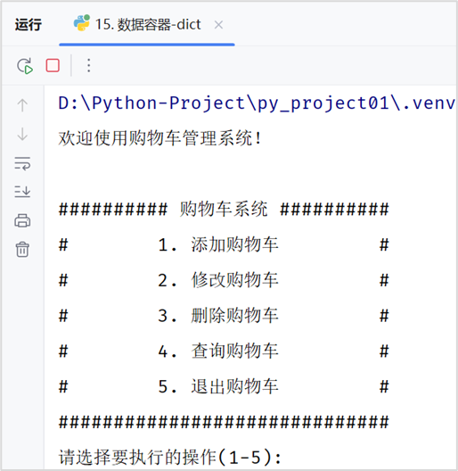
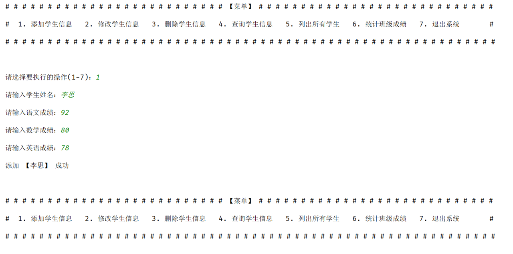

# 字典（dict）

**思考：**

现需要存储班级学员高考成绩，其中包含 王林(670)，韩立（556），李慕婉（582），紫灵（435），许立国      （608）…，该如何存储呢？

## 定义

- 字典：存储的元素是一个键值对。 可以通过键(key)快速找到值(value)

- 定义：
  - 字典名称 = {key: value, key:value, key:value …}
  - 字典名称 = {}           
  - 字典名称 = dict()

- 访问
  - 获取 value ：字典名[key]
  - 修改 value ：字典名[key] = 新value
  - 添加键值对：字典名[key] = value

- 特点：
  - 元素有序
  - 键（key）不会重复
  - 键（key）的类型只能为 (int、float、str、bool、tuple)，不能为可变类型（set、list、dict）
  - 值（value）可以重复，类型不限制

- 样例：

```python
#定义一个字典:字典中有数据
dict01 = {"王林":670,"韩立":556,"李慕婉":582,"紫灵":435,"许立国":608}
#定义一个空字典
dict02 = {}
dict03 = dict()

#获取李慕婉的成绩:
print(dict01["李慕婉"])
print(dict01["许立国"])

#修改韩立的成绩为 700
dict01["韩立"] = 700
print(dict01)

#添加新的键值对  马富强:600
dict01["马富强"] = 600
print(dict01)
```

```python
# 字典 -- key不能重复(如果重复, 后面的值, 会覆盖前面的值)、key必须得是不可变类型（str，int，float，tuple）
# 定义字典
dict1 = {"王林":670, "李慕婉":608, "徐立国":580, "韩立":688}

print(dict1)
print(type(dict1))

# key必须得是不可变类型（str，int，float，tuple）, 不能是 list、set、dict
dict2 = {0:670, 1.5:608, (1,2):580, ('A','B'):688}
print(dict2)

# 访问
print(dict1["李慕婉"]) # 获取
dict1["李慕婉"] = 688 # 修改
print(dict1)
```

> [!tip] 提示
> **总结：**
>
> 1. **字典的存储形式及特点?**
>   - 字典(dict)存储的是键值对(key:value)形式的数据
>   - 特点：键值对、key是唯一的、值可修改,值可重复
> 1. **字典定义的语法?**
>   - 定义：`dict1 = {"王林": 675, "李慕婉": 608, "许立国": 478, …}`
>   - 获取：`v = dict1["王林"]`
> 1. **字典的注意事项**
>   - value可以是任意类型，而key必须是不可变类型（不能为list、set、dict）
>   - 字典内的key不允许重复，如果重复定义，后面的覆盖前面的
>   - 字典是没有索引下标的，不能根据索引获取值，只可以根据key获取value

## 常见操作

`dict1 = {"小智": 675, "李思": 608, "李琪": 478, "小黑": 545, "温韬": 429}`

字典的增删改查操作如下：

<table>
<tr>
<td><b>类型</b></td>
<td><b>操作</b></td>
<td><b>含义</b></td>
<td><b>样例</b></td>
</tr>
<tr>
<td><b>添加</b></td>
<td>字典名称[key]   = value</td>
<td>往指定字典中添加key-value键值对</td>
<td><code>dict1["莫厉海"] = 688</code></td>
</tr>
<tr>
<td rowspan="2"><b>删除</b></td>
<td>字典名称.pop(key)</td>
<td>删除字典中指定的key,   并返回该key对应的value</td>
<td><code>score = dict1.pop("莫厉海")</code></td>
</tr>
<tr>
<td>del 字典名称[key]</td>
<td>删除字典中指定的键值对</td>
<td><code>del dict1["莫厉海"]</code></td>
</tr>
<tr>
<td><b>修改</b></td>
<td>字典名称[key] = value</td>
<td>修改字典中指定的key对应的值</td>
<td><code>dict1["小智"] = 658</code></td>
</tr>
<tr>
<td rowspan="5"><b>查询</b></td>
<td>字典名称[key]</td>
<td>根据key获取value</td>
<td><code>dict1["莫厉海"]</code></td>
</tr>
<tr>
<td>字典名称.get(key)</td>
<td>根据key获取value</td>
<td><code>dict1.get("莫厉海")</code></td>
</tr>
<tr>
<td>字典名称.keys()</td>
<td>获取所有的key</td>
<td><code>dict1.keys()</code></td>
</tr>
<tr>
<td>字典名称.values()</td>
<td>获取所有的value</td>
<td><code>dict1.values()</code></td>
</tr>
<tr>
<td>字典名称.items()</td>
<td>获取所有的key-value键值对</td>
<td><code>dict1.items()</code></td>
</tr>
</table>

演示代码：

```python
dict1 = {"小智": 675, "李思": 608, "李琪": 478, "小黑": 545, "温韬": 429}
#数据的新增
dict1["王林"] = 900
print(dict1)

#数据的删除
rs = dict1.pop("小黑")
print(dict1)
print(rs)

del dict1["小智"]
print(dict1)

#数据的修改
dict1["李思"] = 609
print(dict1)

#根据key获取value
print(dict1["李琪"])
print(dict1.get("温韬"))

# print(dict1["张三"])  # 如果不存在该key :报错
print(dict1.get("张三"))  # 如果不存在该key :返回None

#获取字典中所有的key
keys = dict1.keys()
print(keys)

#获取字典中所有的value
values = dict1.values()
print(values)

#获取字典中所有的键值对
#[(key,value),(key,value),(key,value)]
items = dict1.items()
print(items)
```

**字典的遍历**

```python
dict1 = {"小智": 675, "李思": 608, "李琪": 478, "小黑": 545, "温韬": 429}

# 完成字典的遍历：可以单独获取每一个元素的key value

#第一种遍历方式：根据key 获取value
#非简化版:
for key in dict1.keys():
    value = dict1.get(key)
    print(f"key:{key}，value:{value}")

print("="*50)
#简化版:
for key in dict1:
    value = dict1.get(key)
    print(f"key:{key}，value:{value}")

print("=" * 50)

#第二种遍历方式: 先获取到每一个键值对,再分别取出该对中的key 和value
#[('小智', 675), ('李思', 608), ('李琪', 478), ('小黑', 545), ('温韬', 429)]
for item in dict1.items():
    key = item[0]
    value = item[1]
    print(f"key:{key}，value:{value}")

print("=" * 50)

for key,value in dict1.items():
    print(f"key:{key}，value:{value}")
```

## 案例

- 需求：开发一个购物车管理系统，实现商品信息的添加、修改、删除、查询功能。

系统使用字典结构存储商品数据，通过控制台菜单与用户交互。

存储商品的结构如下:

*                    *shopping_cart = {"Meta80": {"price": 6999, "num": 2}, "鼠标": {...}}

- 具体功能如下：
  1. 添加购物车：用户根据提示录入商品名称、以及该商品的价格、数量，保存该商品信息到购物车。
  2. 修改购物车：要求用户输入要修改的购物车商品名称，然后再提示输入该商品的价格、数量，输入完成后修改该商品信息。
  3. 删除购物车：要求用户输入要删除的购物车商品名称，根据名称删除购物车中的商品。
  4. 查询购物车：将购物车中的商品信息展示出来，格式为："商品名称: xxx, 商品价格: xxx, 商品数量: xxx"。
  5. 退出购物车



```markdown
########### 购物车系统 ##########
#         1. 添加购物车         #
#         2. 修改购物车         #
#         3. 删除购物车         #
#         4. 查询购物车         #
#         5. 退出购物车         #
###############################
```

- 代码实现：

```python
# - 需求：开发一个购物车管理系统，实现商品信息的添加、修改、删除、查询功能。
#         系统使用字典结构存储商品数据，通过控制台菜单与用户交互。
#               存储商品的结构如下:
#               shopping_cart = {
#                   "Meta80": {"price": 6999, "num": 2},
#                   "鼠标": {"price": 100, "num": 2}
#               }

# - 具体功能如下：
#   1. 添加购物车：用户根据提示录入商品名称、以及该商品的价格、数量，保存该商品信息到购物车。
#   2. 修改购物车：要求用户输入要修改的购物车商品名称，然后再提示输入该商品的价格、数量，输入完成后修改该商品信息。
#   3. 删除购物车：要求用户输入要删除的购物车商品名称，根据名称删除购物车中的商品。
#   4. 查询购物车：将购物车中的商品信息展示出来，格式为："商品名称: xxx, 商品价格: xxx, 商品数量: xxx"。
#   5. 退出购物车

#定义一个变量，用来存储购物车商品信息

menu = """
########### 购物车系统 ##########
#         1. 添加购物车         #
#         2. 修改购物车         #
#         3. 删除购物车         #
#         4. 查询购物车         #
#         5. 退出购物车         #
###############################
"""

print("欢迎使用购物车管理系统")

shopping_cart = {
   # "笔记本":{"price":9000,"num":2}
}
while True:
    print(menu)
    choice = input("请录入您要进行的操作（1-5）：")
    match choice:
        case "1":
            name = input("请录入商品名称：")
            #判断商品是否已存在
            if name in shopping_cart:
                print("该商品已存在,请录入2修改商品信息")
            else:
                price = input("请录入商品价格：")
                num = input("请录入商品数量：")
                shopping_cart[name] = {"price":price,"num":num}
                print("商品添加成功!")

        case "2":
            name = input("请录入您要修改的商品名称：")
            if name in shopping_cart:
                new_price = input("请录入您要修改的商品价格：")
                new_num = input("请录入您要修改的商品数量：")
                shopping_cart[name] = {"price":new_price,"num":new_num}
                print("商品修改成功!")
            else:
                print("该商品不存在,请录入1添加商品")
        case "3":
            name = input("请录入您要删除的商品名称：")
            if name in shopping_cart:
                del shopping_cart[name]
                print("商品信息删除成功")
            else:
                print("该商品不存在,请录入1添加商品")

        case "4":
            if not shopping_cart:   #判断变量/容器是否为空， not变量名/容器名 为空， 则为True，否则为False
                print("购物车为空,请添加商品")
            else:
                print("购物车信息如下:")
                for name in shopping_cart:
                    info = shopping_cart.get(name)
                    price = info.get("price")
                    num = info.get("num")
                    print(f"商品名称: {name}, 商品价格: {price}, 商品数量: {num}")

        case "5":
            print("退出购物车")
            break
        case _:
            print("输入有误，请重新输入")
```

# 数据容器对比

| **特性** | **字符串（str）** | **列表（list）[]** | **元组（tuple）** | **集合（set）** | **字典（dict）** |
| --- | --- | --- | --- | --- | --- |
| **有序性** | 有序 | 有序 | 有序 | 无序 | 有序(3.7+) |
| **重复元素** | 允许 | 允许 | 允许 | 不允许 | key不允许 |
| **可变性** | 不可变 | 可变 | 不可变 | 可变 | 可变 |
| **索引访问** | 支持 | 支持 | 支持 | 不支持 | 不支持 |
| **切片操作** | 支持 | 支持 | 支持 | 不支持 | 不支持 |
| **使用场景** | 存储文本 | 有序可重复数据集合 | 固定数据记录 | 去重数据集合 | 键值对 |

**序列类型：字符串（str）、列表（list）、元组（tuple）、range（range()函数返回值）**

# 综合案例

**开发一个教务管理系统，在该系统中可以维护和管理学员的成绩信息，具体需求如下：**

1. 添加学生信息：根据提示录入学生姓名、语文、数学、英语成绩，录入完成保存到系统中。

2. 修改学生信息：要求输入要修改的学生姓名，然后再提示输入语文、数学、英语成绩，输入完成后修改学员信息。

3. 删除学生信息：要求输入要删除的学生姓名，根据姓名删除学生信息。

4. 查询学生信息：要求输入要查询的学生姓名，根据姓名查询学生信息并输出。

5. 列出所有学生：遍历所有学生信息并输出。

6. 统计班级成绩：统计班级语文、数学、英语成绩的最高分、最低分、平均分，以及语文、数学、英语最高分和最低分的学员姓名。

7. 退出系统。



具体代码实现如下：

```python
"""
    案例:
    开发一个教务管理系统，在该系统中可以维护和管理学员的成绩信息，具体需求如下：
        1. 添加学生信息：根据提示录入学生姓名、语文、数学、英语成绩，录入完成保存到系统中。
        2. 修改学生信息：要求输入要修改的学生姓名，然后再提示输入语文、数学、英语成绩，输入完成后修改学员信息。
        3. 删除学生信息：要求输入要删除的学生姓名，根据姓名删除学生信息。
        4. 查询学生信息：要求输入要查询的学生姓名，根据姓名查询学生信息并输出。
        5. 列出所有学生：遍历所有学生信息并输出。
        6. 统计班级成绩：统计班级语文、数学、英语成绩的最高分、最低分、平均分，以及语文、数学、英语最高分和最低分的学员姓名。
        7. 退出系统。
"""

menu = """
# # # # # # # # # # # # # # # # # # # # # # # # # # 【菜单】 # # # # # # # # # # # # # # # # # # # # # # # # # # # #
#  1. 添加学生信息   2. 修改学生信息   3. 删除学生信息   4. 查询学生信息   5. 列出所有学生   6. 统计班级成绩   7. 退出系统       #
# # # # # # # # # # # # # # # # # # # # # # # # # # # # # # # # # # # # # # # # # # # # # # # # # # # # # # # # # #
"""
print("欢迎使用教务管理系统 ~")

student_scores = {}

while True:
    # 1. 制作菜单
    print(menu)

    # 2. 执行的具体操作
    choice = input("请选择要执行的操作(1-7): ")
    match choice:
        case "1":  # 添加学生信息
            student_name = input("请输入学生姓名: ")
            chinese_score = float(input("请输入语文成绩: "))
            math_score = float(input("请输入数学成绩: "))
            english_score = float(input("请输入英语成绩: "))

            # 如果学生存在, 则不执行添加, 提示信息
            if student_name in student_scores:
                print("该学生已存在, 请重新选择 ~")
            else:
                student_scores[student_name] = {"chinese": chinese_score, "math": math_score, "english": english_score}
                print("学生信息添加完毕 ~")
        case "2":  # 修改学生信息
            student_name = input("请输入要修改的学生姓名: ")
            # 如果学生不存在, 则提示错误信息, 重新选择
            if student_name not in student_scores:
                print("该学生不存在, 请重新选择 ~")
                continue

            chinese_score = float(input("请输入语文成绩: "))
            math_score = float(input("请输入数学成绩: "))
            english_score = float(input("请输入英语成绩: "))
            student_scores[student_name] = {"chinese": chinese_score, "math": math_score, "english": english_score}
            print("学生信息修改完毕 ~")
        case "3":  # 删除学生信息
            student_name = input("请输入要删除的学生姓名: ")

            # 如果学生不存在, 则提示错误信息, 重新选择
            if student_name not in student_scores:
                print("该学生不存在, 请重新选择 ~")
            else:
                del student_scores[student_name]
                print("学生信息删除完毕 ~")
        case "4":  # 查询学生信息
            student_name = input("请输入要查询的学生姓名: ")

            # 如果学生不存在, 则提示错误信息
            if student_name not in student_scores:
                print("该学生不存在, 请重新选择 ~")
            else:
                student_info = student_scores[student_name]
                print(f"学生姓名: {student_name}, 语文成绩: {student_info['chinese']}, 数学成绩: {student_info['math']}, 英语成绩: {student_info['english']}")
        case "5":  # 列出所有学生
            for student_name in student_scores.keys():
                student_info = student_scores[student_name]
                print(f"学生姓名: {student_name}, 语文成绩: {student_info['chinese']}, 数学成绩: {student_info['math']}, 英语成绩: {student_info['english']}")
        case "6":  # 统计班级成绩
            if not student_scores:
                print("系统中暂无学生信息，请先添加学生 ~")
                continue

            # 初始化统计变量
            chinese_scores = []
            math_scores = []
            english_scores = []

            # 收集所有成绩
            for student_name, scores in student_scores.items():
                chinese_scores.append(scores['chinese'])
                math_scores.append(scores['math'])
                english_scores.append(scores['english'])

            # 计算最高分、最低分、平均分
            chinese_max = max(chinese_scores)
            chinese_min = min(chinese_scores)
            chinese_avg = sum(chinese_scores) / len(chinese_scores)

            math_max = max(math_scores)
            math_min = min(math_scores)
            math_avg = sum(math_scores) / len(math_scores)

            english_max = max(english_scores)
            english_min = min(english_scores)
            english_avg = sum(english_scores) / len(english_scores)

            # 找出最高分和最低分的学生
            chinese_max_students = [name for name, scores in student_scores.items() if scores['chinese'] == chinese_max]
            chinese_min_students = [name for name, scores in student_scores.items() if scores['chinese'] == chinese_min]

            math_max_students = [name for name, scores in student_scores.items() if scores['math'] == math_max]
            math_min_students = [name for name, scores in student_scores.items() if scores['math'] == math_min]

            english_max_students = [name for name, scores in student_scores.items() if scores['english'] == english_max]
            english_min_students = [name for name, scores in student_scores.items() if scores['english'] == english_min]

            # 输出统计结果
            print("===== 班级成绩统计 =====")
            print(f"语文 - 最高分: {chinese_max}, 最低分: {chinese_min}, 平均分: {chinese_avg:.2f}")
            print(f"     最高分学生: {chinese_max_students}")
            print(f"     最低分学生: {chinese_min_students}")

            print(f"数学 - 最高分: {math_max}, 最低分: {math_min}, 平均分: {math_avg:.2f}")
            print(f"     最高分学生: {math_max_students}")
            print(f"     最低分学生: {math_min_students}")

            print(f"英语 - 最高分: {english_max}, 最低分: {english_min}, 平均分: {english_avg:.2f}")
            print(f"     最高分学生: {english_max_students}")
            print(f"     最低分学生: {english_min_students}")
            print("========================")
        case "7":  # 退出系统
            print("Bye ~")
            break
        case _:  # 匹配其他所有情况
            print("非法操作, 不支持!!!")
```

# 函数基础

## 介绍

**函数**是组织好的、可重复使用的，用来实现特定功能的代码片段。

## 定义

- **函数**是组织好的、可重复使用的，用来实现特定功能的代码片段。

- **定义与调用语法：**

```python
# 定义函数
def 函数名(参数列表):
    函数体
    ......
    return 返回值
    

# 调用函数
函数名(参数)
```

- **定义与调用样例：**

```python
# 定义函数
def out_line():
    print('---------------------------')

# 调用函数
out_line()
```

> [!danger] 🔔
> **注意：**
>
> - 函数必须先定义，在调用
> - 函数定义时，并不会执行，只有在调用函数时，函数体的逻辑才会运行
> - 函数中通过缩进来描述归属关系
> - 函数定义时的参数列表与返回值语句是可有可无的(由需求确定)
> - **内置函数**：Python内部定义好的可以完成某些功能的代码片段

## 参数与返回值

在定义函数时，根据业务需要，可以指定参数与返回值，具体格式如下：

```python
# 定义函数
def 函数名(形参列表):
    函数体
    ......
    return 返回值1,2,3

# 调用函数
v = 函数名(实参)
```

- 形参（形式参数）：函数定义时括号里的参数，只能在函数内使用（局部变量）

- 实参（实际参数）：函数在实际调用时传入的参数。

样例：

```python
# 函数1: 计算圆的面积 -- 半径
def circle_area(r):
    area = 3.14 * r ** 2
    return area

area = circle_area(10)
print(area)
```

```python
# 函数2: 计算长方形的面积 -- 长, 宽
def rectangle_area(l,w):
    area = l * w
    return area
 
print(rectangle_area(20, 10))
```

```python
# 函数3: 计算圆的面积, 周长 -- 半径 ----> 如果返回值有多个, 多个返回值之间逗号分隔 ---> 多个返回值会封装到元组之中
def circle_area_len(r):
    return round(3.14 * r * r, 1), round(2 * 3.14 * r, 1)

al = circle_area_len(10)
print(al)
print(type(al))

area, length = circle_area_len(10) # 解包
print(area)
print(length)
```

> [!danger] 🔔
> **注意：**
>
> - 函数定义时如果有多个参数，多个参数之间使用逗号（,）分隔 。
> - `return`语句只有返回功能，而没有输出打印的功能，如果要输出，需要结合`print()`函数来实现
> - 函数是可以定义多个返回值的，多个返回值会封装到一个元组中。