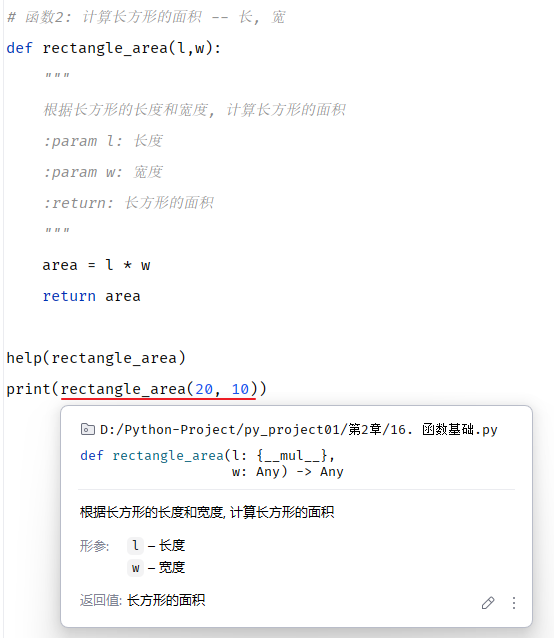
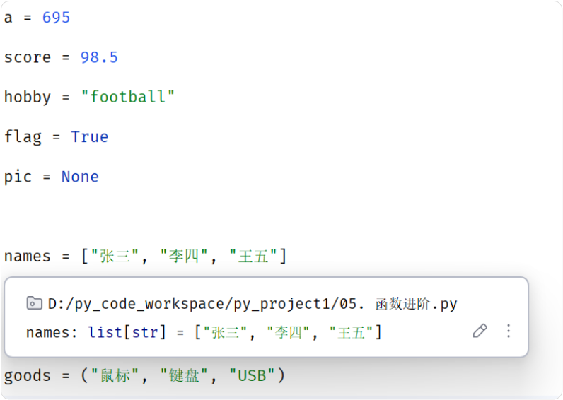
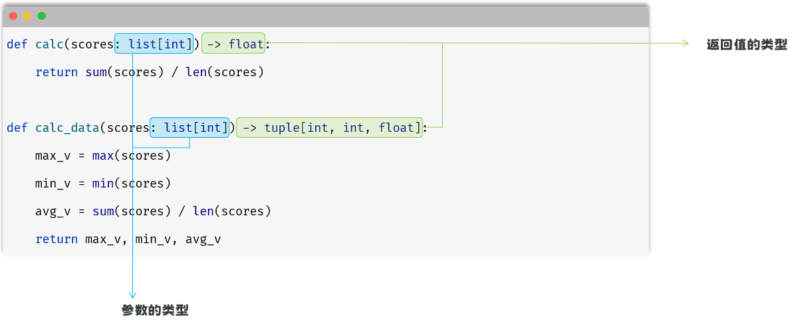
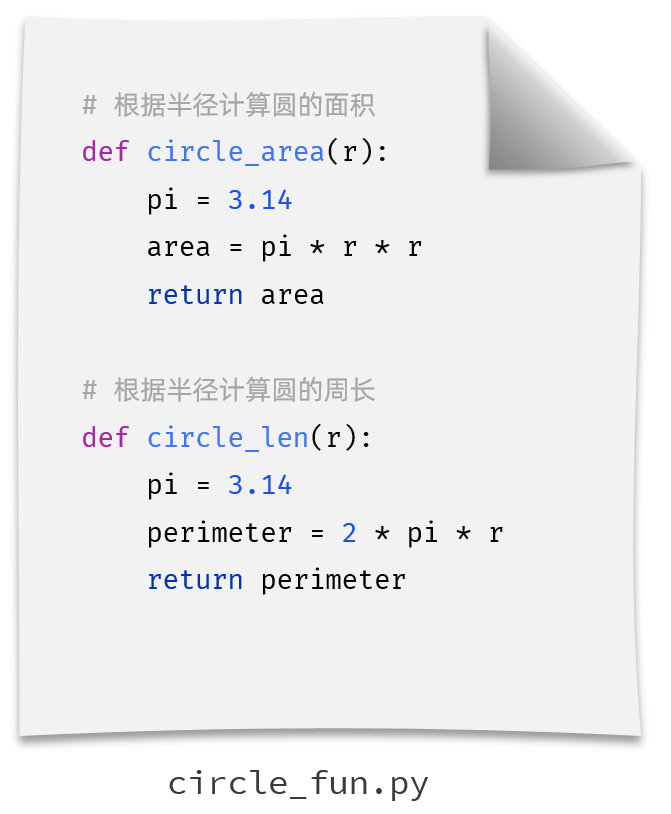
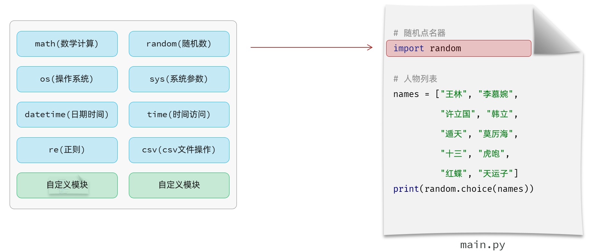

# 函数基础

## 函数说明文档

- 函数的说明文档（Docstring）是写在函数开头，用三个引号包裹的字符串，用于解释函数的功能、参数、返回值等信息，方便调用者清楚函数的具体作用及细节。

- **样例：**
```python
# 函数2: 计算长方形的面积 -- 长, 宽
def rectangle_area(l,w):
    """
    根据长方形的长度和宽度, 计算长方形的面积
    :param l: 长度
    :param w: 宽度
    :return: 长方形的面积
    """
    area = l * w
    return area

print(rectangle_area(20, 10))
help(rectangle_area)
```

  - `:param` ：描述函数的参数
  - `:return`：描述函数的返回值

- **查看函数说明文档：**
  - 方式一：通过help函数，比如 `help(rectangle_area)`
  - 方式二：在pycharm中，鼠标悬浮在函数上，自动展示（推荐）


> [!tip] 🍀
> **记住：好的文档，能让你的代码更容易理解、使用和维护！**

## 嵌套调用

- 嵌套调用指的是在一个函数中，又调用了另外一个函数。

- 函数调用遵循栈结构，最后被调用的函数最先返回LIFO(Last In First Out，后进先出)

- 样例：

```python
# 函数的嵌套调用
def function_a():
    print("a ... before")
    function_b()
    print("a ... after")

def function_b():
    print("b ... before")
    function_c()
    print("b ... after")

def function_c():
    print("c ...")

function_a()

print("函数调用完毕 ~")
```

- 执行流程：
  - 调用 `function_a()` 函数，输出 "a ... before" 
  - 调用 `function_b()`函数，输出 "b ... before"
  - 调用 `function_c()`函数，输出 "c ..."
  - `function_c()`函数执行完毕后，再执行`function_b()`函数的后半部分，输出 "b ... after"
  - `function_b()`函数执行完毕后，再执行`function_a()`函数的后半部分，输出 "a ... after"
  - `function_a()`函数执行完毕

## 案例

定义一个函数：

函数接收参数：学员成绩列表
函数体逻辑：求出成绩列表中的最高分、最低分、平均分(保留1位小数)，并返回。

```python
# 案例3: 定义一个函数：计算传入的班级学员高考成绩列表中成绩的最高分、最低分、平均分(保留1位小数)，并返回。
def calc_score(score_list):
    """
    计算传入的班级学员高考成绩列表中成绩的最高分、最低分、平均分
    :param score_list: 分数列表
    :return: 最高分, 最低分, 平均分
    """
    max_s = max(score_list)
    min_s = min(score_list)
    avg_s = round(sum(score_list) / len(score_list), 1)
    return max_s, min_s, avg_s

s_list = [589, 609, 605, 643, 677, 455, 477, 489, 503]
max_score, min_score, avg_score = calc_score(s_list)
print("最高分: ", max_score)
print("最低分: ", min_score)
print("平均分: ", avg_score)
```

# 函数进阶

## 变量作用域

### 介绍

- 变量的作用域指的是变量的作用范围，也就是说这个变量，在哪里可以使用，在哪儿不可以使用。

- 根据作用范围的不同，常见的变量作用域分为两类：全局变量 和 局部变量。

- **全局变量：**在函数、推导式之外定义的变量，称之为全局变量，在整个文件中（包括函数内）都可以使用（通常定义在文件的顶部）。

- **局部变量：**在函数、推导式内部定义的变量，称之为局部变量，只能在该函数内部使用，外部无法访问(执行完毕后，会自动销毁其内部局部变量) 。

- **优先级：**在使用变量时，优先在当前作用域范围内查找，如果未查询到，再到上一层作用域查询。

**思考如下代码：**

```python

tax_rate = 0.05

# 定义函数
def cal_tax(total_price):
    tax_rate = 0.08
    
    tax = total_price * tax_rate
    
    return  tax

my_tax = cal_tax(10000)
print(f"税前价格: 10000, 税: {my_tax}")
def aaa():
    globe tax_tate
    print(tax_rate)
```

### global关键字

`作用：global`关键字用于明确的告诉Python解释器，在函数中要使用全局变量，使得可以在函数内部修改全局变量的值。

- 代码形式如下：

```python
# 全局变量 : 在函数外部 或 函数的内部都是可以访问的 ;
tax_rate = 0.05

# 定义函数
def cal_tax(total_price): 
    global tax_rate
    tax_rate = 0.08
    
    tax = total_price * tax_rate
    
    return  tax

my_tax = cal_tax(10000)
print(f"税前价格: 10000, 税: {my_tax}")
print(tax_rate)
```

> [!danger] 
> **注意：**
>
> - 在基于global声明全局变量时，要先声明，再使用。
> - 尽量避免在函数中修改全局变量，因为会使代码难以维护和调试
> - global主要用在程序的状态、配置和计数器等场景中

## 参数详解

### 传参方式

**概述：**传参方式指的是，在调用函数时，传递实参的方式，主要分为两类：

**分类：**位置参数 和 关键字参数。

**1). 位置参数：**调用函数时根据函数定义时的位置来传递参数。

```python
# 定义函数
def reg_stu(name, age, gender, city):
    print(f"注册成功,姓名:{name}, 年龄:{age}, 性别:{gender}, 城市:{city}")

# 调用函数
reg_stu("张三", 18, "男", "北京")
```

**要求：**调用函数时参数顺序与定义函数时参数顺序完全一致。

**2). 关键字参数：**调用函数时以函数定义时形参名称作为关键字，以 "键=值" 的形式来传递参数(不要求顺序)。

```python
# 定义函数
def reg_stu(name, age, gender, city):
    print(f"注册成功,姓名:{name}, 年龄:{age}, 性别:{gender}, 城市:{city}")
    

# 调用函数
reg_stu(name="张三", age=18, gender="男", city="北京")

reg_stu(gender="男", name="王武", city="上海", age=22)

reg_stu("赵四", 28, gender="男", city="上海")
```

**要求：**如果位置参数与关键字参数混用, 关键字参数必须在位置参数之后(关键字参数之间,没有顺序要求)。

<table>
<tr>
<td></td>
<td><b>位置参数</b></td>
<td><b>关键字参数</b></td>
</tr>
<tr>
<td><b>形式</b></td>
<td><code>s = calc(87, 68, 92, 85)</code></td>
<td><code>s = calc(math=87, chinese=68, english=92, computer=85)</code></td>
</tr>
<tr>
<td><b>优点</b></td>
<td>简洁</td>
<td>可读性强、易维护和扩展</td>
</tr>
<tr>
<td><b>缺点</b></td>
<td>可读性差、易出错、维护难</td>
<td>代码繁琐</td>
</tr>
<tr>
<td><b>场景</b></td>
<td>参数少（一般不超过3个），且顺序自然</td>
<td>参数较多，或容易混淆的场景</td>
</tr>
<tr>
<td colspan="3"><b>黄金法则：半年后回头看你今天写的代码，能否一眼看出每个参数的含义，如果不能，就应该使用关键字参数。</b></td>
</tr>
</table>

### 默认参数

**默认参数**也称为**缺省参数**，用于在定义函数时，为参数提供默认值，调用函数时，可以不传递有默认值的参数。

```python
# 定义函数
def reg_stu(name, age, gender, city='北京'):
    print(f"注册成功,姓名:{name}, 年龄:{age}, 性别:{gender}, 城市:{city}")

# 调用函数
reg_stu("张三", 18, "男")

reg_stu("赵四", 22, "男", "深圳")
```

> [!danger] 
> **注意：**
>
> - 函数调用时，如果为默认参数传递了值，则会使用传递进来的值；如果没有传递该参数，则直接使用默认值。
> - 默认参数必须放在没有默认值的参数列表的后面，一个函数在定义时是可以设置多个默认参数的。

```python
# 定义函数
def reg_stu(name, age, gender="男", city="北京"):
    print(f"注册成功, 姓名: {name}, 年龄: {age}, 性别: {gender}, 城市: {city}")

# 调用函数
reg_stu("王林", 20)

reg_stu("李慕婉", 18, "女")

reg_stu("韩立", 22, city="上海")
```

### 不定长参数

**思考：**
需求：定义一个函数，根据传入的数据，计算这批数据中的最小值、最大值、平均值。

#### 介绍

参数的个数是不固定的，就可以通过**不定长参数**来实现。

> [!tip] 提示
> **不定长参数**也叫**可变参数**，用于函数定义及调用时参数个数不确定（0个或多个）的场景。对于不定长参数，根据传参方式的不同，又分为两类：位置参数 与 关键字参数。

#### 不定长位置参数（*args）

**概念**：不定长位置参数指的是，通过位置参数形式传递进来的，长度不确定的参数。

**实现**：使用*args接收多个参数

```python
# 定义函数
def calc_data(*args):
    min_data = min(args)
    max_data = max(args)
    avg_data = sum(args) / len(args)
    return min_data, max_data, round(avg_data,1)

# 调用函数
data = calc_data(10, 20, 30, 40, 50, 60, 70, 80, 90, 100)
print(data)

 data = calc_data(100, 200, 300, 400, 500)
print(data)
```

> [!danger] 
> 注意：`args` 只是约定俗成的变量名，并不是关键字，这里可以使用任何合法的变量名（如 `*data`）。
>
>           可变参数会被封装到一个tuple元组中

#### 不定长关键字参数（**kwargs）

**概念：**不定长关键字参数指的是，通过关键字参数形式传递进来的，长度不确定的参数

**实现：**不定长关键字参数的写法是 `**kwargs`，传递的参数是以 `"键=值"` 形式传递的关键字参数，

这些 `"键=   值"` 参数都会被`kwargs`接收，并合并封装为一个字典类型 。

```python
# 需求: 根据传入的这批数据, 计算这批数据的最小值, 最大值, 平均值
def calc_data(*args, **kwargs):
    """
    根据传入的这批数据, 计算这批数据的最小值, 最大值, 平均值
    :param args: 不定长位置参数, 需要计算的这批数据
    :param kwargs: 不定长关键字参数
         round: 保留的小数位个数
         print: 是否打印输出
    :return: 最小值, 最大值, 平均值
    """
    min_value= min(args)
    max_value= max(args)
    avg_value= sum(args) / len(args)

    if kwargs.get("round") is not None:
        avg_value= round(avg_data, kwargs.get("round"))

   if keywords.get("get_zero_count"):
        zero_count = nums.count(0)
        return max_value,min_value,avg_value,zero_count
    else:
        return max_value,min_value,avg_value

# 调用函数
print(calc_data(2, 7, 9, 10, 45, round=3, get_zero_count=True))

print(calc_data(2, 7, 9, 10, 45, 73, 37, 93, 92, 111, 222, round=4))
```

> [!danger] 
> 注意：`kwargs`只是约定俗成的变量名，并不是关键字，这里可以使用任何合法的变量名（如 `**options`）。

> [!tip] 提示
> **总结：**
>
> 1. **什么是不定长参数？**
> - 参数个数不确定，此时就可以使用不定长参数解决这类问题
> 1. **不定长参数的分类？**
> - `*args`：不定长位置参数，函数调用时，通过位置参数传递多个参数封装到一个元组(tuple)中
> - `**kwargs`：不定长关键字参数，函数调用时，通过关键字参数传递多个参数封装到一个字典(dict)

### 参数类型

**概念**：在定义函数时，关于函数的参数类型可以是普通参数，也可以是特殊参数。

**分类**：

普通参数，比较常见的就是：float、int、bool、str、list、set、tuple、dict等。

特殊参数：比如：函数

```python
def circle_area(r): # 参数是 int、float 类型
    area = 3.14 * r ** 2
    return area

area = circle_area(10)
print(area)
```

```python
def calc_score(score_list): # 参数 是 list 列表类型
    max_s = max(score_list)
    min_s = min(score_list)
    avg_s = round(sum(score_list) / len(score_list), 1)
    return max_s, min_s, avg_s

s_list = [589, 609, 605, 643, 677, 455, 477, 489, 503]
 max_score, min_score, avg_score = calc_score(s_list)
```

```python
# 函数的参数类型
# 加
def add(x, y):
    return x + y
# 减
def subtract(x, y):
    return x - y
# 乘
def multiply(x, y):
    return x * y
# 除
def divide(x, y):
    return x / y
# 计算
def calc(x, y, oper):
    return oper(x, y)

print(calc(10, 20, multiply))
```

## 匿名函数

**概念：**匿名函数指的是没有名称的函数，需要通过lambda表达式来声明函数，可以简化简单函数的编写（单行表达式）。

- 语法对比：

```python
# 定义命名函数
def 函数名(参数列表):
    函数体...
```

```python
# 定义匿名函数
lambda 参数列表 : 函数体
```

- 代码样例：

```python
def out_line():
    print('-------------------------')

def add(x, y):
    return x + y

out_line()
print(add(10, 20))
```

```python
lambda : print('-------------------------')
lambda x, y: x + y
```

- **案例：完成如下列表的排序操作, 按照每一个元素的字符个数, 从小到大排序 ;**

```python
# 需求: 完成如下列表的排序操作, 按照每一个元素的字符个数, 从小到大排序 ;
data_list = ["C++", "C", "Python", "Jack", "PHP", "Java", "Go", "JavaScript", "Rust"]
print(data_list)

#lambda x: len(x)

data_list.sort(key=lambda x:len(x)) # 匿名函数典型的应用场景 .
print(data_list)
```

> [!tip] 提示
> 1. 命名函数与匿名函数的选择？
>   - 建议使用匿名函数的情况：函数逻辑简单，只在一个地方调用（常作为高阶函数的参数）
>   - 建议使用命名函数的情况：函数逻辑复杂，需要多步操作，需要多个地方重复使用或需要加文档说明的场景
>
> **记住：代码的可读性和可维护性比简洁性更重要**

# 类型注解（Type Hints）

## 介绍

- 类型注解是Python中的一种语法特性，用于明确标识变量、函数参数和返回值的数据类型，从而使代码更清晰、更安全、更易维护。

之前定义变量：

```python
# 定义变量
a = 695
score = 98.5
hobby = "Python"
flag = True
pic = None

names = ["A", "C", "E"]
phones = {"13309091111", "15209109121"}
options = {"count": 0, "total": 0}
goods = ("手机", 5999, 1)
```

限定变量中存储的数据的类型，就可以为变量指定其数据类型，格式为：`变量名: 数据类型`，代码演示如下：

```python
# 定义变量
a: int = 695
score: float = 98.5
hobby: str = "Python"
flag: bool = True
pic: None = None

names: list[str] = ["A", "C", "E"]
phones: set[str] = {"13309091111", "15209109121"}
options: dict[str, int] = {"count": 0, "total": 0}
goods: tuple[str,int,int] = ("手机", 5999, 1)
```

> [!danger] 
> **注意：Python是动态类型语言，添加的类型注解只是提示，并不是强制约束!!!**

## 类型推断

- 类型推断是指Python解释器自动推断出变量、表达式或函数返回值的数据类型的能力，而无需开发者显式声明。



> [!danger] 
> **注意：**在对变量进行直接赋值，或者涉及到变量的运算、容器的推导等场景时，解释器会自动推导出变量的类型 ，此时无需再指定变量的类型。

> [!tip] 提示
> **总结：**
>
> 1. 类型注解的写法？
>   变量: 数据类型 (如 `a: int`)
> 1. 常见类型的写法
>   - `int`、`float`、`bool`、`str`、`None`、`list`、`set`、`tuple`、`dict`
>   - `str | int`
> 1. 为什么要使用类型注解，有什么好处呢？
>   - 代码结构更清晰、代码逻辑更安全、易维护
>   - 提前发现代码潜在问题
> 1. 注意事项
>   - Python是动态类型语言,添加的类型注解只是提示,并不是强制约束!!!
>   - 如果对变量直接赋值、变量运算等场景， Python会自动进行类型推断，此时无需指定变量的类型

## 函数类型注解

**概念**：函数拥有** **参数列表和返回值，可以在定义函数时，指定参数和返回值的类型

- **样例：**

为函数的参数、返回值指定类型。

```python
# 函数类型注解
def get_count(s:str,num:str)->int:
    return s.count(num)
```

> [!tip] 提示
> **提示：对于需要团队协作开发和长期维护的项目，推荐使用类型注解**

**案例:**



# 模块

**思考**：我们在 `circle_fun.py` 文件中定义了两个函数，想要在其他py文件中使用，应该怎么办



## 介绍

- **Python模块(module)**：一个**.py**文件就是一个模块，模块是Python程序的基本组织单位。

在模块中可以定义变量、函数、类，以及可执行的代码。

- **分类**：
  - 自定义模块：开发人员自己创建的模块
  - 内置模块：官方定义的模块

  【`数学计算模块 math`、`随机数模块 random`、`操作系统模块 os`、`系统参数模块 sys`、

- **使用**：想要使用其他模块的内容，需要导入



## 导入模块

**导入模块方式**：

| **导入形式** | **代码样例** | **调用方式** | **调用方式** |
| --- | --- | --- | --- |
| import 模块名 | import   random, os | 模块名.功能名 | random.randint(10,   100) |
| import 模块名   as 别名 | import   random as rd | 别名.功能名 | rd.randint(10,   100) |
| from 模块名   import 功能名 | from   random import randint,choice | 功能名 | randint(10,   100) |
| from 模块名   import 功能名 as 别名 | from   random import randint as rint | 别名 | rint(10,   100) |
| from 模块名   import * | from   random import * | 功能名 | randint(10,   100) |

代码演示：

```python
# 1. 导入模块 import ... [ as ... ] ---> 调用方式: 模块名.功能名 / 别名.功能名
# import random
# import random as rd

# 2. 导入模块中的功能 from ... import .... ----> 调用方式: 功能名 / 别名
# from random import randint
# from random import randint as rint
from random import *

# for i in range(100):
#     print(rd.randint(1, 100))

for i in range(100):
    print(randint(1, 100))
```