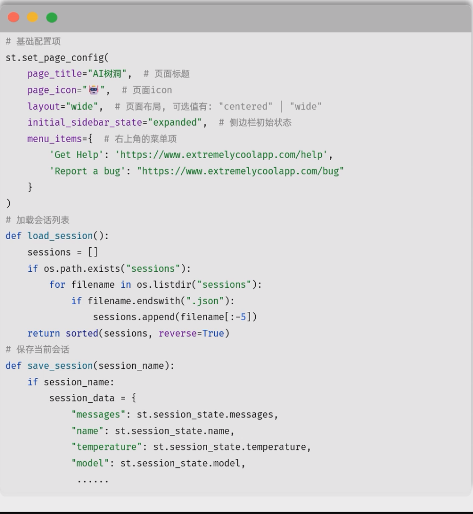
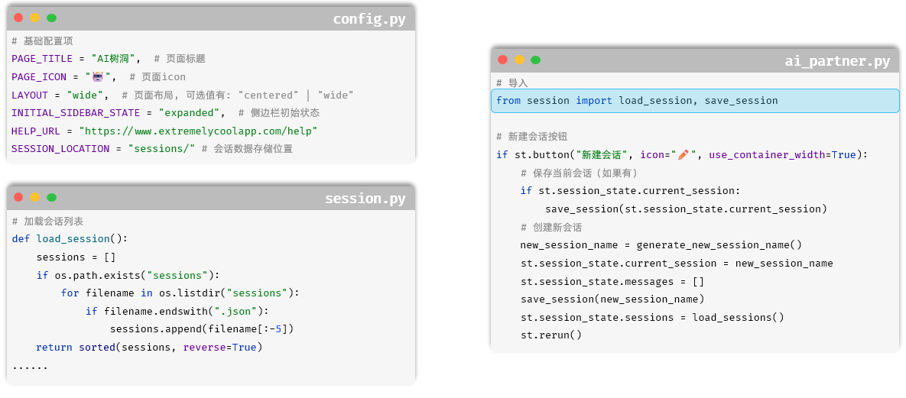
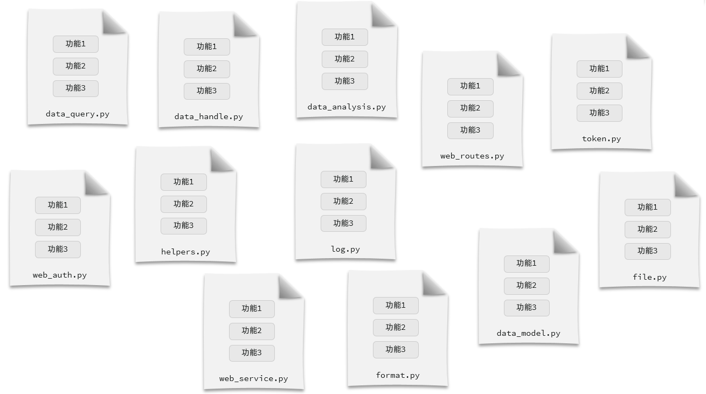
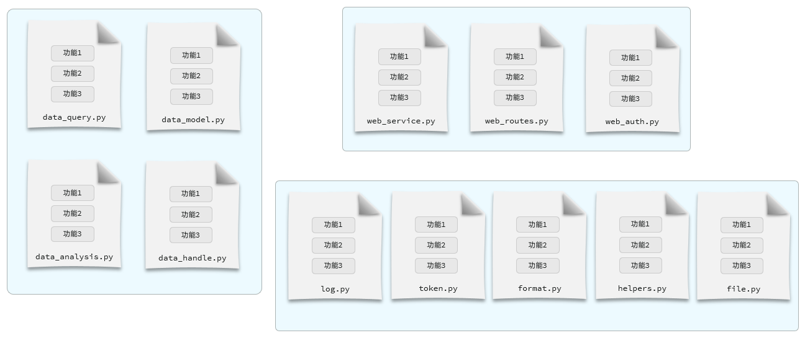
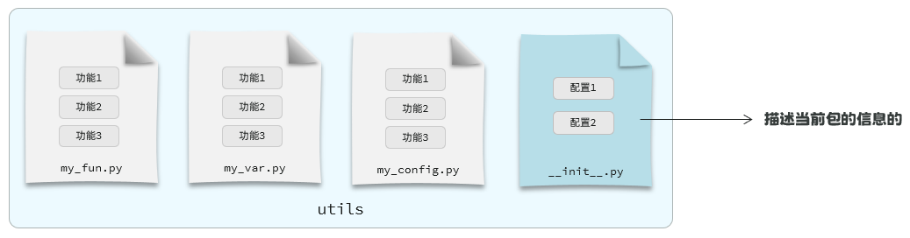
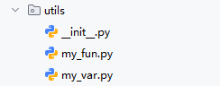
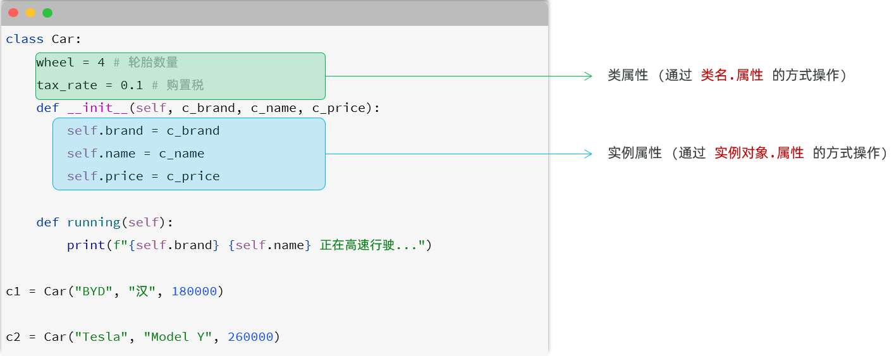

# 1.模块操作

## 自定义模块

在开发一些复杂的项目时，为了让项目结构更清晰，更便于项目的管理维护 以及 代码的复用，通常会将一个项目拆分为若干个模块。每个模块负责不同的职责，比如像如下这样：

- `config.py` 主要定义一些项目的配置信息

- `session.py` 主要定义项目会话操作

- 在核心业务代码 `ai_partner.py` 中要想使用，就需要将其导入进来





> [!tip] 🍀
> **提示：**每一个python文件都可以作为一个模块，模块的名字就是文件的名字（建议使用python标识符定义，规范命名） 。

- **案例演示1：**

1). 在 my_fun.py 文件中定义常量, 函数

```python
# __all__ 指定 from ... import * 导入的是哪些功能
__all__ = ["log_separator1", "log_separator3", "PI"]

# 常量(不会发生变化的数据 ; 常量的名称为全部大写)
PI = 3.1415926
NAME = "黑马☆程序员"

# 函数
def log_separator1():
    print("- " * 30) # "- "重复输出30次

def log_separator2():
    print("+ " * 30)

def log_separator3():
    print("# " * 30)

def log_separator4():
    print("* " * 30)
```

> [!tip] 🍀
> `__all__`是一个模块级别的特殊变量，用于指定 `from 模块名 import *` 时会导入哪些功能(`*`通配了哪些功能)。

2). 在 `main.py` 文件中引入进来测试

```python
# 导入自定义模块中的功能
from my_fun import *

# 使用模块中的功能
print(PI)

log_separator1()
log_separator3()
```

此时 `import *` 这个 `*` 导入进来的功能，就包括 `log_separator1`，`log_separator3`，`PI` ，这些都是在定义模块的时候，`__all__` 这个变量中指定的。

> [!tip] 🍀
> `__name__` 是Python中非常重要的内置变量，表示的是当前模块的名称
>
> - 当模块直接运行时：`__name__`的值为 "main" 
>   - 因此，如果这段测试代码，我们只想在模型直接运行的时候执行，模块被导入时不执行，就可以将测试代码放在if代码块中。
>   - `if __name__ == "main"`
> - 当模块被导入时：`__name__`等于模块的文件名(不含.py后缀)

## 软件包(package)

**思考：**随着业务量的激增，定义的模块越来越多，如何更好的管理模块？



**解决**：可以使用包来管理模块



- **包：**本质就是一个文件夹，该文件夹中可以包含若干python模块（.py文件）。

- **作用：**模块文件较多时，用来管理多个模块。



在 __init__.py 文件中就可以描述这个包的基本信息，包括版本、作者、import * 时导入的是哪些模块等。 定义好了包之后，在别的模块中要想使用，还是需要先将其导入进来。

- **包的导入方式：**

| **导入形式** | **代码样例** | **调用方式** | **调用方式** |
| --- | --- | --- | --- |
| import 包名.模块名 | import   utils.my_fun | 包名.模块名.功能名 | utils.my_fun.log_separator1() |
| from 包名  import 模块名 | from   utils import my_fun | 模块名.功能名 | my_fun.log_separator1() |
| from 包名   import * | from   utils import * | 模块名.功能名 | my_fun.log_separator1() |
| from 包名.模块名 import   功能名 | from   utils.my_fun import log_separator1 | 功能名 | log_separator1() |
| from 包名.模块名 import   * | from   utils.my_fun import * | 功能名 | log_separator1() |

- **演示代码：**

**1). 定义一个目录 utils , 并在目录下定义两个python文件(模块)**



my_var.py 中定义两个常量

```python
# 常量(不会发生变化的数据 ; 常量的名称为全部大写)
PI = 3.1415926
NAME = "黑马☆程序员"
```

my_fun.py 中定义了几个函数

```python
# 函数
def log_separator1():
    print("- " * 30) # "- "重复输出30次

def log_separator2():
    print("+ " * 30)

def log_separator3():
    print("# " * 30)

def log_separator4():
    print("* " * 30)
```

然后在 __init__.py 中描述一下这个包的基本信息

```python
# 描述包信息
__version__ = "1.0.0"
__author__ = "黑马程序员"

__all__ = ["my_fun", "my_var"]
```

**2). 引入包的模块，进行测试**

**方式一：**import 包名.模块名

```python
# 1. 导入模块
import utils.my_fun

utils.my_fun.log_separator1()
utils.my_fun.log_separator2()
```

**方式二：**from 包名 import 模块名

```python
from utils import my_fun

my_fun.log_separator1()
my_fun.log_separator2()
my_fun.log_separator3()
```

**方式三：**from 包名 import *

```python
# 注意: 如果要通过 from utils import * 导入包下的所有模块, 需要 __init__.py 文件中添加 __all__=[]
from utils import *

my_fun.log_separator1()
my_fun.log_separator4()

print(my_var.PI)
print(my_var.NAME)
```

**注意：**在通过 `from 包名 import *` 导入全部模块的时候，必须要在 `__init__.py` 文件中添加 `__all__=[]`，控制允许导入的模块列表 。

**方式四：**from 包名.模块 import 功能

```python
# 相对路径: 从当前文件所在目录开始查找
# from utils.my_fun import log_separator1, log_separator3

# 绝对路径: 从项目的根目录下开始查找
from day05.utils.my_fun import log_separator1, log_separator3

log_separator1()
log_separator3()
```

# 面向对象前言

**面向过程：**把一个需求分解成一系列要执行的步骤，然后按照步骤依次执行这些任务 (关注的是流程、步骤)。

**面向对象：**关注谁有能力来解决这个需求，通过对象的功能来解决。

需求：做饭

买菜，洗菜，切菜，开火，倒油，放菜，炒一炒 ，出锅

交给一个厨师来完成

---

**对象**：用来表示一个个具体的事物  【万物皆对象】

特性  和  功能

属性        方法

**类**：对具有相同特征和功能的事物的统称

---

**思考**：想要通过面向对象的思想 在程序中 创建一个  人类对象

这个人类对象的姓名为：张三，年龄为：23，爱好为：smoking

# 面向对象基础

## 类与对象

- 定义类的语法1：

```python
# 定义类
class 类名:
    pass

# 创建对象
对象名 = 类名()
对象名.属性名1 = 属性值1
对象名.属性名2 = 属性值2
```

- 定义类的代码演示：

```python
class Person:
  pass

per = Person()
per.name = "张三"
per.age = 23
per.hobby = "smoking"
per.height = 180.5
print(per.__dict__)

per2 = Person()
per2.name = "李四"
per2.age = 24
per2.hobby = "drinking"
print(per2.__dict__)
```

这种方式在定义类的时候，并未明确指定类中有哪些属性，都是在基于类创建对象之后，动态添加的对象属性。【不建议】

- 定义类的语法2：【推荐】

```python
# 定义类
class 类名:
    def __init__(self, 参数列表):
       self.属性名 = 参数值
       self.属性名 = 参数值

class Person:
    def __init__(self,n,a):   #当前对象:哪一个对象调用该方法,指的就是哪个对象
       self.name =  n
       self.age = a
       
       
       
    def eat(self):
        print
  
  
 

per = Person("张三",23)
per.eat()

per2 = Person("lsi")
per2.eat
per.name
per.age

# 创建对象
对象名 = 类名(参数列表)
```

`__init__` 方法是对象初始化的方法，也称之为构造方法，在我们基于类创建对象的时候，会自动调用该方法，主要用于设置对象的初始状态（设置对象属性）。

`self` 是类中方法的第一个参数，表示当前创建的示例对象。

- 定义类的代码样例：

```python
#在类中指定了每一个该类的对象，都具备相同的属性
class Person:
    def __init__(self,name:str,age:int,hobby:str):   # self表示基于类型创建的当前对象
        #用来指定该类型的对象拥有哪些属性
        self.name = name
        self.age = age
        self.hobby = hobby

per1 = Person("张三",23,"抽烟喝酒烫头")
print(per1.__dict__)

per2 = Person("李四",24,"玩游戏")
print(per2.__dict__)
```

> [!tip] 🍀
> **说明1：**定义在类的外面的称之为函数，定义在类中的函数称之为方法 。
>
> **说明2：**类名的命名规范，遵循大驼峰命名法，每个单词的首字母都是大写，单词之间没有分隔符，比如：UserInfo，UserAccount 。   UserInfo
>
> **说明3:**`__dict__`是Python中用户自定义类实例的一个特殊属性，用于以字典形式存储对象的属性 。

## 实例方法

- **实例方法：**就是属于 "对象/实例"的方法，必须通过对象来调用。在类中定义实例方法时，定义语法与之前学习的函数定义的方式是一致的。

- 语法：

```python
# 定义类
class 类名:
    def __init__(self, 形参列表):
       self.属性名 = 参数值
       self.属性名 = 参数值
    
    def 方法名(self, 形参列表):
       ...
       
    def 方法名(self, 形参列表):
       ...

# 创建对象
对象名 = 类名(参数列表)
对象名.方法名(实参)
```

在声明实例方法时参数列表中的`self`表示当前实例对象，方法调用时就是基于创建出来的实例对象调用的，所以是无需传递`self`的 。

- 演示代码：

```python
# 定义类
# class 类名:
#     def __init__(self, 参数列表):
#        self.属性名 = 参数值
#        self.属性名 = 参数值

#推荐使用
#在定义类的时候,在init方法中,指定该类型的所有对象都具备相同的属性
#不同对象的属性值不一样,所以需要在创建对象时,自己传递,自己赋值
class Person:
    #init方法是创建对象(实例)时,自动调用
    def __init__(self,name,age,hobby): #self 当前对象
        self.name = name
        self.age = age
        self.hobby = hobby

    #给每一个Person的对象指定拥有的方法
    def eat(self):                         #self 当前对象,将来哪个对象调用该方法,self就表示哪一个对象
        print("我会吃饭")

    def show_info(self):
        print(f"大家好,我的姓名:{self.name},年龄:{self.age},爱好:{self.hobby}")

per1 = Person("张三",23,"抽烟")
print(per1.__dict__)
per1.eat()
per1.show_info()

per2 = Person("李四",24,"打游戏")
print(per2.__dict__)
per2.eat()
per2.show_info()
```

## 魔法方法

- 魔法方法是指Python中提供的以双下划线开头和结尾的特殊方法，用于定义类的特殊行为，比如：`__init__`。魔法方法是不需要我们手动调用的，Python会在合适的时机自动调用。

- 常见魔法方法：

| **魔法方法** | **描述** |
| --- | --- |
| **__init__** | 初始化方法 |
| **__str__** | 字符串表示的方法，面向用户，返回易懂、友好的描述字符串（对象如果包裹在容器中，输出容器时不触发） |
| **__repr__** | 字符串表示的方法，面向开发者，返回精确、可还原对象的字符串（对象如果包裹在容器中，输出容器时也触发） |
| **__eq__** | 比较两个对象是否相等   (equal) |
| **__lt__** | 支持比较两个对象的大小，小于(less   than) |
| **__le__ ** | 支持比较两个对象的大小,   小于等于(less   than or equal) |
| **__gt__ ** | 支持比较两个对象的大小,   大于(greater than) |
| **__ge__** | 支持比较两个对象的大小,  大于等于(greater than or equal)) |

> [!tip] 🍀
> **提示：**当 `__str__` 未定义时， 会降级使用 `__repr__`

```python
class Person:
    def __init__(self,name:str,age:int,hobby:str):
        self.name = name
        self.age = age
        self.hobby = hobby

    def __str__(self):
        return f"Person(姓名={self.name},年龄={self.age},爱好={self.hobby})"

    def __repr__(self):
        return f"Person(姓名={self.name},年龄={self.age},爱好={self.hobby})"

    def __eq__(self, other):
        return self.name == other.name and self.age == other.age and self.hobby == other.hobby

    def __le__(self, other):
        return self.age <= other.age

    def __ge__(self, other):
        return self.age >= other.age

per1 = Person("张三",23,"抽烟喝酒烫头")
print(per1)
per2 = Person("张三",26,"抽烟喝酒烫头")
print(per2)
pers = [per1,per2]
print(pers)

print(per1 == per2)

print(per1 <= per2)

print(per1 >= per2)
```

## 属性

在前面我们讲解 类 与 对象 的时候，已经讲到了如何在定义类的时候，声明对象的属性。

接下来，我们来详细介绍一下类中的属性，属性分为两份：

- **实例属性：**实例属性属于每个具体对象的属性，每个对象都是独立的。（各个对象特有的数据）

- **类属性：**类属性是属于类本身的属性，所有实例共享的。（所有对象共享的数据或配置）



> [!tip] 提示
> **说明：**通过实例查找属性时，会先查找实例属性，实例属性不存在时，再查找类属性 。

- 代码演示：

```python
class Car:
    # 类属性 (所有实例对象共享的)
    wheel = 4 # 轮胎数量

    def __init__(self, c_color, c_brand, c_name, c_price):
        # 实例属性
        self.color = c_color
        self.brand = c_brand
        self.name = c_name
        self.price = c_price

 

# 测试
c1 = Car("白色", "BYD", "汉", 180000)
print(c1.brand)
print(c1.wheel) # 通过实例对象, 查找属性时, 会先查找实例属性; 实例属性不存在, 再查找类属性

# 通过类名访问类属性
print(Car.wheel)
```

## 案例

采用面向对象的编程思想，完成教务管理系统的开发。教务管理系统可以管理在校学生的成绩信息，通过控制台菜单与用户交互，具体的功能如下：

1. 添加学生成绩：根据输入的学生姓名、语文成绩、数学成绩、英语成绩，记录在系统中

2. 修改学生成绩：根据输入的学生姓名，修改对应的学生成绩

3. 删除学生成绩：根据输入的学生姓名，删除对应的学生成绩

4. 查询指定学生成绩：根据输入的学生姓名，查找对应的学生成绩，并输出

5. 展示全部学生成绩：展示出系统中所有学生的成绩

### 分析

教务管理系统（EduManagement）：添加学生成绩、修改学生成绩、删除学生成绩、查询指定学生成绩
学生（Student）：姓名、语文成绩、数学成绩、英语成绩

### 实现

具体代码实现如下：

```python
# 采用面向对象的编程思想，完成教务管理系统的开发。教务管理系统可以管理在校学生的成绩信息，通过控制台菜单与用户交互，具体的功能如下：
#     1. 添加学生成绩：根据输入的学生姓名、语文成绩、数学成绩、英语成绩，记录在系统中
#         1.1 输入学生姓名、语文成绩、数学成绩、英语成绩
#         1.2 检查学生姓名是否已存在, 如果学生不存在, 再添加 (存在则, 不添加)
#         1.3 创建学生对象并添加到系统
#     2. 修改学生成绩：根据输入的学生姓名，修改对应的学生成绩
#         2.1 输入要修改的学生姓名
#         2.2 根据姓名查找该学生, 显示该生当前成绩信息
#         2.3 输入新的语文、数学、英语成绩
#         2.4 更新学生成绩数据
#     3. 删除学生成绩：根据输入的学生姓名，删除对应的学生成绩
#     4. 查询指定学生成绩：根据输入的学生姓名，查找对应的学生成绩，并输出
#         4.1 输出格式为: "姓名：张三 | 语文：85 | 数学：90 | 英语：88 | 总分：263"
#     5. 展示全部学生成绩：展示出系统中所有学生的成绩

class Student:
    def __init__(self, name, chinese, math, english):
        self.name = name
        self.chinese = chinese
        self.math = math
        self.english = english

    def __repr__(self):
        return f"姓名：{self.name} | 语文：{self.chinese} | 数学：{self.math} | 英语：{self.english} | 总分：{self.chinese + self.math + self.english}"

class EduManagement:
    def __init__(self):  #stu_dict = {"张三": Student(“张三”,30,40,50)，"李四": stu对象，...}
        self.stu_dict = {}

    def add_stu(self):
        name = input("请输入学生姓名：")
        if name in self.stu_dict:
            print("学生已存在")
        else:
            chinese = int(input("请输入学生的语文成绩: "))
            math = int(input("请输入学生的数学成绩: "))
            english = int(input("请输入学生的英语成绩: "))
            self.stu_dict[name] = Student(name,chinese,math,english)
            print("添加学生信息成功")

    def update_stu(self):
        name = input("请输入学生姓名：")
        if name not in self.stu_dict:
            print("该学生不存在")
        else:
            stu = self.stu_dict.get(name)
            print("该学生成绩为：")
            print(stu)
            chinese = int(input("请输入学生最新语文成绩: "))
            math = int(input("请输入学生最新数学成绩: "))
            english = int(input("请输入学生最新英语成绩: "))
            stu.chinses =  chinese
            stu.math =  math
            stu.english =  english
            print("修改学生信息成功")

    def delete_stu(self):
        name = input("请输入学生姓名：")
        if name not in self.stu_dict:
            print("该学生不存在")
        else:
            del self.stu_dict[name]
            print("删除学生信息成功")

    def query_stu(self):
        name = input("请输入学生姓名：")
        if name not in self.stu_dict:
            print("该学生不存在")
        else:
            stu = self.stu_dict.get(name)
            print("该学生成绩为：")
            print(stu)
    def query_all_stus(self):
        for stu in self.stu_dict.values():
            print(stu)

    # 运行系统
    def run(self):
        print("######## 欢迎您访问教务管理系统 ########")

        while True:
            print()
            print("# # # # # # # # # # # # # # # # # # # # # # # # # # # # # # # # # # # # # # #")
            print("# 1.添加学生   2.修改学生   3.删除学生   4.查询指定学生   5.查询所有学生   6.退出系统   #")
            print("# # # # # # # # # # # # # # # # # # # # # # # # # # # # # # # # # # # # # # #")
            print()

            choice = input("请选择要执行的操作, 输入1-6: ")
            match choice:
                case "1":  # 添加学生
                    self.add_stu()
                case "2":  # 修改学生
                    self.update_stu()
                case "3":  # 删除学生
                    self.delete_stu()
                case "4":  # 查询指定学生
                    self.query_stu()
                case "5":  # 查询所有学生
                    self.query_all_stus()
                case "6":  # 退出系统
                    print("Bye ~")
                    break
                case _:  # 其他情况
                    print("输入错误, 请选择1-6之间的菜单功能!")

if __name__ == "__main__":
    EduManagement().run()
```