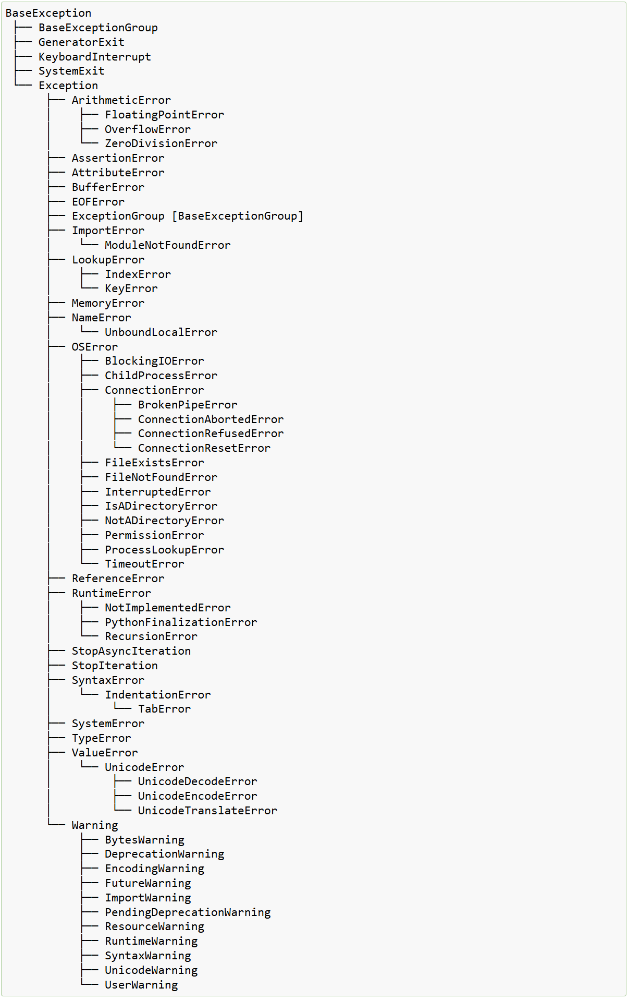
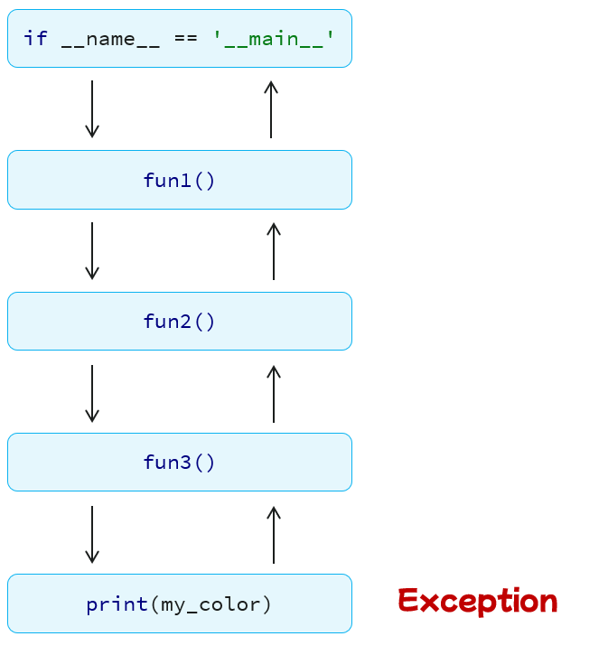
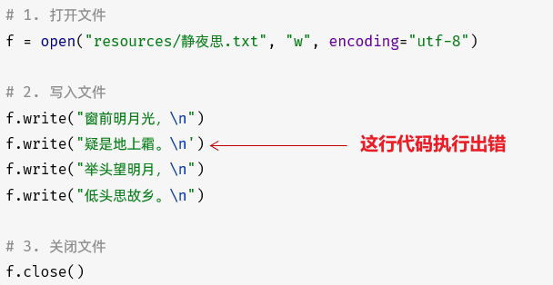

# 面向对象进阶

面向对象的三大特性：封装、继承、多态 。

## 封装

- **封装 **
  - 就是把数据(属性)和操作数据的函数(方法)捆绑在一起，形成一个独立的单元（类）
  - 隐藏内部的实现细节，只对外暴露必要的功能（方法）。

- **封装实现：**属性/方法前 使用** __**

- **特点：**私有的属性和方法只能在类中使用

- **好处：**提升数据的安全性

- 案例代码：

```python
class Person:
    def __init__(self,name:str,age:int,hobby:str):
        self.name = name
        self.__age = age
        self.hobby = hobby

    def __str__(self):
        return f"Person(姓名={self.name},年龄={self.__age},爱好={self.hobby})"

    def set_age(self,age):
        if age > 0 and age <= 150:
            self.__age = age

per1 = Person("张三",23,"抽烟喝酒烫头")
# print(per1.__age)

per1.set_age(10)

# print(per1._Person__age)

print(per1)
```

> [!tip] 🍀
> **提示：**
>
> - 我们在类中定义的私有属性、私有方法名，其实最终的属性名和方法名，被自动改写了，使我们不能通过原来的名字调用而已 。
> - Python 对以 双下划线 `__` 开头 的属性 / 方法，会自动执行 名称改写（name mangling）
>   - __属性名 → _类名__属性名
>   - __方法名 → _类名__方法名
>   - 实际的属性名、方法名规则为：`_类名 + 私有属性名/私有方法名`
>
>        比如：`_Car__owner`，`_Car__control_fuel()`

> [!tip] 提示
> **总结：**
>
> 1. **简单描述一下什么是封装?**
>   封装就是将数据（属性）及操作数据的方法绑定在一起，形成一个独立的类。
>
>      也可以将类中的属性，私有化，不让外界直接访问
>
> 1. **私有属性、方法与公共的有什么区别呢？该怎么定义？**
>    私有的只能在类的内部访问，在外部是无法访问的；
>
>           而公共的属性、方法在类的内部、外部都是可以访问的。
>
>    私有的属性和方法在命名的时候，均以 __ 作为开头。(Python中没有真正的私有机制)
> 1. **私有属性、方法的应用场景？**
>
> 如果某些属性和方法是不对使用者公开/有严格限制的，就可以将其设置为私有的。

## 继承


思考：有两个汽车类，`FuelCar油车类`、`ElectricCar电车类`。
          两个类中都有颜色、品牌属性

两个类中都有启动、行驶、停止的功能

```python
#燃油车
class FuelCar:
    def __init__(self, brand, model):
        self.brand = brand          # 品牌(公有属性)
        self.model = model          # 型号(公有属性)

    def start(self): # 启动
        print(f'{self.brand} {self.model} 正在启动...')

    def run(self): # 行驶
        print(f'{self.brand} {self.model} 正在行驶...')

    def stop(self): # 停止
        print(f'{self.brand} {self.model} 停止行驶...')

# 电车
class ElectricCar:
    def __init__(self, brand, model):
        self.brand = brand          # 品牌(公有属性)
        self.model = model          # 型号(公有属性)

    def start(self): # 启动
        print(f'{self.brand} {self.model} 正在启动...')

    def run(self): # 行驶
        print(f'{self.brand} {self.model} 正在行驶...')

    def stop(self): # 停止
        print(f'{self.brand} {self.model} 停止行驶...')
```

### 介绍及实现

- **继承：**使用结构  类A（类C）让两个类之间产生子父类的关系

- **特点：**子类继承父类，就可以获取到父类的属性和方法(非私有)

- **好处：**提高代码复用性、可维护性

**完整代码演示：**

```python
class Car:
    def __init__(self, brand, model):
        self.brand = brand      # 品牌
        self.model = model      # 型号
    

    def start(self):  # 启动
        print(f'{self.brand} {self.model} 正在启动...')

    def run(self):  # 行驶
        print(f'{self.brand} {self.model} 正在行驶...')

    def stop(self):  # 停止
        print(f'{self.brand} {self.model} 停止行驶...')

# 燃油车子类：继承父类Car，子类目前没有扩展，直接复用父类
class FuelCar(Car):
    pass

# 电车子类：继承父类Car，子类目前没有扩展，直接复用父类
class ElectricCar(Car):
    pass

if __name__ == '__main__':
    c1 = FuelCar("BMW", "X5")
    c1.start()
    c1.run()
    c1.stop()
    print(c1.brand)
    print(c1.model)

    c2 = ElectricCar("特斯拉", "Model3")
    c2.start()
    c2.run()
    c2.stop()
    print(c2.brand)
    print(c2.model)
```

```python
class Car:
    def __init__(self, brand, model):
        self.brand = brand      # 品牌
        self.model = model      # 型号
        self.__vin = "123456"

    def start(self):  # 启动
        print(f'{self.brand} {self.model} 正在启动...')

    def run(self):  # 行驶
        print(f'{self.brand} {self.model} 正在行驶...')

    def stop(self):  # 停止
        print(f'{self.brand} {self.model} 停止行驶...')

# 燃油车子类：继承父类Car，子类目前没有扩展，直接复用父类
class FuelCar(Car):
    def use_private(self):
        print(self.__vin)

# 电车子类：继承父类Car，子类目前没有扩展，直接复用父类
class ElectricCar(Car):
    def use_private(self):
        print(self.__vin)

if __name__ == '__main__':
    c1 = FuelCar("BMW", "X5")
    c1.use_private()

    c2 = ElectricCar("特斯拉", "Model3",)
    c2.use_private()
```

### 继承扩展

**案例：**

```python
#总结：两个子类都有的属性和方法，定义在父类中（定义一遍就行）
#     每一个子类特有的内容，定义在各自的子类中
#     将来给父类中继承的属性赋值时，调用父类的init方法来赋值
class Car:
    def __init__(self,color,brand):
        self.color = color
        self.brand = brand
    def start(self):
        print("汽车启动了")

class FuelCar(Car):
   #子类定义了__init__方法，父类的__init__方法就会被覆盖，
   #如果想要给父类中继承的属性赋值时，调用父类的init方法来赋值：super().__init__
   def __init__(self,color,brand,tank_size):
       super().__init__(color,brand)
       self.tank_size = tank_size

class ElectricCar(Car):
    def __init__(self,color,brand,battery_size):
        super().__init__(color,brand)
        self.battery_size = battery_size

if __name__ == '__main__':
    f = FuelCar("红色","宝马",100)
    print(f.brand)
    print(f.color)
    print(f.tank_size)
    
    e = ElectricCar("蓝色","BYD",1000)
    print(e.__dict__)
```

### 重写

- **重写 **是指子类继承父类后，如果父类中的方法不满足需求，可以在子类中重新定义父类中已有的方法（方法名相同），从而用子类的实现替换父类的实现。

- 语法：

```python
class Animal:
    def __init__(self,name,color):
        self.name = name
        self.color = color

    def eat(self):
        print("开始干饭~")

class Dog(Animal):
    def eat(self):
        # super().eat()
        # Animal.eat(self)
        print("开始吃狗粮~")

class Cat(Animal):
    def eat(self):
        print("开始吃鱼~")

d = Dog("小白狗","白色")
d.eat()
```

> [!warning] 警告
> 扩展：
> 如果在子类重写父类的方法时，需要调用父类的方法，可以通过 `父类名.方法名(self)` / `super().方法名()` 方式来调用。

> [!tip] 提示
> **总结：**
>
> 1. **什么是方法重写? 重写的语法?**
>   在继承体系中，如果父类的方法不能满足需求，就可以在子类中重新定义一个与父类同名的方法，从而用子类自己的实现来替换父类的实现，这个就称之为重写
> 1. **在子类中，如何调用父类中的方法？**
>   - 方式一：super().方法名()
>   - 方式二：父类名.方法名(self)

### 多继承

- **多继承 **指的是一个子类，同时继承了多个父类的情况（会将多个父类中的非私有的属性和方法都继承下来）。

- **语法：**

```python
class 子类名(父类名1, 父类名2, 父类名3, ...):
    代码
    ...
```

> [!warning] 警告
> 注意：继承的多个父类之间使用逗号分隔

- 案例代码：

1、现在有一个汽车类`Car`，里面维护的是汽车的基本信息

属性【*品牌brand 、型号model *】  方法:【行驶run】

2、还有一个是华为智驾类`HuaweiAiDriving`，里面维护的是华为智驾的基本信息

方法：智能驾驶

3、还有一个类就是问界汽车类 `WenJieCar`，问界汽车既具有汽车的属性和方法，也具有华为智驾的方法

```python
class Car:
    def __init__(self, brand, model):
        self.brand = brand
        self.model = model

    def run(self):
        print(f"{self.brand} {self.model} 正在公路上行驶")

    def sing(self):
        print("原生车载系统播放歌曲~")

class HuaweiAiDriving:
    def ai_drive(self):
        print("开启华为高阶智能驾驶，车辆自动行驶")

    def sing(self):
        print("智能系统播放歌曲~")

# 子类：问界汽车，多继承，同时继承两个父类
class WenJieCar(Car, HuaweiAiDriving):
    pass

if __name__ == '__main__':
    # 创建问界对象
    wj = WenJieCar("问界", "M9")

    # 使用来自Car父类的属性和方法
    print(wj.brand)
    print(wj.model)
    wj.run()

    # 使用来自HuaweiAiDriving父类的智驾方法
    wj.ai_drive()

    wj.sing()

    print(WenJieCar.mro())
    print(WenJieCar.__mro__)
    HuaweiAiDriving.sing(wj)
```

> [!danger] 
> - **注意：**
>   - 当一个类继承了多个父类时，默认优先使用第一个父类中的同名属性或方法，可以使用 `类名.__mro__ 属性` 或 `类名.mro()` 方法查看调用顺序。（**MRO **: Method Resolution Order(方法解析顺序)）
>   - 如果想要调用指定父类的方法,就使用父类名.方法名

## 多态

### 介绍

- **多态 **是指同一个父类方法，在不同的子类里重写后，呈现出不同的形态、行为、表现 。

- **语法**：使用父类的类型变量，可以接收子类的对象

- **好处：**提升方法的扩展性

```python
class Dog:
    def swimming(self):
        print("狗刨")

class Frog:
    def swimming(self):
        print("蛙泳")

def swimming_game1(d:Dog):
    print("开始进场")
    print("开始热身")
    print("比赛开始")
    d.swimming()
    print("比赛结束")
```

```python
class Animal:
    def swimming(self):
        print("游泳")

class Dog(Animal):
    def swimming(self):
        print("狗刨")

class Frog(Animal):
    def swimming(self):
        print("蛙泳")

def swimming_game1(d:Animal):
    print("开始进场")
    print("开始热身")
    print("比赛开始")
    d.swimming()
    print("比赛结束")

if __name__ == '__main__':
    swimming_game1(Dog())
    swimming_game1(Frog())
```

### 鸭子类型（Duck Typing）

- **鸭子类型(Duck Typing) **是指如果它走路像鸭子，叫起来叫鸭子，那么它就是鸭子。

- 在鸭子类型中，我们**关注**的是对象的**行为**（它有什么方法），而不是对象的类型（它是什么类）。

> [!tip] 提示
> **提示：**鸭子类型的优势是不需要存在继承关系，只要对象有相应的方法就能使用。

## 抽象类

- **抽象类 **是一种不能被实例化的模板类，里面可以有抽象方法（只有声明、没有实现的方法），子类必须重写（实现）所有的抽象方法，才可以使用。

- 核心作用：
  - 强制规范：规定子类必须实现哪些方法
  - 统一接口：让所有子类保持相同的调用方式
  - 使用抽象类后，忘记实现方法就无法创建对象，把错误提前到开发阶段发现。

> [!note] 🍀
> 可以把抽象类理解为一张蓝图或合同模板，它规定了子类必须完成的工作（抽象方法）。但它本身不完整，不能被直接用来创建对象，只有子类实现了抽象方法后，才可以创建子类对象。

- Python 没有专门的 `abstract` 关键字，而是用 `abc`** **模块（Abstract Base Classes）实现 。使用抽象类的两个核心：
  - `ABC`：抽象类的父类
  - `@abstractmethod`：python装饰器，标记抽象方法（直接将其加在方法上就可以了）

```python
from abc import abstractmethod, ABC

class BankCard(ABC):
    def __init__(self,ower,color,shape):
        self.ower = ower
        self.color = color
        self.shape = shape

    def __str__(self):
        return f"(卡主人={self.ower},颜色={self.color},形状={self.shape})"

    @abstractmethod
    def pay(self):
        pass

class JsBankCard(BankCard):
    def pay(self):
        print("建行卡支付~")

class MsBankCard(BankCard):
    def pay(self):
        print("民生银行卡支付~")

d = JsBankCard("张三","白色","圆形")
d.pay()
print(d)
```

# 异常

- **问题：**

思考：如果在系统的某个功能开发的时候，不小心出现了bug，系统整个挂掉了？合理吗？

## 介绍

- 异常：就是程序运行过程中出现的错误，它会中断程序的正常执行流程。

- 作用：
  - 保证数据、逻辑的正确性，避免程序执行混乱
  - 在开发阶段，尽量发现更多的问题，尽早解决问题，保障程序正常执行

- 样例：
```python
total = 20000
num = input("请输入取款金额: ")

print(f"您的银行卡余额为: {total - int(num)}")
print("请取出您的银行卡, 欢迎您下次光临")
```

> [!tip] 🍀
> **提示：异常不是坏东西，而是编写健壮程序的重要工具**

## 异常处理

### 基础

处理异常并不是让异常消失，而是需要将异常捕获到，然后根据捕获到的异常的情况，按照我们自己的处理方式，处理完异常，程序继续执行。（编写程序时，做好预案，出现异常后，按照预案处理）

- **捕获异常语法：**

```python
try：
    可能出现异常的业务代码1
    可能出现异常的业务代码2
    ...    
except 异常类型 as 变量名:
    出现异常时的预案
```

- 样例：

```python
#余额
total = 20000
#1、将可能会出现异常的代码定义在try中
#2、如果定义的代码没有出现异常，那么except中的内容不会执行
#3、如果定义的代码出现了异常，那么就会立即和except中定义的异常类型匹配，如果能匹配到，就按照定义的处理方案处理
#4、处理之后，后续的代码继续执行，程序不会直接挂掉
try:
    num = input("请输入取款金额: ")
    print(f"您的银行卡余额为: {total - int(num)}")
    print("请取出您的银行卡, 欢迎您下次光临")

    dict1 = {"name":"张三","age":23,"hobby":"学习"}
    print(dict1["height"])

except ValueError:
    print("你输入的金额必须为数值类型")

print("这段代码需要执行")
```

程序正常运行，except代码块中的代码不会运行。一旦程序运行出现错误，就会执行except中的异常处理逻辑，给用户提示出对应的错误信息。

```python
try:
    total = 20000
    num = input("请输入取款金额: ")
    print(f"您的银行卡余额为: {total - int(num)}")
    print("请取出您的银行卡, 欢迎您下次光临")

except ValueError as v:
    print("输入的取款金额有误, 必须为数字")
    print(f"具体的异常信息为:{v}")

print("程序结束")
```

如果我们需要获取到捕获到的异常的信息，可以捕获到异常后，在 `as` 后给异常起个别名，然后就可以获取到异常的信息。

### 进阶

**多异常类型匹配**

- 语法：

```python
try：
    可能出现异常的业务代码1
    可能出现异常的业务代码2
    ...
except 异常类型1 as 变量名:
    出现异常1时的预案
except 异常类型2 as 变量名:
    出现异常2时的预案
except 异常类型3 as 变量名:
    出现异常3时的预案
except 异常类型4 as 变量名:
    出现异常4时的预案
...
```

- 案例：

```python
#余额
total = 20000
#1、将可能会出现异常的代码定义在try中
#2、如果定义的代码没有出现异常，那么except中的内容不会执行
#3、如果定义的代码出现了异常，那么就会立即和except中定义的异常类型匹配，如果能匹配到，就按照定义的处理方案处理
#   处理之后，后续的代码继续执行，程序不会直接挂掉
#4、如果出现的异常类型和except中定义的异常类型不匹配，那么程序会直接挂掉

try:
    num = input("请输入取款金额: ")
    print(f"您的银行卡余额为: {total - int(num)}")
    print("请取出您的银行卡, 欢迎您下次光临")
    # dict1 = {"name":"张三","age":23,"hobby":"学习"}
    # print(dict1["height"])
    index = int(input("输入一个索引："))
    list1 = [1,2,3]
    print(list1[index])

#可以通过 as 给捕获到的异常对象起一个别名，方便后续使用
except KeyError as k:
    print("字典中不存在该key")
    print(k)
except ValueError:
    print("你输入的金额必须为数值类型")
except IndexError as i:
    print("你输入的索引不存在")
    print(i)

print("这段代码需要执行")
```

- **Python中的异常体系结构如下：**

官方文档：https://docs.python.org/zh-cn/3.14/library/exceptions.html



## 异常传递

- 异常传递就是异常在函数调用中层层上报的过程，直到有人处理它，或者程序崩溃。

- 演示：

```python
def fun1():
    print("fun1 ... running ...")
    fun2()

def fun2():
    print("fun2 ... running ...")
    fun3()

def fun3():
    print("fun3 ... running ...")

    total = 20000
    num = input("请输入取款金额: ")
    print(f"您的银行卡余额为: {total - int(num)}")

if __name__ == '__main__':
    fun1()
```



程序运行时，调用的是`fun1`函数，`fun1`中调用了`fun2`，`fun2`中调用了`fun3`，如果`fun3`函数体的逻辑运行出现异常，异常未被捕获处理，则会顺着调用链路，一层一层的往上抛 （`fun3` ---> `fun2` ---> `fun1` ---> 入口）。

# 文件操作

## 入门程序

- 操作文件分为三步操作：打开、读/写、关闭。

- **读操作**
  - 打开：f = open("文件地址" , "r" , encoding = "utf-8")
  - 读取：content = f.read()                【读取所有内容】

                content_list = f.readlines()    【读取所有行】

  -  关闭：f.close

比如我们，可以读取 目录下的  `望庐山瀑布.txt`文件，具体操作如下：

```python
# 读文件
# 1. 打开文件
f = open("望庐山瀑布.txt", "r", encoding="utf-8")

# 2. 读取文件内容
# content = f.read() # 读取所有内容
# print(content)

content_list = f.readlines() # 读取所有行
for line in content_list:
    print(line.strip())

# 3. 关闭文件
f.close()
```

> [!tip] 🍀
> - **"r"：**表示的是操作模式，r 代表 read ，表示读文件
> - **encoding：**表示的是文件的编码
> - **编码：**是将字符(文字、数字、符号)转换为计算机能够存储和处理的数字代码的规则系统，如：ASCII、GBK、UTF-8 。 
>   - ASCII：是最简单的西文编码方案，主要是针对于 数字、字母、常见符号 进行编码，无法对中文、韩文、日文等语言进行编码
>   - GBK：中国制定的一个汉字字符集编码标准，兼容ASCII，但是无法对 韩文、日文 进行编码
>   - **UTF-8：**目前互联网上最通用的字符编码标准，兼容 ASCII、全球通用，已经成为现代软件、网络和存储中最正确、最推荐的字符编码。

- **写文件：**
  - f = open("文件地址", "w", encoding="utf-8")
  - f.write(写入的内容)
  - f.close()

案例：将静夜思这首古诗，写入文件中，存储在 `resources` 目录下的 `静夜思.txt` 文件中，具体代码如下：

```python
# # 写文件
# 1. 打开文件
f = open("resources/静夜思.txt", "w", encoding="utf-8")

# 2. 写入文件内容
f.write("静夜思(李白)\n\n")
f.write("窗前明月光，\n")
f.write("疑是地上霜。\n")
f.write("举头望明月，\n")
f.write("低头思故乡。\n")

# 3. 关闭文件
f.close()
```

> [!danger] 
> **注意：**如果操作完文件，未调用close方法关闭文件，同时程序没有停止运行，那么这个文件将一直被Python程序占用，浪费系统资源 。

## 释放资源



**思考：**如果操作文件过程中，代码运行出现了异常，那后面的代码是无法继续执行的，也就意味着，关闭文件的代码也是无法运行的，这个文件并没有正确的关闭掉，那么此时这个文件将一直被该Python程序占用，无法操作。那怎么解决这个问题呢 ?

那其实呢，有两种方案都可以解决这个问题。

**方案一：**`try ... finally ...`** 【繁琐】**

```python
# 写文件
# 1. 打开文件
f = open("resources/静夜思.txt", "w", encoding="utf-8")

try:
    # 2. 写入文件内容
    f.write("静夜思(李白)\n\n")
    f.write("窗前明月光，\n")
    i = 1 / 0
    f.write("疑是地上霜。\n")
    f.write("举头望明月，\n")
    f.write("低头思故乡。\n")
finally:
    # 3. 关闭文件
    print("关闭文件")
    f.close()
```

`try...finally` 是一种异常处理结构，其中的 `finally` 子句用于定义 **无论是否发生异常，都会被执行** 的清理/资源释放代码。【finally 代码块必须跟在try之后，不能单独出现】

**方案二：with 上下文管理器 【推荐】**

`with` 上下文管理器，是 Python 中用于资源管理的语法糖，它能够自动处理资源的获取和释放，确保即使在发生异常的情况下，资源也能被正确清理。

语法：

```python
with 表达式 as 变量:
    代码块

# 可以同时管理多个资源
with 表达式1 as 变量1, 表达式2 as 变量2:
    代码块
```

样例：

```python
# 写文件
# 1. 打开文件
with open("resources/静夜思.txt", "w", encoding="utf-8") as f:
    # 2. 写入文件内容
    f.write("静夜思(李白)\n\n")
    f.write("窗前明月光，\n")
    f.write("疑是地上霜。\n")
    f.write("举头望明月，\n")
    f.write("低头思故乡。\n")
```

> [!tip] 🍀
> **语法糖：**就是编程语言中让代码写起来更简洁、更易读，但并没有增加新功能的便捷写法。（比如 +=，-=，推导式这些都是语法糖）
>
> i+=10

## 操作详解

- 文件路径的写法

- 操作模式

### 路径写法

关于文件路径写法，主要分为两类：

- **相对路径：** 从当前文件所在目录开始查找 **【推荐】**
  - `.` : 当前目录 ----> `./resources/望庐山瀑布.txt`   `./` 可以省略
  - `..`: 上一级目录 ----> `../第2章/file/寻隐者不遇.txt` ----> `../../第2章/file/寻隐者不遇.txt`

```python
# 读取文件
with open("../望庐山瀑布.txt", "r", encoding="utf-8") as f:
    content = f.read()
    print(content)

# 写文件
# a: append, 追加内容; w: write, 覆盖内容; ----> 文件不存在, 则创建文件;
with open("resources/静夜思.txt", "a", encoding="utf-8") as f:
    f.write("静夜思(李白)\n\n")
    f.write("窗前明月光，\n")
    f.write("疑是地上霜。\n")
    f.write("举头望明月，\n")
    f.write("低头思故乡。\n")
```

- **绝对路径：**从文件系统根目录开始查找, 文件位置的完整路径 (注意: 反斜杠 在字符串中表示的是转义字符, `\n` `\t`)
  - 方式一:  `D:\\Python-Project\\py_project01\\第3章\\resources\\望庐山瀑布.txt`
  - 方式二: `D:/Python-Project/py_project01/第3章/resources/望庐山瀑布.txt`

```python
# 读取文件
with open("D:\\Python-Project\\py_project01\\第3章\\resources\\望庐山瀑布.txt", "r", encoding="utf-8") as f:
    content = f.read()
    print(content)

# 写文件
# a: append, 追加内容; w: write, 覆盖内容; ----> 文件不存在, 则创建文件;
with open("D:/Python-Project/py_project01/第3章/resources/望庐山瀑布.txt", "a", encoding="utf-8") as f:
    f.write("静夜思(李白)\n\n")
    f.write("窗前明月光，\n")
    f.write("疑是地上霜。\n")
    f.write("举头望明月，\n")
    f.write("低头思故乡。\n")
```

> [!tip] 🍀
> **提示：**在项目开发中，推荐使用相对路径写法，可移植性更好、路径简洁、易于阅读 。

### 操作模式

关于文件的操作模式，常见的分为三种，分别是：

- `r`：只读的方式打开文件，指针放在文件的开头。（默认模式）

- `w`：只写入模式，从头编辑，原有内容会被删除；文件不存在则创建新文件

- `a`：追加模式，新内容会被追加在原有内容之后；文件不存在则创建新文件

```python
# 读取文件
# r: 只读的方式打开文件，指针放在文件的开头
with open("resources/望庐山瀑布.txt", "r", encoding="utf-8") as f:
    content = f.read()
    print(content)

# 写文件
# w: write, 写入模式, 从文件开头开始写入, 原有内容将会被删除; ----> 文件不存在, 则创建文件;
with open("resources/静夜思.txt", "w", encoding="utf-8") as f:
    f.write("静夜思(李白)\n\n")
    f.write("窗前明月光，\n")
    f.write("疑是地上霜。\n")
    f.write("举头望明月，\n")
    f.write("低头思故乡。\n")
    
# 写文件
# a: append, 追加模式, 新内容会被追加在原有内容之后; ----> 文件不存在, 则创建文件;
with open("resources/静夜思.txt", "a", encoding="utf-8") as f:
    f.write("静夜思(李白)\n\n")
    f.write("窗前明月光，\n")
    f.write("疑是地上霜。\n")
    f.write("举头望明月，\n")
    f.write("低头思故乡。\n")
```

## json操作

JSON是软件开发中最常用的数据交换格式，而为了简化JSON数据的处理，在Python标准库中就提供了处理JSON数据的核心模块 json。

我们可以基于json模块中提供的两个函数，来完成json数据的序列化（将字典dict/列表 转为json格式字符串，存入文件） 和 反序列化（将文件中的json格式字符串，转为字典dict/列表）。

- **序列化操作（**`json.dump(..)`**）：**
```json
{
    "name" : "张三",
    "age" : 23,
    "gender" : "男",
    "hobby" : [
        "reading",
        "swimming"
    ]
}
```

```python
import json

# 定义字典对象user
user = {
    "name": "涛哥",
    "age": 18,
    "gender": "男",
    "hobby": ["reading", "swimming"]
}

# 将user对象写入json数据文件
with open("resources/user.json", "w", encoding="utf-8") as f:
    # 
    # 
    json.dump(user, f, ensure_ascii=False, indent=2)
```

  - `ensure_ascii`: 默认为True, 确保所有的数据输出的数据都是ascii编码(非ASCII码会进行转义); False, 非ASCII码保留原样输出
  - `indent`: 会在输出的json数据中添加缩进(格式化)

- **反序列化操作（**`json.load(..)`**）：**
```python
import json

# 读取json数据文件
with open("resources/user.json", "r", encoding="utf-8") as f:
    user = json.load(f)
    print(user)
    print(type(user))
```