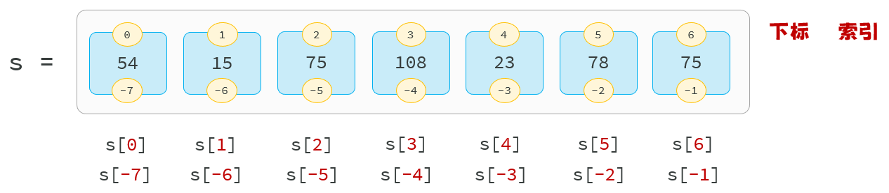
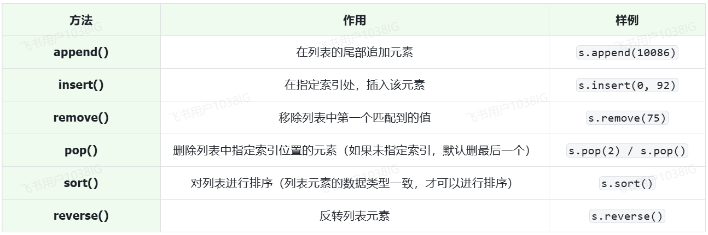
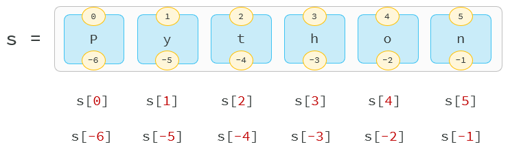
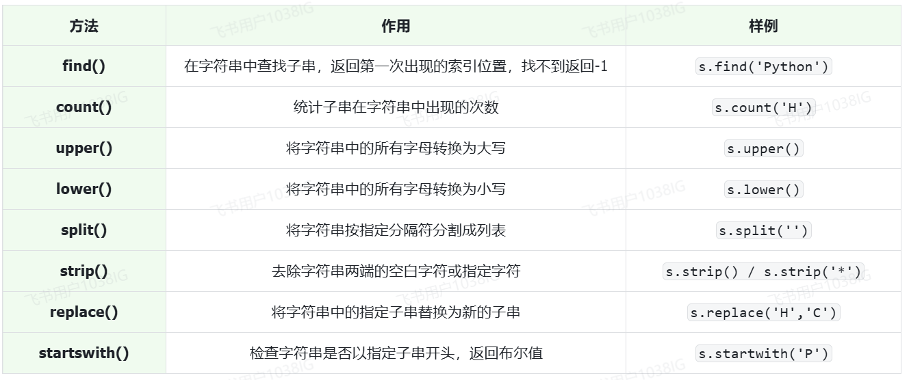
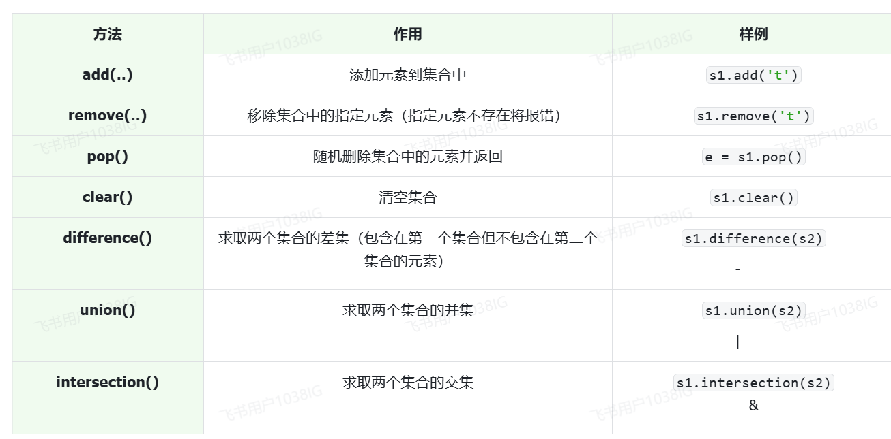
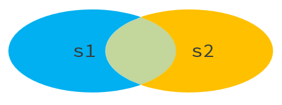
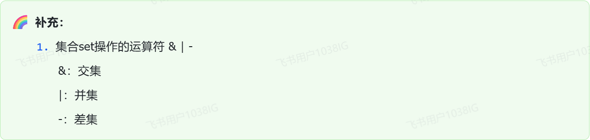
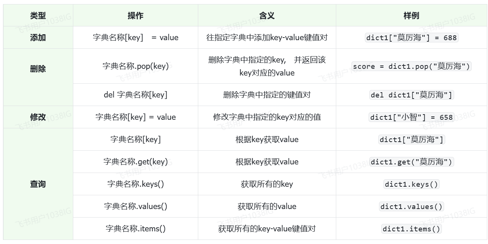
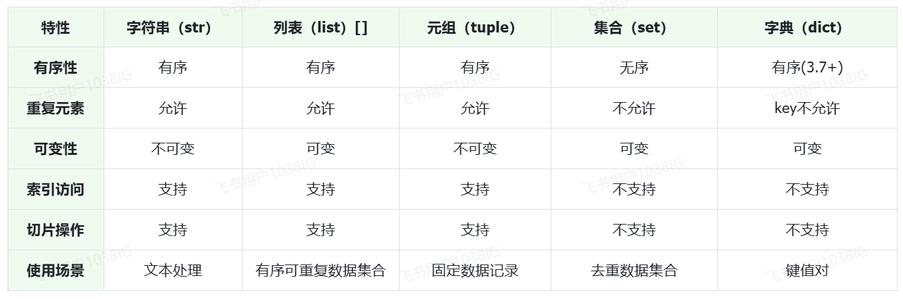

---
tags:
  - 数据容器
date: 2026-11-12
cover: false
title: "`i` 表示索引，`e` 表示遍历出来的元素、"
---
## 1. 五类数据容器

- 列表（list）
- 字符串（str）
- 元组（tuple）
- 集合（set）
- 字典（dict）

## 2. 列表


### 2.1 定义
	定义： `列表名称 = [``元素1``，``元素2``，``元素3``，``元素4``，``元素5``...]`

### 2.2 访问

使用索引访问


### 2.3 删除

语法：
``` python
del nemes[s索引]
```

### 2.4 特点

- 可以存储不同类型的元素【不推荐】
- 元素有序、可以重复、元素可以修改

### 2.5 遍历

两种方法：

``` python
for num in nums
	print(num)

# `i` 表示索引，`e` 表示遍历出来的元素、
# 需要获取索引的时候: 

for i,e in enumerate(list01)
	print(e)
	print(list01[i])
	
```


> [!NOTE] 注意
> 序列类型：容器中的元素按特定顺存储的、可通过索引访问并支持顺序遍历的容器类型称之为序列。


### 2.6 切片

#### 2.6.1 语法
``` python
容器名[开始索引:结束索引:步长]

"""
样例：
s = ["A", "C", "E", "B", "D"]
s[0:5]
s[-5:-1]
"""
```


#### 2.6.2 列表常见方法



| 方案      | 作用               | 样例        |
| ------- | ---------------- | --------- |
| count() | 获取某个元素在列表中的出现的次数 | s.count() |


#### 2.6.3 四个函数

> [!NOTE] 注意
> - `min()`：获取最小值
> - `max()`：获取最大值
> - `sum()`：求和
> - `len()`：获取元素的个数


### 2.7 合并列表

#### 2.7.1 两种方式

- 使用+合并
- 使用解包、组包操作合并
	- num_list = `[*num_list1, *num_list2]`

### 2.8 in 运算符

语法为：`元素 in 列表`。not in则相反，结果为布尔值

### 2.9 列表推导式

> [!NOTE] 注意
> 列表推导式：就是按照一定的规则<span style="color:#d83931">快速生成</span>一个列表的方法 
> - 语法格式1: 新列表 = [<span style="color:#d83931">要插入的值</span> for i in 容器]
> - 语法格式2: 新列表 = [要插入的值 for i in 容器 <span style="color:#d83931">if 条件表达式</span>]
> - 
> - 样例：
> - nwe_list01 = [i**2 for i in range(1,21)]
> - new_list02 = [i**2 for i in fange(1,21) if i % 2 == 0]

## 3. 字符串（str）

- 介绍：字符串是字符的容器，一个字符串中可以存放任意数量的字符 。

- 特点：不可变性（无法修改）、有序性、可迭代性 (遍历)。



- 切片：序列对象[<span style="color:#d83931">开始索引</span>:<span style="color:#d83931">结束索引</span>:<span style="color:#d83931">步长</span>]

### 3.1 常用方法



## 4. 元组（tuple）

- 介绍：元组是<span style="color:#d83931">不可变</span>的序列，类似于列表，但创建后不能修改。
    
- 特点：
    
    - 可以存储不同类型的元素
        
    - 元素可以重复、有序、<span style="color:#d83931">不可以修改 </span>(支持索引访问、切片)
        
- 定义：
``` python
元组名称 = (元素1，元素2，...) 
元组名称 = (元素1，) 
元组名称 = () 
元组名称 = tuple()

```
### 4.1 常用方法


| 方法           | 作用                                                     |
| ------------ | ------------------------------------------------------ |
| count()      | 统计某元素在元组中出现的<span style="color:#d83931">次数</span>            |
| index("abc") | 查找某个元素在元组中的<span style="color:#d83931">索引位置</span>(第一次出现的位置) |

### 4.2 注意事项

> [!NOTE] 注意
> 1. `t3 = (100)` 中的 `()` 是数学中的小括号，用于改变运算优先级，而不是元组的语法。
>     
> 2. 定义单元素元组时，需要在结尾加上<span style="color:#d83931">逗号</span>，比如 `('A',)`
>     
> 3. 记住这句口诀：逗号才是元组的灵魂，<span style="color:#d83931">括号只是礼貌的装饰</span>。
>     
> 4. 定义元组也可以写为： `t3 = 100`, ; `t3 = 100,200` (这里其实是元组组包的写法)
>         
> 5. 如果需要存储一批<span style="color:#d83931">固定不变</span>的数据，可以元组存储


### 4.3 组包与解包

```Python
# 定义元组, 组包
t1 = (5, 7, 9, 1)
list1 = [1，2，3，4，5]
# 定义元组, 组包
t2 = 5, 7, 9, 1

# 基础解包
a, b, c, d = t1

# (*)扩展解包
x, *y, z = t2   # x为5，y为[7, 9]，z为1
s, *o = t2      # s为5，o为[7, 9, 1]
*o, e = t2      # o为[5, 7, 9]，e为1
```

## 5. 集合（set）

- 介绍：集合(set)是一种无序的、不可重复、可修改的数据容器。

- 定义：
```Python
# 定义集合
s1 = {"C", "D", "X", "T", "O", "U","U"}


# 定义空集合
s2 = set()
```


> [!NOTE] 提示
> 空集合的定义不可以使用{}，{}表示的是<span style="color:#d83931">空字典；</span>


#### 5.1 常见方法

空集合的定义不可以使用{}，{}表示的是空字典；


### 5.2 图示



- s1与s2的差集，`s1.difference(s2)` 结果就是蓝色部分表示的元素；
    
- s1与s2的并集，`s1.union(s2)` 就是 蓝色部分 + 黄色部分 + 绿色部分 的元素。
    
- s1与s2的交集，`s1.intersection(s2)` 就是 绿色部分 的元素。


    


> [!NOTE] 总结
> 容器： 可以存储多个数据的变量
> 列表（list）: 有序、可重复、可修改、有索引、可切片
> 遍历方式
> 切片： [start：end：step]
> 字符串（str）: 有序、有索引、可以切片、<span style="color:#d83931">不可修改</span>、可以重复
> 元组（tuple）: 有序、有索引、可以切片、<span style="color:#d83931">不可修改</span>、可以重复
> 集合（set）: <span style="color:#d83931">无序、无索引、不可以切片、</span>可以修改、<span style="color:#d83931">不可重复</span>


## 6. 字典

### 6.1 定义

- 字典名称 = {key: value, key:value, key:value …}
- 字典名称 = {}
- 字典名称 = dict()

### 6.2 访问

- 获取 value ：字典名[key]
- 修改 value ：字典名[key] = 新value
- 添加键值对：字典名[key] = value


### 6.3 特点

- 元素有序
- 键（key）不会重复
- 键（key）的类型只能为 (int、float、str、bool、tuple)，<span style="color:#d83931">不能为可变类型</span>（set、list、dict）
- 值（value）可以重复，类型不限制
- 字典是<span style="color:#d83931">没有索引</span>下标的，不能根据索引获取值，只可以根据key获取value

### 6.4 常见操作




### 6.5 实践例子

#### get()方法
```python
dict1={"name":"张三","age":18,"sex":"男"}  
  
re = dict1.get("hobby","没有爱好")  
print(re)  
re2=dict1.get("age","没有年龄")  
print(re2)  
  
"""  
没有爱好  
18  
"""
```


## 7. 数据容器对比


<span style="color:#d83931">序列类型：</span>字符串（str）、列表（list）、元组（tuple）、range（range()函数返回值）

