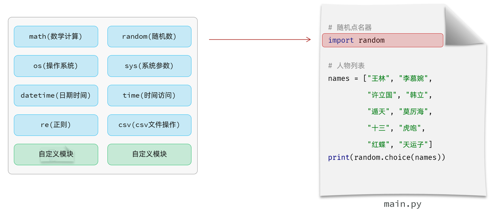
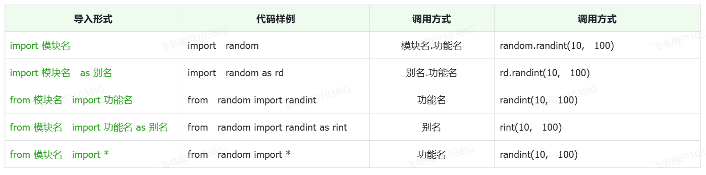
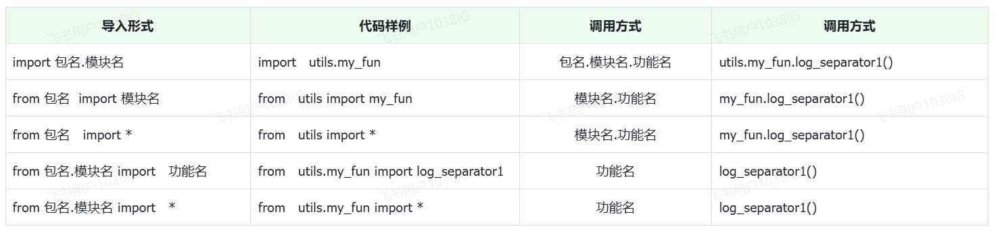

---
tags:
  - 模块
date: 2026-11-18
cover: false
title: "描述包信息"
---
### 模块入门

- Python模块(module)：一个.py文件就是一个模块，模块是Python程序的基本组织单位。在模块中可以定义变量、函数、类，以及可执行的代码。

- **分类**：
    - 自定义模块：开发人员自己创建的模块
    - 内置模块：官方定义的模块
      【`数学计算模块 math`、`随机数模块 random`、`操作系统模块 os`、`系统参数模块 sys` 、`日期时间模块 datetime`】
- **使用**：想要使用其他模块的内容，需要导入



#### 导入模块




## 模块进阶操作


### 自定义模块

每一个python文件都可以作为一个模块，模块的名字就是文件的名字
#### 自定义模块导入

`__all__`是一个模块级别的特殊变量，用于指定 `from 模块名 import *` 时会导入哪些功能

`__name__`表示当前模块的名字
- 在当前模块中运行：`__name__`的值为 "main"
- 在被导入模块中运行：`__name__`等于模块的文件名(不含.py后缀)
- 因此, 在被导入模块中,不想执行测试代码，就可以将测试代码放在if代码块中。
  `if __name__ == "main"`

## 软件包(package)

- 本质就是一个文件夹，该文件夹中可以包含若干python模块（.py文件）。

- 作用：模块文件较多时，用来管理多个模块。
- 在 `__init__.py` 文件中就可以描述这个包的基本信息，包括版本、作者、import * 时导入的是哪些模块等。
```Python
# 描述包信息
__version__ = "1.0.0"
__author__ = "黑马程序员"

__all__ = ["my_fun", "my_var"]
```


### 包的导入方式



> [!warning] 警告
>如果创建的是一个普通文件夹，其他包无法导入你的文件夹
>
>如果创建的是一个软件包，本质也是一个文件夹，但是可以实现导入操作
>
>**注意：**在通过 `from 包名 import *` 导入全部模块的时候，必须要在 `__init__.py` 文件中添加 `__all__=[]`，控制允许导入的模块列表 。


