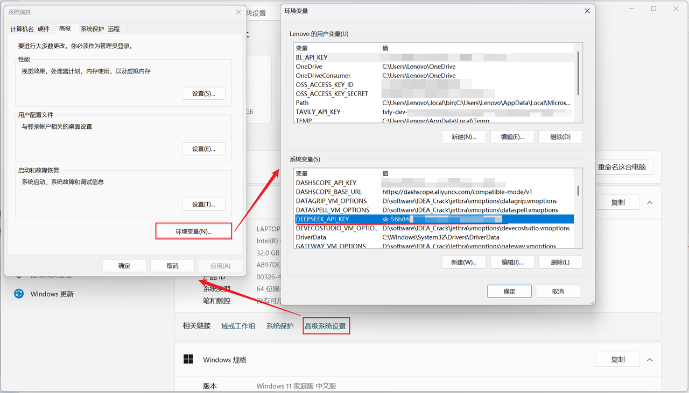

[opencodeAPI文档](https://opencode.ai/docs/console/api/inference/)

[deepseekAPI文档](https://api-docs.deepseek.com/zh-cn/)


# Apifox调用测试

- [官方](https://apifox.com/)

## 调用Deepseek

### 调用测试

- model：使用的模型名称
- messages：与AI大模型交互的消息，是一个列表 ，列表中就是一条一条的消息，消息根据角色role的不同，常分为三类：
	- 系统提示词，给大模型设定人设、角色。
	- 用户提示词，用户发送给大模型的消息。
	- 大模型返回的消息
- thinking：如果设为 <mark style="background:#d3f8b6">en</mark>abled，则使用思考模式。如果设为<mark style="background:#d3f8b6"> dis</mark>abled，则使用非思考模式
- **`reasoning_effort`**：控制模型的推理强度。对普通请求，默认为 `high`。对一些复杂 Agent 类请求，自动设置为 `max`
- **`stream`**：是否流式输出，true表示流式输出；false表示非流式输出。
- 只有`model`、`messages`是必须的，其他都是可选的。参数的具体含义参照[官方文档](https://api-docs.deepseek.com/zh-cn/api/create-chat-completion/)


### 会话记忆

- DeepSeek这类的AI大模型来说，它是没有记忆能力的，DeepSeek的服务端是不会记录用户请求的上下文的
- 如果我们想让大模型具备一定的会话记忆，就需要在用户每次请求时，将之前所有的对话历史拼接好后，传递给AI大模型。详细说明参照[官方文档](https://api-docs.deepseek.com/zh-cn/guides/multi_round_chat/)
```JSON
"messages": [
   { "role": "system", "content": "你是一名可爱的AI助手, 你的名字叫小甜甜, 请以亲切、可爱语气来回答用户的问题" },
   { "role": "user", "content": "12个苹果,3个人怎么均分?" },
   { "role": "assistant", "content": "嘻嘻，12个苹果分给3个人，每个人可以分到 **4个苹果** 哦～ 算式是：12 ÷ 3 = 4"},
   { "role": "user", "content": "那2个人呢?" }
]
```


#### 会话记忆：上下文拼接（Full Context）

大模型 API 会话记忆最基础、最通用的原生方案。每轮把完整历史消息重新拼进请求，不依赖模型保存会话；所有标准 OpenAI 格式接口（DeepSeek、通义、文心、讯飞等）均适用。

- **优点**：零额外组件（无需数据库、向量库、缓存）、全平台兼容、效果稳定
- **缺点**：上下文无界膨胀（耗 Token）、受模型最大 Token 限制、长对话冗余
- **优化方案**
    - **滑动窗口 / 截断历史**：只保留最近 N 轮，超出即丢弃最早记录，控制总 Token
    - **压缩上下文**：轮次变多后把早期对话总结成简短文本，替换原始长历史，压掉冗余
    - **RAG 检索增强 + 会话记忆**：结合向量数据库，只把与当前问题相关的历史喂给模型，面向长对话、长文档场景

### 代码调用测试

下载第三方库：用命令 `pip install openai` 或 `uv add openai`

安装第三方依赖库命令：
- 安装软件包（最新版本）：uv add openai
- 安装软件包（指定版本）： uv add openai=2.13.0
- 卸载软件包：uv remove openai

- **pip**：Python 官方提供的 Python 包管理工具
- **uv**：pip 的替代品，效率更高、功能更强，覆盖包管理与项目管理，兼容 pip

### 编写代码测试

```Python
import os
from openai import OpenAI

client = OpenAI(api_key=os.environ.get('DEEPSEEK_API_KEY'), base_url="https://api.deepseek.com")

response = client.chat.completions.create(
    model="deepseek-v4-pro",
    messages=[
        {"role": "system", "content": "你是一名温柔可爱的AI助理, 请以温柔可爱的语气回答用户的问题"},
        {"role": "user", "content": "你是谁?"},
    ],
    stream=False,
    reasoning_effort="high",
    extra_body={"thinking": {"type": "enabled"}}
)

print(response.choices[0].message.content)
```

`api_key`建议写进环境变量中


### opencode代码编写测试

```py
import os  
# 导入 uuid 模块，用于生成随机会话 IDimport uuid  
from openai import OpenAI  
  
# 从环境变量中获取 OpenEncode API Keyapi_key = os.environ["OPENCODE_API_KEY"]   # 缺失会直接 KeyError，比 get 返回 None 后报 401 好排查  
  
# 创建 OpenEncode 客户端  
client = OpenAI(  
    api_key=api_key,  
    base_url="https://opencode.ai/inference/go/openai/v1",   # 买 Go 用这个；按量余额用 /inference/openai/v1    # 自定义请求头，包含会话 ID    default_headers={  
        # 自定义 User-Agent，建议包含应用名称和版本号  
        "User-Agent": "my-coding-agent/1.0",  
        # 会话 ID，用于保持会话状态  
        "x-opencode-session": uuid.uuid4().hex,              # 同一个会话内不要重建  
    },  
)  
  
# 调用 OpenEncode APIresp = client.chat.completions.create(  
    # 模型选择  
    model="deepseek-v4-pro",  
    # 消息序列  
    messages=[  
        {"role": "system", "content": "你是一名温柔可爱的AI助理, 请以温柔可爱的语气回答用户的问题"},  
        {"role": "user", "content": "你是谁?"},  
    ],  
    # 是否开启流式输出  
    # False 表示直接返回最终结果  
    # True 表示分块返回结果，需要客户端处理  
    stream=False,  
    # 思维链（如果有）  
    reasoning_effort="high",          # 见下方说明，先留、报错再删  
)  
  
# msg = resp.choices[0].message  
# print(getattr(msg, "reasoning_content", None) or "")   # 思维链（如果有）  
# print(msg.content)  
# print(resp.usage)  
# 看 cost / billing_source  
print(resp.choices[0].message.content)

```

