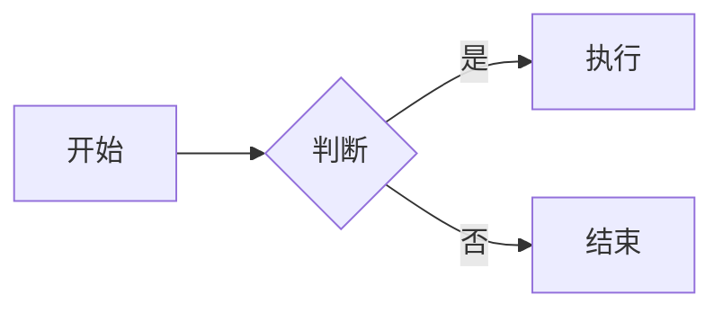
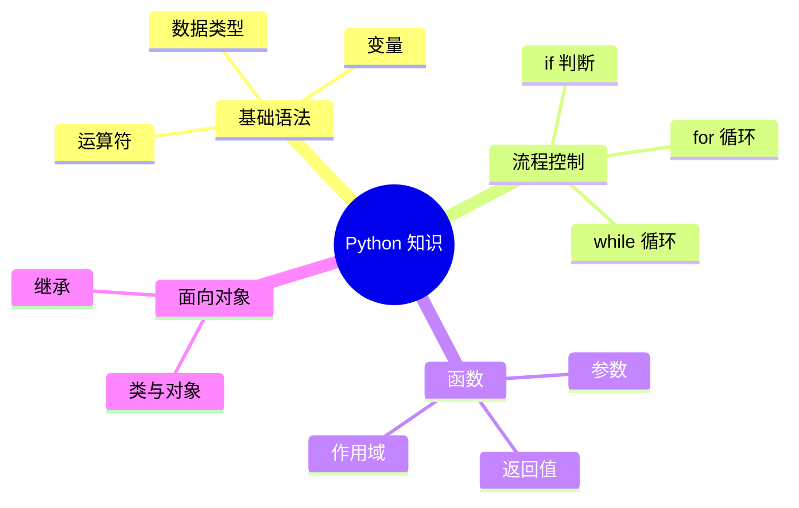
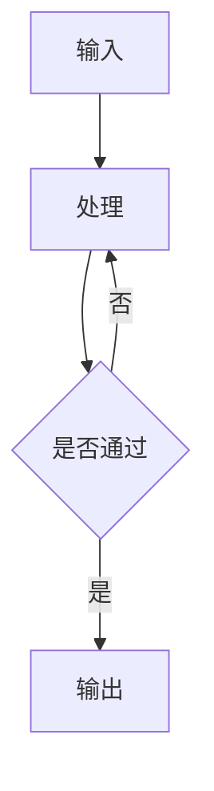
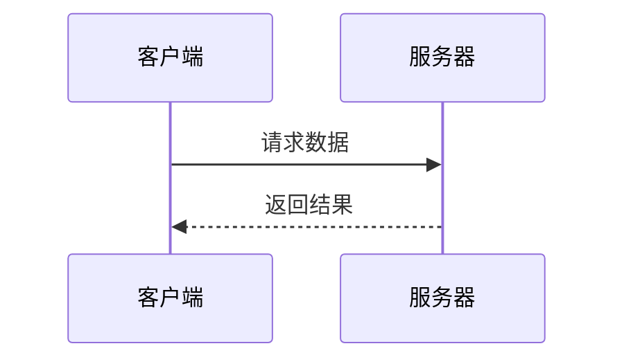
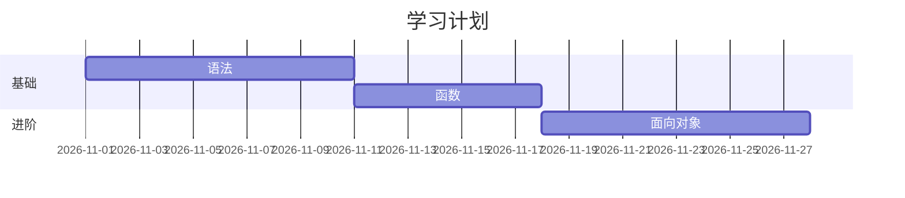
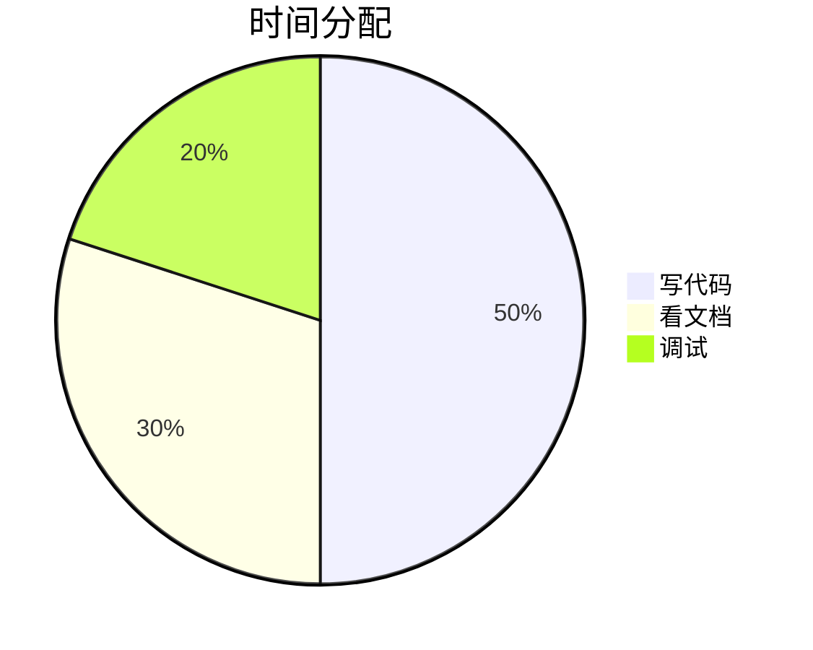

---
tags:
  - Mermaid
date: 2026-11-24
cover: false
title: "00-Mermaid"
---

# Mermaid 使用方法

> 为什么不写 `tags: 大纲笔记`：本目录其他笔记是纯列表，会被大纲插件抓成脑图；这份是说明文档，不参与转图。

Mermaid 是 Obsidian 内置的图表语法。代码块语言标记写 `mermaid` 就能渲染，不装插件、不增加加载时间。

## 一、基本用法

````markdown

````

规则只有三条：

1. 代码块语言标记必须是 `mermaid`
2. 第一行写图表类型（`graph`、`mindmap`、`sequenceDiagram`…）
3. 缩进用空格，全文统一（本文件统一 4 个空格）

## 二、思维导图 mindmap

`mindmap` 靠缩进表达层级，是 Mermaid 里最适合知识梳理的图。



````markdown

````

### 节点形状

| 写法 | 效果 |
|---|---|
| `root((文字))` | 圆形 |
| `root[文字]` | 方形 |
| `root(文字)` | 圆角矩形 |
| `root))文字((` | 爆炸形 |
| `root)文字(` | 云形 |
| `root&#123;&#123;文字}}` | 六边形 |

不写形状就是普通节点。

### 三个必须避开的坑

1. **缩进不一致直接报错**。同一个父节点下的兄弟节点，缩进必须完全一样。层级建议只用 2 或 4 个空格，别混用。
2. **节点文字里的括号、冒号要小心**。`()` `[]` `{}` 是形状语法，文字里真需要就先加引号：`"（示例）"`。
3. **mindmap 需要 Obsidian 1.5 以上**。版本太旧会渲染失败，先确认版本。

## 三、其他常用图

### 流程图



````markdown

````

### 时序图



````markdown

````

### 甘特图（学习计划）



````markdown

````

### 饼图


````markdown

````

## 四、和本目录其他文件的关系

| 方式 | 文件 | 特点 |
|---|---|---|
| Mermaid | 本文件里的代码块 | 文本即图，改笔记等于改图，零加载 |
| Excalidraw | `01-基础知识.excalidraw.md` 等 | 手绘风，能拖动，加载稍重 |
| 大纲列表 | `01-基础知识.md` 等 | 纯列表，配合大纲插件出脑图 |

三者可以共存：先用 Mermaid 快速梳理结构，需要精细排版时再转 Excalidraw。

Excalidraw 插件支持把 Mermaid 代码粘贴进去生成图形（Excalidraw 工具栏 → Mermaid 导入），相当于「文本稿 → 手绘图」的通道。

## 五、常见问题

| 现象 | 原因 | 解决 |
|---|---|---|
| 显示成灰色代码 | 语言标记写错，如 `mermiad`、`mmd` | 改成 `mermaid` |
| 整块报错 | 缩进混用 tab 和空格 | 全部换成空格 |
| 节点文字被截断 | 文字含 `()` `[]` 等符号 | 用引号包住整个文字 |
| 图太大看不清 | 节点过多 | 拆成多张图，一张不超过三层 |
| 想导出图片 | Mermaid 不直接导出 | 截图，或先转 Excalidraw |

## 六、推荐用法

- 每学完一章，新建一个 `mermaid` 代码块，把知识点缩进进去，控制在三层内。
- 结构稳定、需要讲给别人听时，再转成 Excalidraw 精修。
- 不要一上来就画大图，先写文字大纲，确认层级对了再改成 `mindmap`。
