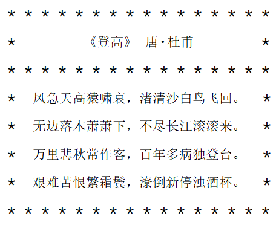

# day01 作业

## 作业一：控制台输出

### 1.1 输出一首古诗（8 行） ✅


> [!question]- 题目
> **需求1：**在控制台中输出一首古诗，分为8行输出，其最终输出的形式为：
> 
> 

- [x] **我的答案**

> [!example]- 我的答案
> ```python
> print("* * * * * * * * * * * * * * * *")
> print("*       《登高》唐·杜甫         *")
> print("* * * * * * * * * * * * * * * *")
> print("* 风急天高猿啸哀，渚清沙白鸟飞回。 *")
> print("* 无边落木萧萧下，不尽长江滚滚来。 *")
> print("* 万里悲秋常作客，百年多病独登台。 *")
> print("* 艰难苦恨繁霜鬓，潦倒新停浊酒杯。 *")
> print("* * * * * * * * * * * * * * * *")
> ```

> [!success]- 参考答案
> ```python
> # 需求1：在控制台中输出一首古诗，分为8行输出
> print("* * * * * * * * * * * * * * * * ")
> print("*       《登高》 唐・杜甫        * ")
> print("* * * * * * * * * * * * * * * * ")
> print("*  风急天高猿啸哀，渚清沙白鸟飞回。  * ")
> print("*  无边落木萧萧下，不尽长江滚滚来。  * ")
> print("*  万里悲秋常作客，百年多病独登台。  * ")
> print("*  艰难苦恨繁霜鬓，潦倒新停浊酒杯。  * ")
> print("* * * * * * * * * * * * * * * * ")
> ```

**批改**

✅ 正确

实际输出 8 行，形式和需求一致。
小提示：中文按 2 列宽显示，横线 31 列、诗句行 36 列，右侧 `*` 不在同一列；想让方框整齐，可以按显示宽度补空格。

### 1.2 用字符串语法打印带换行与缩进的内容 ✅


> [!question]- 题目
> **需求2：**使用字符串语法，打印如下格式内容（保留换行、制表缩进效果）：
> 
> ```python
> 名言:
>   人生苦短，我用"Python"
> ```

- [x] **我的答案**

> [!example]- 我的答案
> ```python
> print("名言:\n    人生苦短，我用\"Python\"")
> ```

> [!success]- 参考答案
> ```python
> # 需求2：使用字符串语法，打印如下格式内容（保留换行、制表缩进效果
> print("""
> 名言:
>   人生苦短，我用"Python"
> """)
> ```

**批改**

✅ 正确

`\n` 换行、缩进、`\"` 转义都生效，输出就是需求里的两行。

## 作业二：变量交换 ✅


> [!question]- 题目
> 现有三个变量，分别为：a=100，b = 200，c = 300，现需要将这三个变量值进行交换，将a, b, c的值分别赋值给c, a, b，并将其输出到控制台 ，最终a 的值为 200，b 的值为 300，c 的值为 100 。

- [x] **我的答案**

> [!example]- 我的答案
> ```python
> a=100  
> b=200  
> c=300  
>   
> temp=a  
> a=b  
> b=c  
> c=temp  
>   
> print(f"a:{a}")  
> print(f"b:{b}")  
> print(f"c:{c}")
> ```

> [!success]- 参考答案
> ```python
> # 需求3: 现有三个变量，分别为：a=100，b = 200，c = 300，现需要将这三个变量值进行交换，将a, b, c的值分别赋值给c, a, b，并将其输出到控制台 ，最终a 的值为 200，b 的值为 300，c 的值为 100 。
> a = 100
> b = 200
> c = 300
>
> temp = c
> c = a
> a = b
> b = temp
>
> print("a = ", a, ", b = ", b, ", c = ", c)
> ```

**批改**

✅ 正确

输出 a:200、b:300、c:100，用临时变量中转，赋值顺序没互相覆盖。

## 作业三：实现计算器功能 ✅


> [!question]- 题目
> **需求：**根据用户输入的两个数字，计算两个数相加、相减、相除、相乘的结果，并将其输出到控制台。

- [x] **我的答案**

> [!example]- 我的答案
> ```python
> """  
> 需求：根据用户输入的两个数字，计算两个数相加、相减、相除、相乘的结果，并将其输出到控制台。  
> """  
> a=int(input("请输入第一个数字:\n"))  
> b=int(input("请输入第二个数字:\n"))  
>   
> print("a+b=",a+b)  
> print("a-b=",a-b)  
> print("a*b=",a*b)  
> print("a/b=",a/b)
> ```

> [!success]- 参考答案
> ```python
> # 需求4：根据用户输入的两个数字，计算两个数相加、相减、相除、相乘的结果，并将其输出到控制台。
> num1 = int(input("请输入第一个数字: "))
> num2 = int(input("请输入第二个数字: "))
>
> print(f"两个数字相加的结果为: {num1 + num2}")
> print(f"两个数字相减的结果为: {num1 - num2}")
> print(f"两个数字相乘的结果为: {num1 * num2}")
> print(f"两个数字相除的结果为: {num1 / num2}")
> ```

**批改**

✅ 正确

输入 10 和 4，输出 14 / 6 / 40 / 2.5，四则运算都对。
小提示：`int()` 只收整数，输入 7.5 会报 `ValueError: invalid literal for int() with base 10: '7.5'`；需求说的是"两个数字"，用 `float()` 更稳。另外第二个数输入 0 时 `a/b` 会 ZeroDivisionError。

## 作业四：运算符练习

### 4.1 计算梯形面积 ✅


> [!question]- 题目
> - **需求1：**要求输入梯形的上底、下底、高，然后计算梯形的面积

- [x] **我的答案**

> [!example]- 我的答案
> ```python
> """  
> 需求1：要求输入梯形的上底、下底、高，然后计算梯形的面积  
> 需求2：要求输入圆的半径，然后计算圆的周长和面积(周长：2πr，面积：πr²)  
> 需求3：身体质量指数BMI的计算（BMI = 体重(kg)／身高(m)²)  
>         a． 输入体重(单位kg)  
>         b． 输入身高(单位m)  
>         c． 计算身体质量指数BMI并输出  
> 需求4：输入一个秒数，把它转换成小时+分钟+秒输出。例如输入 130→输出：0小时 2分10秒  
> 需求5：输入苹果单价、购买重量，计算总价，并输出一句话：“苹果单价X元，购买X斤，总价X元”  
> 需求6：输入语文、数学、英语三科成绩，计算总分和平均分，并输出。  
> 需求7：接收用户输入一个整数，判断该数字是否大于10并且小于50，打印最终判断结果（True/False）。  
> 需求8：接收用户输入一个整数，判断该数字是否小于等于10或者大于等于50，打印最终判断结果（如果满  
> 足条件输出True，不满足输出False）。  
> 需求9：输入语文、数学成绩，判断是否至少有一科分数大于90 分，输出结果（如果有输出True，没有输出  
> False)。  
> 需求10:  
>     模拟成绩统计与评优：  
>         i．输入姓名、语文成绩、英语成绩；  
>         ii． 计算两科总分与平均分;  
>         iii． 评优规则：两科分数都大于 85 分 或者 总分大于 180 分，评为优秀；  
>         iv．输出结果：姓名、总分、平均分、是否评为优秀。具体格式为： 姓名：王林，总分：192，平均分：  
>         96，是否评为优秀：True  
> """  
> from functools import total_ordering  
> # print("=========================================")  
> # # 需求1：要求输入梯形的上底、下底、高，然后计算梯形的面积  
> # print("需求1")  
> # shangdi=float(input("请输入梯形的上底:\n"))  
> # xiadi=float(input("请输入梯形的下底:\n"))  
> # gao=float(input("请输入梯形的高:\n"))  
> #  
> # print("梯形的面积为: %s"%((shangdi+xiadi)*gao*0.5))  
> ```

> [!success]- 参考答案
> ```python
> # 需求5：要求输入梯形的上底、下底、高，然后计算梯形的面积
> base1 = float(input("请输入梯形的上底: "))
> base2 = float(input("请输入梯形的下底: "))
> height = float(input("请输入梯形的高: "))
>
> print(f"梯形的面积是: {(base1 + base2) * height / 2}")
> ```

**批改**

✅ 正确

(3+5)×4×0.5 = 16.0，梯形面积公式对。
注意：这段代码在文件里是**注释状态**（每行前面都有 `#`），我是取消注释后才测的，恢复注释后自己跑一遍确认。另外第 191 行 `from functools import total_ordering` 是没用到的导入，可以删掉。

### 4.2 计算圆的周长和面积 ❌


> [!question]- 题目
> - **需求2：**要求输入圆的半径，然后计算圆的周长和面积 (周长: 2πr，面积：πr²)

- [x] **我的答案**

> [!example]- 我的答案
> ```python
> # print("=========================================")  
> # # 需求2：要求输入圆的半径，然后计算圆的周长和面积(周长：2πr，面积：πr²)  
> # print("需求2")  
> #  
> # PI=3.1415926  
> # r=float(input("请输入圆的半径:\n"))  
> # print(f"圆的面积为: {PI*r*r}\n圆的周长为: {2*PI*r}")  
> ```

> [!success]- 参考答案
> ```python
> # 需求6: 要求输入圆的半径，然后计算圆的周长和面积 (周长: 2πr，面积：πr²)
> radius = float(input("请输入圆的半径: "))
> print(f"圆的周长为: {2 * 3.14 * radius}")
> print(f"圆的面积为: {3.14 * radius ** 2}")
> ```

**批改**

- [ ] ❌ 有问题(已改)

- 错在哪：第一个 f-string 里算的是 `PI*r*r`（面积），标签却写成了"圆的周长为"，两行都叫周长。
- 正确写法：

```python
print(f"圆的面积为: {PI*r*r}\n圆的周长为: {2*PI*r}")
```

- 原因：r=2 时两行都输出 12.5663704，从结果完全看不出哪个是面积。

另外这段代码是注释状态，我是取消注释后测的。

### 4.3 计算 BMI 身体质量指数 ❌


> [!question]- 题目
> - **需求3：**身体质量指数BMI的计算（BMI = 体重(kg) / 身高(m)²）
>   1. 输入体重(单位kg)
>   2. 输入身高(单位m)
>   3. 计算身体质量指数BMI并输出

- [x] **我的答案**

> [!example]- 我的答案
> ```python
> # print("=========================================")  
> # 需求3：身体质量指数BMI的计算（BMI = 体重(kg)／身高(m)²)  
> # Weight, Height  
> # print("需求3")  
> #  
> # weight=float(input("请输入你的体重(单位kg):\n"))  
> # height=float(input("请输入你的身高(单位m):\n"))  
> #  
> # BMI=weight/height **2  
> #  
> # print(f"你的BMI指数为: {BMI}")  
> ```

> [!success]- 参考答案
> ```python
> # 需求7：身体质量指数BMI的计算（BMI = 体重(kg) / 身高(m)²）
> #   1. 输入体重(单位kg)
> #   2. 输入身高(单位m)
> #   3. 计算身体质量指数BMI并输出
> weight = float(input("请输入体重(单位kg): "))
> height = float(input("请输入身高(单位m): "))
> print(f"BMI为: {weight / height ** 2}")
> ```

**批改**

- [ ] ❌ 有问题(已改)

- 错在哪：`BMI=weight/height` 漏了平方，公式是 BMI = 体重 ÷ 身高²。
- 正确写法：

```python
BMI = weight / height ** 2
```

- 原因：70kg、1.75m 时正确答案是 22.86，你算出来 40.0，一个正常一个肥胖。

另外这段代码是注释状态，我是取消注释后测的。

### 4.4 秒数转换为时分秒 ✅


> [!question]- 题目
> - **需求4：** 输入一个秒数，把它转换成小时 + 分钟 + 秒输出。 例如输入 130 → 输出：0 小时 2 分 10 秒

- [x] **我的答案**

> [!example]- 我的答案
> ```python
> # # print("=========================================")  
> # # 需求4：输入一个秒数，把它转换成小时+分钟+秒输出。例如输入 130→输出：0小时 2分10秒  
> # # Hours, Minutes, Seconds  
> # print("需求4")  
> # seconds=int(input("请输入一个秒数:\n"))  
> # """  
> # 一分钟60s  
> # 一小时3600s  
> # """  
> # Hours=seconds//3600  
> # Minutes=seconds//60%60  
> # seconds=seconds%60  
> #  
> # print(f"{Hours}时{Minutes}分{seconds}秒")  
> ```

> [!success]- 参考答案
> ```python
> # 需求8： 输入一个秒数，把它转换成小时 + 分钟 + 秒输出。 例如输入 130 → 输出：0 小时 2 分 10 秒
> second = int(input("请输入秒数: "))
> print(f"{second // 3600} 小时 {(second % 3600) // 60} 分钟 {(second % 3600) % 60} 秒")
> ```

**批改**

✅ 正确

130 → 0时2分10秒，3661 → 1时1分1秒，`//3600`、`//60%60`、`%60` 的组合没问题（注释状态，取消注释后已验证）。

### 4.5 计算苹果总价 ✅


> [!question]- 题目
> - **需求5：** 输入苹果单价、购买重量，计算总价，并输出一句话： “苹果单价 X 元，购买 X 斤，总价 X 元”

- [x] **我的答案**

> [!example]- 我的答案
> ```python
> # # print("=========================================")  
> # # 需求5：输入苹果单价、购买重量，计算总价，并输出一句话：“苹果单价X元，购买X斤，总价X元”  
> #  
> # # 苹果,单价,重量,价格  
> # # Apple, unit price, weight, price  
> #  
> # apple_unit=float(input("请输入苹果单价:\n"))  
> # weight=float(input("请输入购入重量:\n"))  
> #  
> # # Total 总计  
> #  
> # total_price=apple_unit*weight  
> #  
> # print(f"苹果单价:{apple_unit}元,购买{weight}斤,总价{total_price}元")  
> ```

> [!success]- 参考答案
> ```python
> # 需求9: 输入苹果单价、购买重量，计算总价，并输出一句话： “苹果单价 X 元，购买 X 斤，总价 X 元”
> price = float(input("请输入苹果单价: "))
> weight = float(input("请输入苹果重量: "))
>
> print(f"苹果单价 {price} 元，购买 {weight} 斤，总价 {price * weight} 元")
> ```

**批改**

✅ 正确

单价 5、重量 2，输出总价 10.0 元，句子格式和需求一致（注释状态）。

### 4.6 计算三科总分与平均分 ✅


> [!question]- 题目
> - **需求6：**输入语文、数学、英语三科成绩，计算总分和平均分，并输出。

- [x] **我的答案**

> [!example]- 我的答案
> ```python
> # print("=========================================")  
> # 需求6：输入语文、数学、英语三科成绩，计算总分和平均分，并输出。  
>   
> # 语文,数学,英语,总分,平均分  
> # Chinese, Mathematics, English, Total Score, Average Score  
>   
> # chinese=float(input("请输入你的语文成绩:\n"))  
> # mathematics=float(input("请输入你的数学成绩:\n"))  
> # english=float(input("请输入你的英语成绩:\n"))  
> #  
> # total_score=chinese+mathematics+english  
> #  
> # average_score=total_score/3  
> #  
> # print(f"你的总分为:{total_score},平均分为:{average_score}")  
> ```

> [!success]- 参考答案
> ```python
> # 需求10: 输入语文、数学、英语三科成绩，计算总分和平均分，并输出。
> chinese = int(input("请输入语文成绩: "))
> math = int(input("请输入数学成绩: "))
> english = int(input("请输入英语成绩: "))
>
> print(f"总分: {chinese + math + english}，平均分: {(chinese + math + english) / 3}")
> ```

**批改**

✅ 正确

90+95+88 = 273.0，平均 91.0，总分和平均分都对（注释状态）。

### 4.7 判断数字是否大于 10 且小于 50 ✅


> [!question]- 题目
> - **需求7：**接收用户输入一个整数，判断该数字是否大于 10 并且 小于 50，打印最终判断结果（True/False）。

- [x] **我的答案**

> [!example]- 我的答案
> ```python
> # print("=========================================")  
> # # 需求7：接收用户输入一个整数，判断该数字是否大于10并且小于50，  
> # #       打印最终判断结果（True/False）。  
> # enter_int=int(input("请输入一个人整数:\n"))  
> #  
> # print(f"结果为:{(enter_int> 10) and (enter_int<50)}")  
> ```

> [!success]- 参考答案
> ```python
> # 需求11：接收用户输入一个整数，判断该数字是否大于 10 并且 小于 50，打印最终判断结果（True/False）。
> num = int(input("请输入一个整数: "))
> print(f"{num} 是大于 10 并且 小于 50的吗?  {num > 10 and num < 50}")
> ```

**批改**

✅ 正确

输入 30 → True，输入 5 → False，`and` 两侧都加了括号，读起来清楚（注释状态）。

### 4.8 判断数字是否小于等于 10 或大于等于 50 ✅


> [!question]- 题目
> - **需求8：**接收用户输入一个整数，判断该数字是否小于等于 10 或者 大于等于 50，打印最终判断结果（如果满足条件输出True，不满足输出False）。

- [x] **我的答案**

> [!example]- 我的答案
> ```python
> # print("=========================================")  
> # 需求8：接收用户输入一个整数，判断该数字是否小于等于10或者大于等于50，  
> #       打印最终判断结果（如果满足条件输出True，不满足输出False）。  
> # enter_int = int(input("请输入一个整数:\n"))  
> #  
> # print(f"结果为:{(enter_int<= 10) or (enter_int>=50)}")  
> ```

> [!success]- 参考答案
> ```python
> # 需求12：接收用户输入一个整数，判断该数字是否小于等于 10 或者 大于等于 50，打印最终判断结果（如果满足条件输出True，不满足输出False）。
> num = int(input("请输入一个整数: "))
> print(f"{num} 是小于等于 10 或者 大于等于 50的吗? {num <= 10 or num >= 50}")
> ```

**批改**

✅ 正确

输入 5 → True，输入 30 → False，`or` 条件写对了（注释状态）。

### 4.9 判断是否至少有一科大于 90 分 ✅


> [!question]- 题目
> - **需求9：** 输入语文、数学成绩，判断是否至少有一科分数大于 90 分，输出结果（如果有输出True，没有输出False）。

- [x] **我的答案**

> [!example]- 我的答案
> ```python
> # 需求9：输入语文、数学成绩，判断是否至少有一科分数大于90 分，\  
> #       输出结果（如果有输出True，没有输出False)。  
>   
> # chinese=float(input("请输入你的语文成绩:\n"))  
> # mathematics=float(input("请输入你的数学成绩:\n"))  
> #  
> # print(f"结果为{chinese>90 or mathematics>90}")  
> ```

> [!success]- 参考答案
> ```python
> # 需求13： 输入语文、数学成绩，判断是否至少有一科分数大于 90 分，输出结果（如果有输出True，没有输出False）。
> chinese = int(input("请输入语文成绩: "))
> math = int(input("请输入数学成绩: "))
>
> print(f"至少有一科分数大于 90 分吗? {chinese > 90 or math > 90}")
> ```

**批改**

✅ 正确

95、80 → True；80、80 → False。判断"至少一科"用 `or` 正确（注释状态）。
小提示：第 473 行注释末尾的 `\` 在注释里没有续行作用，不影响运行，不用管。

### 4.10 成绩统计与评优 ✅


> [!question]- 题目
> - **需求10：**
>   - 模拟成绩统计与评优：
>     1. 输入姓名、语文成绩、英语成绩；
>     2. 计算两科总分与平均分；
>     3. 评优规则：两科分数都大于 85 分 或者 总分大于 180 分，评为优秀；
>     4. 输出结果：姓名、总分、平均分、是否评为优秀 。 具体格式为：`姓名：王林，总分：192，平均分：96，是否评为优秀：True`

- [x] **我的答案**

> [!example]- 我的答案
> ```python
> # print("=========================================")  
> # 需求10:  
> #     模拟成绩统计与评优：  
> #         i．输入姓名、语文成绩、英语成绩；  
> #         ii． 计算两科总分与平均分;  
> #         iii． 评优规则：两科分数都大于 85 分 或者 总分大于 180 分，评为优秀；  
> #         iv．输出结果：姓名、总分、平均分、是否评为优秀。具体格式为： 姓名：王林，  
> #         总分：192，平均分：96，是否评为优秀：True  
> name = input("请输入你的姓名:\n")  
> chinese=float(input("请输入你的语文成绩:\n"))  
> english=float(input("请输入你的英语成绩:\n"))  
>   
> total_score=chinese+english  
> average_score=total_score/2  
>   
> print("True为优秀,False为不优秀")  
> print((chinese>85 and english>85) or (total_score>180))  
> print(f"姓名:{name},总分:{total_score},平均分:{average_score},是否评为优秀:{(chinese>85 and english>85) or (total_score>180)}")
> ```

> [!success]- 参考答案
> ```python
> # 需求14: 模拟成绩统计与评优：
> #     1. 输入姓名、语文成绩、英语成绩；
> #     2. 计算两科总分与平均分；
> #     3. 评优规则：两科分数都大于 85 分 或者 总分大于 180 分，评为优秀；
> #     4. 输出结果：姓名、总分、平均分、是否评为优秀 。 具体格式为：姓名：王林，总分：192，平均分：96，是否评为优秀：True
> name = input("请输入姓名: ")
> chinese = int(input("请输入语文成绩: "))
> english = int(input("请输入英语成绩: "))
>
> print(f"姓名：{name}，总分：{chinese + english}，平均分：{(chinese + english) / 2}，是否评为优秀：{chinese > 85 and english > 85 or (chinese + english) > 180}")
> ```

**批改**

✅ 正确

96、96 → 总分 192.0、平均 96.0、评优 True；改成分数 80、80 也会正确输出 False，评优逻辑（都>85 或 总分>180）没问题。
小提示：需求给的格式是全角"姓名：王林，总分：192…"，你用的是半角冒号和逗号；另外前面两行 print 是调试输出，正式交作业只留最后一行更像需求里的样子。

## 作业五：上述作业做完了，今天的内容没问题了，可以预习一下明天的内容。 ✅


> [!question]- 题目
> 上述作业做完了，今天的内容没问题了，可以预习一下明天的内容。

- [x] **我的答案**

> [!example]- 我的答案
> ```python
> 已预习
> ```

> [!success]- 参考答案
> 预习类任务无参考答案，`[待补充]`

**批改**

✅ 正确

预习任务，不需要写代码。

