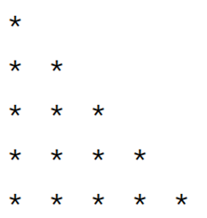

# day02 作业

## 作业一：完成如下条件判断的需求

### 1.1 判断奇偶数 ✅


> [!question]- 题目
> - 需求1：根据用户输入的数字，判断该数字是奇数还是偶数。

- [x] **我的答案**

> [!example]- 我的答案
> ```python
> """  
> 1. 完成如下条件判断的需求  
> - 需求1：根据用户输入的数字，判断该数字是奇数还是偶数。  
> - 需求2：根据用户输入的年龄，判断该用户是否已经成年（>=18，成年；否则，未成年）。  
> - 需求3：根据用户输入的数字，判断该数字是正数还是负数还是0 。  
> - 需求4：根据用户输入的考试分数，判断该分数是否及格了（大于等于60就是及格了, 否则就是不及格）。  
> """  
> # 需求一  
> input_num=int(input("请输入一个整数:\n"))  
>   
> if input_num%2==0:  
>     print("是偶数")  
> else:  
>     print("是奇数")  
> ```

> [!success]- 参考答案
> ```python
> # 需求1：根据用户输入的数字，判断该数字是奇数还是偶数。
> num = int(input("请输入一个整数: "))
>
> if num % 2 == 0:
>     print(f"{num} 是偶数")
> else:
>     print(f"{num} 是奇数")
> ```

**批改**

✅ 正确

7 → 是奇数，8 → 是偶数，`%2` 判断正确。

### 1.2 判断是否成年 ✅


> [!question]- 题目
> - 需求2：根据用户输入的年龄，判断该用户是否已经成年（>=18，成年；否则，未成年）。

- [x] **我的答案**

> [!example]- 我的答案
> ```python
> # 需求二  
> input_num=int(input("请输入你的年龄:\n"))  
> if input_num>=18:  
>     print("已成年")  
> else:  
>     print("未成年")  
> ```

> [!success]- 参考答案
> ```python
> # 需求2：根据用户输入的年龄，判断该用户是否已经成年（>=18成年，否则未成年）。
> age = int(input("请输入年龄: "))
>
> if age >= 18:
>     print("已成年")
> else:
>     print("未成年")
> ```

**批改**

✅ 正确

18 → 已成年，17 → 未成年，`>=18` 边界对。

### 1.3 判断正数 / 负数 / 0 ❌


> [!question]- 题目
> - 需求3：根据用户输入的数字，判断该数字是正数还是负数还是0 。

- [x] **我的答案**

> [!example]- 我的答案
> ```python
> # 需求三  
> input_num=int(input("请输入一个数字:\n"))  
> if input_num>=0:  
>     print("正数")  
> elif input_num<0:  
>     print("负数")  
> else:  
>     print("0")  
> ```

> [!success]- 参考答案
> ```python
> # 需求3：根据用户输入的数字，判断该数字是正数还是负数还是0。
> num = float(input("请输入一个数字: "))
>
> if num > 0:
>     print(f"{num} 是正数")
> elif num < 0:
>     print(f"{num} 是负数")
> else:
>     print(f"{num} 是零")
> ```

**批改**

- [ ] ❌ 有问题

- 错在哪：`if input_num>=0` 把 0 也当成了正数，所以输入 0 输出"正数"，最后那个 `else: print("0")` 永远执行不到。
- 正确写法：

```python
if input_num > 0:
    print("正数")
elif input_num < 0:
    print("负数")
else:
    print("0")
```

- 原因：正数的定义是 >0，0 既不是正数也不是负数，`>=0` 把 0 吃进第一个分支了。

### 1.4 判断考试分数是否及格 ✅


> [!question]- 题目
> - 需求4：根据用户输入的考试分数，判断该分数是否及格了（大于等于60就是及格了, 否则就是不及格）。

- [x] **我的答案**

> [!example]- 我的答案
> ```python
> # 需求四  
> input_num=int(input("请输入一个分数:\n"))  
>   
> if input_num>=60:  
>     print("及格了")  
>   
> else:  
>     print("不及格")
> ```

> [!success]- 参考答案
> ```python
> # 需求4：根据用户输入的考试分数，判断该分数是否及格（>=60及格，否则不及格）。
> score = float(input("请输入考试分数: "))
>
> if score >= 60:
>     print("及格")
> else:
>     print("不及格")
> ```

**批改**

✅ 正确

60 → 及格了，59 → 不及格，边界正确。

## 作业二：完成如下需求 ✅


> [!question]- 题目
> 1. 根据输入的考试成绩，判断成绩等级。
>    1. 大于等于85分为优秀
>    2. 60-85分为及格
>    3. 否则就是不及格

- [x] **我的答案**

> [!example]- 我的答案
> ```python
> # Scores  
>   
> Scores = int(input("请输入你的考试成绩:\n"))  
>   
> if Scores <= 100 and Scores >= 85:  
>     print("你的成绩为优秀")  
>   
> elif Scores >= 60:  
>     print("你的成绩为及格")  
>   
> else:  
>     print("你的成绩不及格")
> ```

> [!success]- 参考答案
> ```python
> # 需求5：根据输入的考试成绩，判断成绩等级。
> #         >=85 优秀，60-85 及格，否则不及格
> score = float(input("请输入考试成绩: "))
>
> if score >= 85:
>     print("优秀")
> elif score >= 60:
>     print("及格")
> else:
>     print("不及格")
> ```

**批改**

✅ 正确

85 → 优秀，84 → 及格，50 → 不及格，三档都对。
小提示：`Scores <= 100` 这个上限让 120 分落到了"及格"（实测）。按题面只写 `Scores >= 85` 就行；真要拦超范围分数，应该在最后 `else` 之外单独判一次更合理。

## 作业三：接收用户输入百分制分数（整数），按照规则判定等级并输出： ✅


> [!question]- 题目
> 1. 90 ~ 100：优秀
> 2. 80 ~ 89：良好
> 3. 70 ~ 79：中等
> 4. 60 ~ 69：及格
> 5. 0 ~ 59：不及格
> 6. 分数小于 0 或 大于 100：输出「分数输入有误」

- [x] **我的答案**

> [!example]- 我的答案
> ```python
> num = int(input("请输入一个整数:\n"))  
>   
> if num>100 or num<0:  
>     print("输入不合法")  
> elif 100 >= num >= 90:  
>     print("优秀")  
> elif num>=80:  
>     print("良好")  
> elif num>=70:  
>     print("中等")  
> elif num>=60:  
>     print("及格")  
> else:  
>     print("不及格")
> ```

> [!success]- 参考答案
> ```python
> # 需求6：接收用户输入百分制分数（整数），按照规则判定等级并输出：
> #        90~100：优秀    80~89：良好    70~79：中等
> #        60~69：及格     0~59：不及格    <0 或 >100：分数输入有误
> score = int(input("请输入百分制分数(0-100): "))
>
> if score < 0 or score > 100:
>     print("分数输入有误")
> elif score >= 90:
>     print("优秀")
> elif score >= 80:
>     print("良好")
> elif score >= 70:
>     print("中等")
> elif score >= 60:
>     print("及格")
> else:
>     print("不及格")
> ```

**批改**

✅ 正确

90 → 优秀，89 → 良好，79 → 中等，59 → 不及格，101 / -1 → 输入不合法，先判非法再从高到低，顺序对。

## 作业四：购物折扣计算 ✅


> [!question]- 题目
> 根据输入的购物车的商品总额，以及如下的折扣规则，计算实际应付的金额。
> 
> - 金额 >= 500: 8折
> - 300 <= 金额 < 500: 9折  
> - 100 <= 金额 < 300: 95折
> - 金额 < 100: 无折扣

- [x] **我的答案**

> [!example]- 我的答案
> ```python
> product_total=float(input("请输入您购入商品的总额:\n"))  
>   
> if product_total >= 500:  
>     print(f"您应支付的金额为:{product_total * 0.8}元")  
> elif product_total >= 300:  
>     print(f"您应支付的金额为:{product_total*0.9}元")  
> elif product_total >= 100:  
>     print(f"您应支付的金额为:{product_total*0.95}元")  
> elif 100 > product_total >= 0:  
>     print(f"您应支付的金额为:{product_total}元")  
> else:  
>     print("你输入的金额不合法")
> ```

> [!success]- 参考答案
> ```python
> # 需求7：购物折扣计算
> #        >=500：8折    300~499：9折    100~299：95折    <100：无折扣
> total = float(input("请输入购物车商品总额: "))
>
> if total >= 500:
>     pay = total * 0.8
>     print(f"享受8折，实际应付: {pay:.2f}元")
> elif total >= 300:
>     pay = total * 0.9
>     print(f"享受9折，实际应付: {pay:.2f}元")
> elif total >= 100:
>     pay = total * 0.95
>     print(f"享受95折，实际应付: {pay:.2f}元")
> else:
>     print(f"无折扣，实际应付: {total:.2f}元")
> ```

**批改**

✅ 正确

500 → 400.0（8 折），99 → 99.0（无折扣），300 和 100 两个边界也都落在正确档位。

## 作业五：北京市居民年度用电电费计算：根据输入的用电度数，计算电费 ❌


> [!question]- 题目
> 北京市居民电费采用阶梯电价计价方式，所谓阶梯电价是指按照用户消费的电量分段定价，用电价格随用电量增加呈阶梯状逐级递增的一种电价定价机制。
> 
> 阶梯电价规则：
> 
> [待补充]

- [x] **我的答案**

> [!example]- 我的答案
> ```python
> electricity=float(input("请输入你的用电度:\n"))  
>   
> if electricity>4800:  
>     print(f"你的用电费用为:{electricity*0.7883}元")  
> elif electricity>=2880 and electricity<=4800:  
>     print(f"你的用电费用为:{electricity*0.5383}元")  
> elif electricity>=0:  
>     print(f"你的用电费用为:{electricity*0.4883}元")  
> else:  
>     print("你输入的价格不合法!!!")
> ```

> [!success]- 参考答案
> ```python
> # 需求8：北京市居民年度用电电费计算（阶梯电价）
> #        第一档：2880度以下，单价 0.4883元/度
> #        第二档：2880~4800度，单价 0.5383元/度
> #        第三档：4800度以上，单价 0.7883元/度
> usage_elec = int(input("请输入用电度数: "))
>
> # 定义阶梯电价
> first_max = 2880  # 第一档上限
> second_max = 4800  # 第二档上限
>
> first_price = 0.4883  # 第一档单价
> second_price = 0.5383  # 第二档单价
> third_price = 0.7883  # 第三档单价
>
> total_cost = 0.0  # 总电费
>
> # 使用if语句进行阶梯电价计算
> if usage_elec <= first_max:
>     # 全部在第一档
>     total_cost = usage_elec * first_price
> elif usage_elec <= second_max:
>     # 第一档部分
>     first_cost = first_max * first_price
>
>     # 第二档部分
>     second_usage = usage_elec - first_max
>     second_tier_cost = second_usage * second_price
>     total_cost = first_cost + second_tier_cost
> else:
>     # 第一档部分
>     first_cost = first_max * first_price
>
>     # 第二档部分
>     second_usage = second_max - first_max
>     second_cost = second_usage * second_price
>
>     # 第三档部分
>     third_usage = usage_elec - second_max
>     third_cost = third_usage * third_price
>     total_cost = first_cost + second_cost + third_cost
>
> print(f"{usage_elec} 度的电费是: {total_cost} 元")
> ```

**批改**

- [ ] ❌ 有问题

- 错在哪：阶梯电价要**分段**计价，你用电量 × 一个单价，等于整笔电量都套用了所在档的最高价。
- 正确写法：

```python
if electricity <= 2880:
    cost = electricity * 0.4883
elif electricity <= 4800:
    cost = 2880 * 0.4883 + (electricity - 2880) * 0.5383
else:
    cost = 2880 * 0.4883 + (4800 - 2880) * 0.5383 + (electricity - 4800) * 0.7883
```

- 原因：实测 3000 度你算出 1614.9 元，正确是 1470.9 元；2880 度你算出 1550.304 元，正确是 1406.304 元。前 2880 度永远按第一档 0.4883 算，"阶梯"就是每一段各自乘单价再相加。

注：这题的题面规则还是 `[待补充]`，我是按参考答案里写明的三档（2880 度 / 4800 度）判的。

## 作业六：接收用户输入的月份（1-12），判断该月份所属的季节 ✅


> [!question]- 题目
> - 春季：3、4、5
> - 夏季：6、7、8
> - 秋季：9、10、11
> - 冬季：12、1、2
> 
> 要求使用 `match-case` 实现，输入非1-12的数字时提示“月份输入有误”。

- [x] **我的答案**

> [!example]- 我的答案
> ```python
> year = input("请输入一个月份(阿拉伯数字):\n")  
>   
> match year:  
>     case "3" | "4" | "5" :  
>         print("所在季节为春季!!")  
>     case "6" | "7" | "8" :  
>         print("所在季节为夏季!!")  
>     case "9" | "10" | "11" :  
>         print("所在季节为秋季!!")  
>     case "12" | "1" | "2" :  
>         print("所在季节为冬季!!")  
>     case _:  
>         print("输入季节非法!!")
> ```

> [!success]- 参考答案
> ```python
> # 需求9：接收用户输入的月份（1-12），判断该月份所属的季节（使用 match-case）
> #        春季：3、4、5    夏季：6、7、8    秋季：9、10、11    冬季：12、1、2
> month = int(input("请输入月份(1-12): "))
>
> match month:
>     case 3 | 4 | 5:
>         print(f"{month}月 属于春季")
>     case 6 | 7 | 8:
>         print(f"{month}月 属于夏季")
>     case 9 | 10 | 11:
>         print(f"{month}月 属于秋季")
>     case 12 | 1 | 2:
>         print(f"{month}月 属于冬季")
>     case _:
>         print("月份输入有误")
> ```

**批改**

✅ 正确

"9" → 秋季，"0" → 提示非法，四个季节的分组和 `match-case` 语法都没问题。
小提示：① 需求要求非 1-12 时提示"月份输入有误"，你的提示语是"输入季节非法!!"，意思到了但字面不一样；② 用字符串匹配时输入 "03" 会掉进默认分支，改成 `int(input())` 配 `case 3 | 4 | 5` 更稳。

## 作业七：简单游戏指令系统开发【选做】 ❌


> [!question]- 题目
> - 请你编写一个游戏角色移动控制系统，根据玩家输入的不同指令，控制游戏角色执行相应的动作(输出控制台)。
> 
> - 具体规则：
> 
> | **玩家输入** | **对应动作** |
> | --- | --- |
> | 上 /   w /W | 角色向上移动 |
> | 下 /   s / S | 角色向下移动 |
> | 左 /   a / A | 角色向左移动 |
> | 右 /   d / D | 角色向右移动 |
> | 跳   / " "(空格) | 角色跳跃 |
> | 攻击   / j / J | 角色发动攻击 |
> | 退出   / esc / ESC | 角色退出游戏 |

- [x] **我的答案**

> [!example]- 我的答案
> ```python
> while True:  
>     input_command=input("请输入游戏指令:\n")  
>   
>     match input_command:  
>         case "w" | "W":  
>             print("角色向上移动了~")  
>             continue  
>         case "s" | "S":  
>             print("角色向下移动了~")  
>             continue  
>         case "a" | "A":  
>             print("角色向左移动了~")  
>             continue  
>         case "d" | "D":  
>             print("角色向右移动了~")  
>             continue  
>         case " ":  
>             print("角色跳跃了~")  
>             continue  
>         case "j" | "J":  
>             print("角色发起攻击了~")  
>             continue  
>         case "esc" | "ESC":  
>             print("角色退出游戏了~")  
>             break  
>         case _:  
>             print("你输入的指令不合法请重新输入")  
>             continue
> ```

> [!success]- 参考答案
> ```python
> # 需求10：简单游戏指令系统（使用 match-case）
> #         上/w/W → 向上移动   下/s/S → 向下移动
> #         左/a/A → 向左移动   右/d/D → 向右移动
> #         跳/空格 → 跳跃      攻击/j/J → 发动攻击
> #         退出/esc/ESC → 退出游戏
> command = input("请输入游戏指令: ")
>
> match command:
>     case "上" | "w" | "W":
>         print("角色向上移动")
>     case "下" | "s" | "S":
>         print("角色向下移动")
>     case "左" | "a" | "A":
>         print("角色向左移动")
>     case "右" | "d" | "D":
>         print("角色向右移动")
>     case "跳" | " ":
>         print("角色跳跃")
>     case "攻击" | "j" | "J":
>         print("角色发动攻击")
>     case "退出" | "esc" | "ESC":
>         print("角色退出游戏")
>     case _:
>         print("无效指令")
> ```

**批改**

- [ ] ❌ 有问题

- 错在哪：题面表格每一行都给的是"中文 / 小写 / 大写"三种输入，你只匹配了 `w/s/a/d/空格/j/esc`，中文指令一个都没有，所以输入"上"会输出"你输入的指令不合法请重新输入"（已实测）。
- 正确写法（每个 case 补上中文）：

```python
case "上" | "w" | "W":
    print("角色向上移动了~")
```

- 原因：需求写的是"上 / w / W"这种并列形式，中文和英文都要认，缺了中文就漏了一半输入方式。

## 作业八：基于循环语句完成如下需求 ✅


> [!question]- 题目
> - 需求1：根据输入的直角边的边长，打印等腰直角三角形 （如下为直角边为5的等腰直角三角形）
> 

- [x] **我的答案**

> [!example]- 我的答案
> ```python
> long = int(input("请输入直角三角形的边长:\n"))  
>   
> for i in range(1,long+1):  
>   
>     for j in range(1,i+1):  
>         print("*", end="  ")  
>   
>     print()
> ```

> [!success]- 参考答案
> ```python
> # 需求11：根据输入的直角边的边长，打印等腰直角三角形（直角边为5的示例）
> #         输出示例（n=5）：
> #         *
> #         *  *
> #         *  *  *
> #         *  *  *  *
> #         *  *  *  *  *
> n = int(input("请输入直角边的边长: "))
>
> for i in range(1, n + 1):
>     # 第 i 行打印 i 个星号
>     for j in range(i):
>         print("*  ", end="")
>     print()  # 换行
> ```

**批改**

✅ 正确

输入 5，输出 5 行直角三角形，每行比上一行多一个 `*  `。行尾会多出两个空格，不影响形状。

## 作业九：根据用户名密码登录 ✅


> [!question]- 题目
> 需求：用户名密码登录，正确的用户名和密码为admin/666888 、zhangsan/123456、taoge/888666, 5次登录机会，输入错误五次，不允许再操作了。

- [x] **我的答案**

> [!example]- 我的答案
> ```python
> for i in range(1,7):  
>     if i == 6:  
>         print("输入错误五次，不允许再操作了")  
>         break  
>   
>     input_user = input("请输入你的用户名:\n")  
>     input_password = input("请输入你的密码:\n")  
>   
>     if input_user == "admin" and input_password == "666888" or input_user == "zhangsan" and input_password == "123456"or input_user == "taoge" and input_password == "888666":  
>         print("密码正确登录成功!")  
>         break  
>     else:  
>         print("账号密码错误,请重新输入!!")
> ```

> [!success]- 参考答案
> ```python
> # 需求14：用户名密码登录
> #         正确的用户名密码：admin/666888、zhangsan/123456、taoge/888666
> #         5次登录机会，输入错误五次则不允许再操作
> chance = 5  # 剩余登录次数
>
> while chance > 0:
>     print(f"\n剩余登录次数: {chance}")
>     username = input("请输入用户名: ")
>     password = input("请输入密码: ")
>
>     # 判断是否登录成功
>     if username == "admin" and password == "666888" :
>         print("登录成功，欢迎进入系统 ~")
>         break
>     elif username == "zhangsan" and password == "123456":
>         print("登录成功，欢迎进入系统 ~")
>         break
>     elif username == "taoge" and password == "888666":
>         print("登录成功，欢迎进入系统 ~")
>         break
>     else:
>         chance -= 1  # 剩余次数减1
>         if chance > 0:
>             print(f"用户名或密码错误，请重新输入！还剩 {chance} 次机会")
>         else:
>             print("五次登录机会已用完，账号已锁定！")
> ```

**批改**

✅ 正确

连错 5 次后输出"输入错误五次，不允许再操作了"并结束；错 3 次后输入 admin/666888 能登录成功退出，两种情况都测过。
小提示：`range(1,7)` 里第 6 次循环专门用来打"错五次"的提示，能跑但有点绕，用 `while` + 剩余次数更直观（参考答案就是这么写的）。

## 作业十：将1-1000之间（含1000）所有的5的倍数的数字累加起来。 ✅


> [!question]- 题目
> 将1-1000之间（含1000）所有的5的倍数的数字累加起来。

- [x] **我的答案**

> [!example]- 我的答案
> ```python
> # sum=0  
> #  
> # for i in range(0,1001,5):  
> #     sum+=i  
> #  
> # print(sum)  
>   
> sum=0  
>   
> for i in range(0,1001):  
>     if i%5==0:  
>         sum=sum+i  
>   
> print(sum)
> ```

> [!success]- 参考答案
> ```python
> # 需求15：将1-1000之间（含1000）所有的5的倍数的数字累加起来。
> total = 0
> for i in range(1, 1001):
>     if i % 5 == 0:
>         total += i
>
> print(f"1-1000之间所有5的倍数之和为: {total}")
> ```

**批改**

✅ 正确

结果 100500，和 5×(1+2+…+200) 一致。`range(0,1001)` 里 0 也被算作 5 的倍数，但加 0 不影响结果。
小提示：`sum` 是 Python 内置函数名，当变量用以后想调 `sum()` 会踩坑，换成 `total` 更安全（你注释里那版用 `range(0,1001,5)` 更简洁）。

## 作业十一：统计字符串 "akiwksjakdiklowiqaamnvbamvaxnsjdsjkaaxkjd" 字符串中有多少个a和k。 【选做】 ✅


> [!question]- 题目
> 统计字符串 "akiwksjakdiklowiqaamnvbamvaxnsjdsjkaaxkjd" 字符串中有多少个a和k。

- [x] **我的答案**

> [!example]- 我的答案
> ```python
> str1="akiwksjakdiklowiqaamnvbamvaxnsjdsjkaaxkjd"  
>   
> quantity_a=0  
> quantity_k=0  
>   
> for i in str1:  
>     if i=="a":  
>         quantity_a=quantity_a+1  
>   
>     if i=="k":  
>         quantity_k=quantity_k+1  
> print(f"有{quantity_a}个a和{quantity_k}个k")
> ```

> [!success]- 参考答案
> ```python
> # 需求16：【选做】统计字符串中有多少个 'a' 和 'k'
> #         字符串: "akiwksjakdiklowiqaamnvbamvaxnsjdsjkaaxkjd"
> s = "akiwksjakdiklowiqaamnvbamvaxnsjdsjkaaxkjd"
> count_a = 0
> count_k = 0
>
> for ch in s:
>     if ch == "a":
>         count_a += 1
>     elif ch == "k":
>         count_k += 1
>
> print(f"字符串: {s}")
> print(f"字母 'a' 出现了 {count_a} 次")
> print(f"字母 'k' 出现了 {count_k} 次")
> ```

**批改**

✅ 正确

统计出 8 个 a、6 个 k，和 `"…".count("a")` / `count("k")` 的结果一致。

## 作业十二：模拟银行取款机  【选做】 ❌


> [!question]- 题目
> 初始余额为 10000 元，循环显示菜单：
> 
> 1. 查询余额
> 
> 2. 存款
> 
> 3. 取款
> 
> 4. 退出
> 
> 根据用户选择执行操作，取款金额不能超过余额，存款为正数，退出时输出“感谢使用”。

- [x] **我的答案**

> [!example]- 我的答案
> ```python
> from tokenize import blank_re  
>   
> balance = 10000  
>   
> while True:  
>     options = input("1. 查询余额\n2. 存款\n3. 取款\n4. 退出\n请输入您要进行的操作:\n")  
>   
>     match options:  
>         case "1":  
>             print(f"您的账户余额为{balance}")  
>         case "2":  
>             save_money = int(input("请输入你要存款的金额:\n"))  
>             balance = balance + save_money  
>         case "3":  
>             withdraw_money = int(input("请输入你要取款的金额:\n"))  
>             balance = balance - withdraw_money  
>         case "4":  
>             print("退出成功!!")  
>             break
> ```

> [!success]- 参考答案
> ```python
> # 需求17：【选做】模拟银行取款机
> #         初始余额 10000 元，循环显示菜单：
> #         1.查询余额  2.存款  3.取款  4.退出
> #         取款金额不能超过余额，存款需为正数，退出时输出"感谢使用"
> #         输入非菜单选项时提示"请重新选择"
> balance = 10000.0  # 初始余额
>
> menu = """
> # # # # # # # # # # # # # # # # # # # # # # # #
> #      欢迎使用银行自助服务系统                   #
> #      1. 查询余额                            #
> #      2. 存款                               #
> #      3. 取款                               #
> #      4. 退出                               #
> # # # # # # # # # # # # # # # # # # # # # # # #
> """
>
> while True:
>     print(menu)
>     choice = input("请选择操作(1-4): ")#
>
>     match choice:
>         case "1":  # 查询余额
>             print(f"当前余额: {balance:.2f}元")
>
>         case "2":  # 存款
>             amount = float(input("请输入存款金额: "))
>             if amount > 0:
>                 balance += amount
>                 print(f"存款成功！当前余额: {balance:.2f}元")
>             else:
>                 print("存款金额必须为正数！")
>
>         case "3":  # 取款
>             amount = float(input("请输入取款金额: "))
>             if amount <= 0:
>                 print("取款金额必须为正数！")
>             elif amount > balance:
>                 print(f"余额不足！当前余额: {balance:.2f}元")
>             else:
>                 balance -= amount
>                 print(f"取款成功！当前余额: {balance:.2f}元")
>
>         case "4":  # 退出
>             print("感谢使用，再见 ~")
>             break
>
>         case _:
>             print("输入有误，请重新选择！")
> ```

**批改**

- [ ] ❌ 有问题

四处问题（都实测过）：

1. 存款没判正数 —— 输入 -500，余额从 10000 变成 9500（等于"负存款"直接扣钱）；
2. 取款没判超余额 —— 余额 10000 时取 999999，余额变成 -989999；
3. 退出提示是"退出成功!!"，需求要"感谢使用"；
4. 没有 `case _` —— 输入 5 只是重新显示菜单，一句提示都没有，用户不知道自己输错了。

正确写法（关键分支）：

```python
case "2":
    save_money = int(input("请输入你要存款的金额:\n"))
    if save_money <= 0:
        print("存款金额必须为正数")
    else:
        balance = balance + save_money
case "3":
    withdraw_money = int(input("请输入你要取款的金额:\n"))
    if withdraw_money <= 0 or withdraw_money > balance:
        print("金额不合法或余额不足")
    else:
        balance = balance - withdraw_money
case "4":
    print("感谢使用")
    break
case _:
    print("请重新选择")
```

原因：题面把"取款金额不能超过余额、存款为正数"写成硬性规则，这几处漏洞能直接把余额改成负数或者凭空多钱。

另外第 727 行 `from tokenize import blank_re` 是编辑器自动补的无效导入，删掉即可（不影响运行）。
