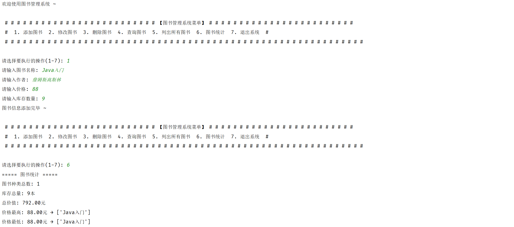
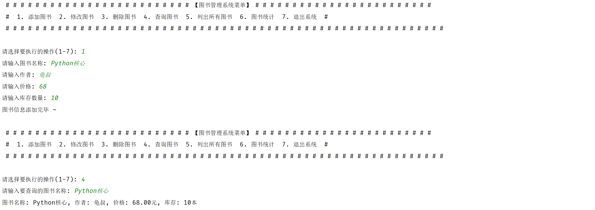
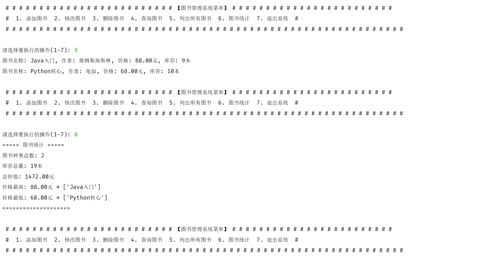

# day04 作业

## 作业一：图书管理系统开发 【必做】 ❌

> [!question]- 题目
>
> **需求描述：**
>
> 开发一个图书管理系统，在该系统中可以维护和管理图书信息，具体需求如下：
>
> 1. 添加图书信息：根据提示录入图书名称、作者、价格、库存数量，录入完成保存到系统中。
>
> 2. 修改图书信息：输入要修改的图书名称，然后再提示输入新的作者、价格、库存数量，输入完成后修改图书信息。
>
> 3. 删除图书信息：输入要删除的图书名称，根据名称删除图书信息。
>
> 4. 查询图书信息：输入要查询的图书名称，根据名称查询图书信息并输出。
>
> 5. 列出所有图书：遍历所有图书信息并输出。
>
> 6. 图书统计：统计图书种类数、库存总量、总价值（每本书价格×库存之和）、价格最高和最低的图书名称。
>
> 7. 退出系统。
>
> ```python
> dict1 = {
>     "钢铁是怎样炼成的":{"price":20,"author":"斯基"，"num":4}
> }
>
> """
>     案例：图书管理系统
>     1. 添加图书信息：根据提示录入图书名称、作者、价格、库存数量，录入完成保存到系统中。
>     2. 修改图书信息：输入要修改的图书名称，然后再提示输入新的作者、价格、库存数量，输入完成后修改图书信息。
>     3. 删除图书信息：输入要删除的图书名称，根据名称删除图书信息。
>     4. 查询图书信息：输入要查询的图书名称，根据名称查询图书信息并输出。
>     5. 列出所有图书：遍历所有图书信息并输出。
>     6. 图书统计：统计图书总数、库存总量、总价值、价格最高和最低的图书名称。
>     7. 退出系统。
> """
>
> menu = """
> # # # # # # # # # # # # # # # # # # # # # # # 【图书管理系统菜单】 # # # # # # # # # # # # # # # # # #
> #       1. 添加图书  2. 修改图书  3. 删除图书  4. 查询图书  5. 列出所有图书  6. 图书统计  7. 退出系统        #
> # # # # # # # # # # # # # # # # # # # # # # # # # # # # # # # # # # # # # # # # # # # # # # # # #
> """
> print("欢迎使用图书管理系统 ~")
> ```
>
> 最终效果如下：
>
> 
>
> 
>
> 

- [x] **我的答案**

> [!example]- 我的答案
> ```python
> books_dict={  
>     "Python从入门到精通":{"author":"张三","price":100,"stock":100},  
> }  
>
> # 数据格式：{"书名":{"作者":"作者","价格":价格,"库存数量":库存数量}}  
>
> menu="""  
> # # # # # # # # # # # # # # # # # # # # # # # 【图书管理系统菜单】 # # # # # # # # # # # # # # # # # ##       1. 添加图书  2. 修改图书  3. 删除图书  4. 查询图书  5. 列出所有图书  6. 图书统计  7. 退出系统       ## # # # # # # # # # # # # # # # # # # # # # # # # # # # # # # # # # # # # # # # # # # # # # # # # #  
> """  
>
> print(menu)  
>
> while True:  
>     operation=int(input("请输入你要进行的操作："))  
>     # 添加图书  
>     match operation:  
>
>         case 1:  
>             name = input("请输入图书的书名：")  
>             if name in books_dict:  
>                 print("该图书已存在，请选择修改功能！！")  
>                 continue  
>             else:  
>                 author=input("请输入图书的作者：")  
>                 price=float(input("请输入图书的价格："))  
>                 stock=int(input("请输入图书的库存数量："))  
>                 books_dict[name]={"author":author,"price":price,"stock":stock}  
>                 print("添加图书成功！！！")  
>                 continue  
>         # 修改图书  
>         case 2:  
>             name=input("请输入你要修改的图书的书名：")  
>             if name not in books_dict:  
>                 print("该图书不在系统中，请先去添加图书信息！！")  
>                 continue  
>             else:  
>                 author=input("请输入新的作者：")  
>                 price=float(input("请输入新的价格："))  
>                 stock=int(input("请输入新的库存数量："))  
>                 books_dict[name]={"author":author,"price":price,"stock":stock}  
>                 print("修改图书信息成功！！！")  
>                 continue  
>         # 删除图书  
>         case 3:  
>             name = input("请输入你要删除的图书的书名：")  
>             if name not in books_dict:  
>                 print("你要删除的图书不存在！！！")  
>                 continue  
>             else:  
>                 books_dict.pop(name)  
>                 print("删除成功！！！！")  
>                 continue  
>         # 查询图书  
>         case 4:  
>             name=input("请输入你要查询的图书的书名：")  
>             if name not in books_dict:  
>                 print("你要查询的图书不存在！！")  
>                 continue  
>             else:  
>                 print(f"{name}的作者为：{books_dict[name]['author']}",end=" ，")  
>                 print(f"价格为：{books_dict[name]['price']}",end=" ，")  
>                 print(f"库存数量为：{books_dict[name]['stock']}")  
>                 continue  
>         # 列出所有图书  
>         case 5:  
>             for name in books_dict:  
>                 print(f"{name}的作者为：{books_dict[name]['author']}",end="")  
>                 print(f"价格为：{books_dict[name]['price']}",end="")  
>                 print(f"库存数量为：{books_dict[name]['stock']}")  
>                 continue  
>         # 图书统计  
>         case 6:  
>             total_books=len(books_dict)  
>             total_price=sum([books_dict[name]["price"] for name in books_dict])  
>             total_stock=sum([books_dict[name]["stock"] for name in books_dict])  
>             print(f"当前系统中总共有{total_books}本图书")  
>             print(f"当前系统中所有图书的总价格为：{total_price}")  
>             print(f"当前系统中所有图书的总库存数量为：{total_stock}")  
>             continue  
>         # 退出系统  
>         case 7:  
>             print("谢谢使用，再见！")  
>             break  
>         case _:  
>             print("请输入正确的操作！！")  
>             continue
> ```

> [!success]- 参考答案
> ```python
> """
>     案例：图书管理系统
>     1. 添加图书信息：根据提示录入图书名称、作者、价格、库存数量，录入完成保存到系统中。
>     2. 修改图书信息：输入要修改的图书名称，然后再提示输入新的作者、价格、库存数量，输入完成后修改图书信息。
>     3. 删除图书信息：输入要删除的图书名称，根据名称删除图书信息。
>     4. 查询图书信息：输入要查询的图书名称，根据名称查询图书信息并输出。
>     5. 列出所有图书：遍历所有图书信息并输出。
>     6. 图书统计：统计图书总数、库存总量、总价值、价格最高和最低的图书信息。
>     7. 退出系统。
> """
>
> menu = """
>  # # # # # # # # # # # # # # # # # # # # # # # # # 【图书管理系统菜单】 # # # # # # # # # # # # # # # # # # # # # # # #
>  #  1. 添加图书  2. 修改图书  3. 删除图书  4. 查询图书  5. 列出所有图书  6. 图书统计  7. 退出系统  #
>  # # # # # # # # # # # # # # # # # # # # # # # # # # # # # # # # # # # # # # # # # # # # # # # # # # # # # # # # # # #
>  """
> print("欢迎使用图书管理系统 ~")
>
> # 使用字典存储图书，key=书名, value=包含作者、价格、库存的字典
> books = {}
>
> while True:
>     print(menu)
>
>     choice = input("请选择要执行的操作(1-7): ")
>     match choice:
>         case "1":  # 添加图书信息
>             book_name = input("请输入图书名称: ")
>             author = input("请输入作者: ")
>             price = float(input("请输入价格: "))
>             stock = int(input("请输入库存数量: "))
>
>             if book_name in books:
>                 print("该图书已存在, 请重新选择 ~")
>             else:
>                 books[book_name] = {"author": author, "price": price, "stock": stock}
>                 print("图书信息添加完毕 ~")
>
>         case "2":  # 修改图书信息
>             book_name = input("请输入要修改的图书名称: ")
>
>             if book_name not in books:
>                 print("该图书不存在, 请重新选择 ~")
>                 continue
>
>             author = input("请输入新的作者: ")
>             price = float(input("请输入新的价格: "))
>             stock = int(input("请输入新的库存数量: "))
>             books[book_name] = {"author": author, "price": price, "stock": stock}
>             print("图书信息修改完毕 ~")
>
>         case "3":  # 删除图书信息
>             book_name = input("请输入要删除的图书名称: ")
>
>             if book_name not in books:
>                 print("该图书不存在, 请重新选择 ~")
>             else:
>                 del books[book_name]
>                 print("图书信息删除完毕 ~")
>
>         case "4":  # 查询图书信息
>             book_name = input("请输入要查询的图书名称: ")
>
>             if book_name not in books:
>                 print("该图书不存在, 请重新选择 ~")
>             else:
>                 book = books[book_name]
>                 print(f"图书名称: {book_name}, 作者: {book['author']}, "
>                       f"价格: {book['price']:.2f}元, 库存: {book['stock']}本")
>
>         case "5":  # 列出所有图书
>             if not books:
>                 print("系统中暂无图书信息 ~")
>                 continue
>
>             for book_name in books.keys():
>                 book = books[book_name]
>                 print(f"图书名称: {book_name}, 作者: {book['author']}, "
>                       f"价格: {book['price']:.2f}元, 库存: {book['stock']}本")
>
>         case "6":  # 图书统计
>             if not books:
>                 print("系统中暂无图书信息，请先添加图书 ~")
>                 continue
>
>             # 初始化统计变量
>             total_books = len(books)  # 图书种类总数
>             total_stock = 0  # 库存总量
>             total_value = 0  # 总价值
>
>             # 初始化价格极值变量
>             prices = []
>
>             for book_name, book in books.items():
>                 total_stock += book['stock']
>                 total_value += book['price'] * book['stock']
>                 prices.append(book['price'])
>
>             # 找出价格最高和最低的图书
>             max_price = max(prices)
>             min_price = min(prices)
>
>             max_price_books = [name for name, info in books.items() if info['price'] == max_price]
>             min_price_books = [name for name, info in books.items() if info['price'] == min_price]
>
>             # 输出统计结果
>             print("===== 图书统计 =====")
>             print(f"图书种类总数: {total_books}")
>             print(f"库存总量: {total_stock}本")
>             print(f"总价值: {total_value:.2f}元")
>             print(f"价格最高: {max_price:.2f}元 → {max_price_books}")
>             print(f"价格最低: {min_price:.2f}元 → {min_price_books}")
>             print("====================")
>
>         case "7":  # 退出系统
>             print("Bye ~")
>             break
>
>         case _:  # 匹配其他所有情况
>             print("非法操作, 不支持!!!")
> ```

**批改**

- [ ] ❌ 有问题

- 错在哪（`case 6` 图书统计）：
  - `total_price` 算的是「各书价格相加」（100 + 12.5 = 112.5），题目要的「总价值」是 Σ(价格 × 库存)。
  - 缺了「价格最高和最低的图书名称」。
- 正确写法：

```python
prices = {v["price"] for v in books_dict.values()}
total_value = sum(v["price"] * v["stock"] for v in books_dict.values())
print(f"总价值：{total_value}")
print(f"最高价图书：{[k for k, v in books_dict.items() if v['price'] == max(prices)]}")
print(f"最低价图书：{[k for k, v in books_dict.items() if v['price'] == min(prices)]}")
```

- 原因：统计项按题目定义算，别用「价格求和」代替「价格×库存」。

## 作业二：函数基础 【必做】

### 2.1 判断闰年 is_leap_year ✅

> [!question]- 题目
>
> ```python
> # ----------------------------------------------------------
> # 需求1：定义一个函数 is_leap_year，接收一个年份 year（整数），
> #       判断该年份是否为闰年，返回 True 或 False。
> #
> #       闰年规则：
> #         - 能被 400 整除的是闰年
> #         - 能被 4 整除但不能被 100 整除的也是闰年
> #         - 其余不是闰年
> #
> #       调用该函数，分别判断 2000年、2024年、1900年、2025年 是否为闰年。
> # ----------------------------------------------------------
> ```

- [x] **我的答案**

> [!example]- 我的答案
> ```python
> def is_leap_year(year):  
>     if year%4==0 and year%100!=0 or year%400==0:  
>         return True  
>     else:  
>         return False  
>
> print()  
> print(is_leap_year(2024))  
> print(is_leap_year(1900))  
> print(is_leap_year(2025))
> ```

> [!success]- 参考答案
> ```python
> # ----------------------------------------------------------
> # 需求1：定义一个函数 is_leap_year，接收一个年份 year（整数），
> #       判断该年份是否为闰年，返回 True 或 False。
> #
> #       闰年规则：
> #         - 能被 400 整除的是闰年
> #         - 能被 4 整除但不能被 100 整除的也是闰年
> #         - 其余不是闰年
> #
> #       调用该函数，分别判断 2000年、2024年、1900年、2025年 是否为闰年。
> # ----------------------------------------------------------
> def is_leap_year(year):
>     """
>     判断 year 是否为闰年，是则返回 True，否则返回 False
>     :param year: 年份
>     :return: True 为闰年, False 为平年
>     """
>     if year % 400 == 0:
>         return True
>     if year % 4 == 0 and year % 100 != 0:
>         return True
>     return False
>
> for y in [2000, 2024, 1900, 2025]:
>     print(f"{y} 年是闰年吗？{is_leap_year(y)}")
> ```

**批改**

✅ 正确

补一句：题目还要求判断 2000 年，你只调了 2024/1900/2025，把 2000 加进调用里就齐了（400 的分支已经写对）。

### 2.2 统计大小写字母个数 count_case ❌

> [!question]- 题目
>
> ```python
> # ----------------------------------------------------------
> # 需求2：定义一个函数 count_case，接收一个字符串参数，
> #       统计其中大写字母和小写字母的个数，返回两个结果。
> #       （提示：可用字符串的 .isupper()判断是否为大写字母 和 .islower() 方法判断该字母是否为小写字母）
> #
> #       调用该函数，传入字符串 "Hello World! Python3 编程"，
> #       用解包方式接收并打印大写字母个数和小写字母个数。
> # ----------------------------------------------------------
> ```

- [x] **我的答案**

> [!example]- 我的答案
> ```python
> def count_case(string):  
>     da_num=0  
>     xia_num=0  
>     for i in string:  
>         if i.isupper():  
>             da_num+=1  
>         elif i.islower():  
>             xia_num+=1  
>     return f"大写字母有{da_num}个，小写字母有{xia_num}个"  
> print(count_case("Hello World! Python3 编程"))
> ```

> [!success]- 参考答案
> ```python
> # ----------------------------------------------------------
> # 需求2：定义一个函数 count_case，接收一个字符串参数，
> #       统计其中大写字母和小写字母的个数，返回两个结果。
> #       （提示：可用字符串的 .isupper() 和 .islower() 方法判断）
> #
> #       调用该函数，传入字符串 "Hello World! Python3 编程"，
> #       用解包方式接收并打印大写字母个数和小写字母个数。
> # ----------------------------------------------------------
> def count_case(s):
>     """
>     统计字符串中大写字母和小写字母的个数，返回 (大写个数, 小写个数)
>     :param s: 字符串
>     :return: 大写字母个数, 小写字母个数
>     """
>     upper = 0
>     lower = 0
>     for ch in s:
>         if ch.isupper():
>             upper += 1
>         elif ch.islower():
>             lower += 1
>     return upper, lower
>
> text = "Hello World! Python3 编程"
> upper_count, lower_count = count_case(text)
> print(f"字符串：{text}")
> print(f"大写字母个数：{upper_count}")
> print(f"小写字母个数：{lower_count}")
> ```

**批改**

- [ ] ❌ 有问题

- 错在哪：返回的是一整句话字符串，题目要求「返回两个结果」并用解包方式接收，`upper, lower = count_case(...)` 会直接报错。
- 正确写法：

```python
def count_case(s):
    ...
    return da_num, xia_num

upper, lower = count_case("Hello World! Python3 编程")
print(f"大写字母个数：{upper}，小写字母个数：{lower}")
```

- 原因：`return f"..."` 只返回一个值，解包不了。
