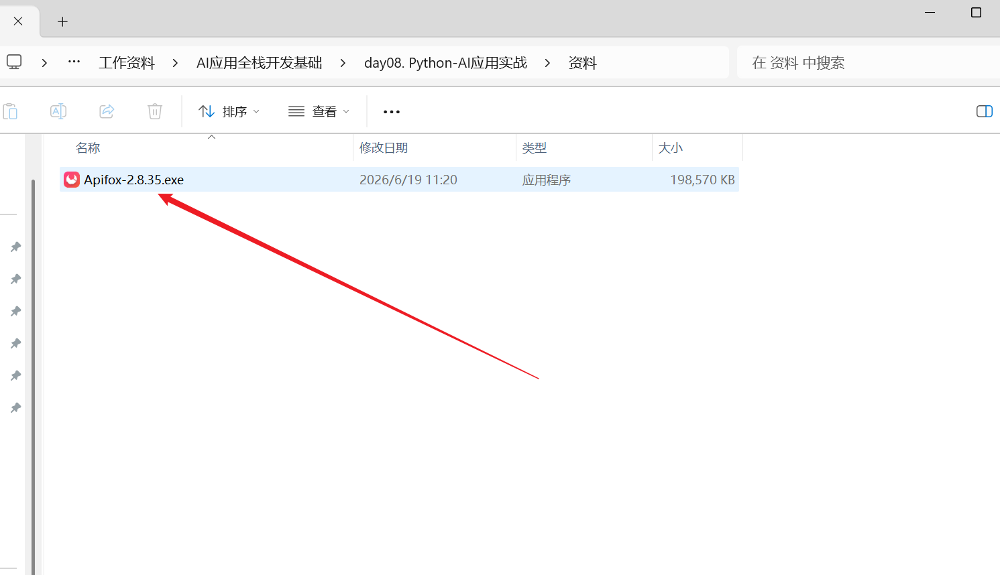

# day07 作业

## 作业一：课堂代码搞明白【必做】


**题目**

### 员工工资计算系统

```python
"""
员工工资计算系统
    需求说明: 某公司有三种类型的员工，基本工资相同，但奖金计算方式不同。使用抽象类规范工资计算方法。
    技术要求:
        创建抽象类 Employee
        属性：emp_id（工号）、name（姓名）、base_salary（基本工资，默认5000） ---> 参数设置默认值
        抽象方法：calculate_bonus()（计算奖金），子类必须实现
        普通方法：total_salary()（总工资 = 基本工资 + 奖金）
        普通方法：show_info()（展示员工信息）
    创建三个子类:
        Salesman（销售员）：奖金 = 销售额 × 提成比例（5%） ---> 扩充属性: 销售金额 sales_amount
        Manager（经理）：奖金固定为 3000
        Programmer（程序员）：奖金 = 完成项目数 × 500  -----> 扩充属性: 完成项目数 projects_completed
    测试程序:
        创建不同类型的员工
        计算并展示每个员工的总工资

测试代码:
# 测试代码
if __name__ == "__main__":
    employees = [
        Salesman("S001", "张三", 5000),
        Manager("M001", "李四"),
        Programmer("P001", "王五", 3)
    ]

    print("=" * 70)
    print("员工工资表")
    print("=" * 70)
    for emp in employees:
        emp.show_info()
    print("=" * 70)
"""
```

运行结果的预期格式：

```python
======================================================================
员工工资表
======================================================================
工号：S001 | 姓名：张三 | 基本工资：5000 | 奖金：250.0 | 总工资：5250.0
工号：M001 | 姓名：李四 | 基本工资：5000 | 奖金：3000 | 总工资：8000
工号：P001 | 姓名：王五 | 基本工资：5000 | 奖金：1500 | 总工资：6500
======================================================================
```

- [ ] **我的答案**

```python

```

> [!success]- 参考答案
> ```python
> """
> 员工工资计算系统
>     需求说明: 某公司有三种类型的员工，基本工资相同，但奖金计算方式不同。使用抽象类规范工资计算方法。
>     技术要求:
>         创建类 Employee(ABC)
>         属性：emp_id（工号）、name（姓名）、base_salary（基本工资，默认5000） ---> 参数设置默认值
>         抽象方法：calculate_bonus()（计算奖金），子类必须实现
>         普通方法：total_salary()（总工资 = 基本工资 + 奖金）
>         普通方法：show_info()（展示员工信息）
>     创建三个子类:
>         Salesman（销售员）：奖金 = 销售额 × 提成比例（5%） ---> 扩充属性: 销售金额 sales_amount
>         Manager（经理）：奖金固定为 3000
>         Programmer（程序员）：奖金 = 完成项目数 × 500  -----> 扩充属性: 完成项目数 projects_completed
>     测试程序:
>         创建不同类型的员工
>         计算并展示每个员工的总工资
> """
>
> from abc import ABC, abstractmethod
>
> class Employee(ABC):
>     def __init__(self, emp_id, name, base_salary=5000):
>         self.emp_id = emp_id
>         self.name = name
>         self.base_salary = base_salary
>
>     @abstractmethod
>     def calculate_bonus(self) -> float:
>         """抽象方法：计算奖金"""
>         pass
>
>     def total_salary(self) -> float:
>         """总工资 = 基本工资 + 奖金"""
>         return self.base_salary + self.calculate_bonus()
>
>     def show_info(self):
>         """展示员工信息"""
>         print(f"工号：{self.emp_id} | 姓名：{self.name} | 基本工资：{self.base_salary} | 奖金：{self.calculate_bonus()} | 总工资：{self.total_salary()}")
>
> class Salesman(Employee):
>     def __init__(self, emp_id, name, sales_amount, base_salary=5000):
>         super().__init__(emp_id, name, base_salary)
>         self.sales_amount = sales_amount
>
>     def calculate_bonus(self) -> float:
>         """销售员奖金 = 销售额 × 5%"""
>         return self.sales_amount * 0.05
>
> class Manager(Employee):
>     def calculate_bonus(self) -> float:
>         """经理奖金固定 3000"""
>         return 3000
>
> class Programmer(Employee):
>     def __init__(self, emp_id, name, projects_completed, base_salary=5000):
>         super().__init__(emp_id, name, base_salary)
>         self.projects_completed = projects_completed
>
>     def calculate_bonus(self) -> float:
>         """程序员奖金 = 项目数 × 500"""
>         return self.projects_completed * 500
>
> # 测试代码
> if __name__ == "__main__":
>     employees = [
>         Salesman("S001", "张三", 5000),
>         Manager("M001", "李四"),
>         Programmer("P001", "王五", 3)
>     ]
>
>     print("=" * 70)
>     print("员工工资表")
>     print("=" * 70)
>     for emp in employees:
>         emp.show_info()
>     print("=" * 70)
> ```

**批改**

（待批改）

## 作业二：通讯录管理系统 【选做-参考答案】


**题目**

```python
"""
>> 通讯录管理系统

1.需求说明：开发一个简单的通讯录管理系统，使用 TXT 文件存储联系人信息

2.数据存储格式（contacts.txt）：
张三|13800138001|zhangsan@example.com
李四|13800138002|lisi@example.com
王五|13800138003|wangwu@example.com

3.功能要求：
    添加联系人：输入姓名、电话、邮箱，追加到文件末尾
    查看所有联系人：读取并格式化展示所有联系人
    搜索联系人：根据姓名搜索联系人
    使用 with 上下文管理器操作文件

4.在下方的代码基础上，完成上述要求
"""

def add_contact():
    """添加联系人"""
    print("\n【添加联系人】")
    name = input("请输入姓名：").strip()
    phone = input("请输入手机号：").strip()
    email = input("请输入邮箱：").strip()

    # TODO: 验证手机号是否为11位数字 -> isdigit() 可判定是否为数字
    # TODO: 以追加模式(模式不要用 "w", 用 "a")写入 contacts.txt，格式：姓名|电话|邮箱

    print("联系人添加成功！")

def show_all_contacts():
    """查看所有联系人"""
    print("\n【所有联系人】")

    # TODO: 读取 contacts.txt 文件
    # TODO: 格式化展示：姓名、电话、邮箱
    # 如果文件不存在或为空，提示"暂无联系人"


def search_contact():
    """搜索联系人"""
    print("\n【搜索联系人】")
    keyword = input("请输入要搜索的姓名：").strip()

    # TODO: 读取文件，查找包含关键字的联系人
    # TODO: 展示匹配结果


def run():
    while True:
        print("\n===== 通讯录管理系统 =====")
        print("1. 添加联系人")
        print("2. 查看所有联系人")
        print("3. 搜索联系人")
        print("4. 退出")

        choice = input("请选择操作(1-4): ").strip()

        if choice == "1":
            add_contact()
        elif choice == "2":
            show_all_contacts()
        elif choice == "3":
            search_contact()
        elif choice == "4":
            print("再见！")
            break
        else:
            print("无效选项！")

if __name__ == "__main__":
    run()
```

> [!tip] 提示
> TODO：表示待办事项，是需要大家填空的地方。

- [ ] **我的答案**

```python

```

> [!success]- 参考答案
> ```python
> """
> 通讯录管理系统 - 使用TXT文件存储联系人信息
> 数据存储格式：姓名|电话|邮箱
> """
>
> def add_contact():
>     """添加联系人"""
>     print("\n【添加联系人】")
>     name = input("请输入姓名：").strip()
>     phone = input("请输入手机号：").strip()
>     email = input("请输入邮箱：").strip()
>
>     # 验证手机号是否为11位数字
>     if not phone.isdigit() or len(phone) != 11:
>         print("错误：手机号必须是11位数字！")
>         return
>
>     # 以追加模式写入 contacts.txt，格式：姓名|电话|邮箱
>     try:
>         with open("contacts.txt", "a", encoding="utf-8") as f:
>             f.write(f"{name}|{phone}|{email}\n")
>         print("联系人添加成功！")
>     except Exception as e:
>         print(f"添加失败：{e}")
>
> def show_all_contacts():
>     """查看所有联系人"""
>     print("\n【所有联系人】")
>
>     try:
>         with open("contacts.txt", "r", encoding="utf-8") as f:
>             lines = f.readlines()
>
>         if not lines:
>             print("暂无联系人")
>             return
>
>         print(f"{'姓名'} \t {'电话'} \t {'邮箱'}")
>         print("-" * 50)
>
>         for line in lines:
>             line = line.strip()
>             if line:
>                 parts = line.split("|")
>                 if len(parts) == 3:
>                     name, phone, email = parts
>                     print(f"{name} \t {phone} \t {email}")
>
>         print(f"\n共有 {len(lines)} 个联系人")
>
>     except FileNotFoundError:
>         print("暂无联系人")
>     except Exception as e:
>         print(f"读取失败：{e}")
>
> def search_contact():
>     """搜索联系人"""
>     print("\n【搜索联系人】")
>     keyword = input("请输入要搜索的姓名：").strip()
>
>     try:
>         with open("contacts.txt", "r", encoding="utf-8") as f:
>             lines = f.readlines()
>
>         if not lines:
>             print("暂无联系人")
>             return
>
>         results = []
>         for line in lines:
>             line = line.strip()
>             if line:
>                 parts = line.split("|")
>                 if len(parts) == 3 and keyword in parts[0]:
>                     results.append(parts)
>
>         if results:
>             print(f"找到 {len(results)} 个匹配的联系人：")
>             print(f"{'姓名'} \t {'电话'} \t {'邮箱'}")
>             print("-" * 50)
>             for name, phone, email in results:
>                 print(f"{name} \t {phone} \t {email}")
>         else:
>             print(f"未找到包含 '{keyword}' 的联系人")
>
>     except FileNotFoundError:
>         print("暂无联系人")
>     except Exception as e:
>         print(f"搜索失败：{e}")
>
> def run():
>     while True:
>         print("\n===== 通讯录管理系统 =====")
>         print("1. 添加联系人")
>         print("2. 查看所有联系人")
>         print("3. 搜索联系人")
>         print("4. 退出")
>
>         choice = input("请选择操作(1-4): ").strip()
>
>         if choice == "1":
>             add_contact()
>         elif choice == "2":
>             show_all_contacts()
>         elif choice == "3":
>             search_contact()
>         elif choice == "4":
>             print("再见！")
>             break
>         else:
>             print("无效选项！")
>
> if __name__ == "__main__":
>     run()
> ```

**批改**

（待批改）

## 作业三：安装一个软件(预习)


**题目**

**1). Apifox**

将同步的资料中的 Apifox 软件，双击后下一步，下一步的安装一下。



安装后，可以使用手机，微信扫码登录一下。

- [ ] **我的答案**

```python

```

> [!success]- 参考答案
> [待补充]

**批改**

（待批改）
