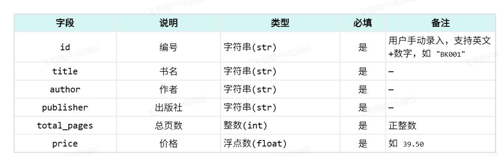

# day09 作业（Python-AI应用实战）

## 作业一：优先完成课程中案例的所有代码【必做】

- [x] 未做

**题目**

优先完成课程中案例的所有代码【必做】

**我的答案**

```python
# 源代码在"E:\HmProject\ai_partner\main.py"下
import json  
import os  
import uuid  
from typing import Any  
from openai import OpenAI  
import uvicorn  
from fastapi import FastAPI  
from pydantic import BaseModel  
  
# 定义系统提示词  
SYSTEM_PROMPT = """你叫 %s，现在是用户的真实伴侣，请完全代入伴侣角色。  
    规则：  
        1. 每次只回1条消息  
        2. 禁止任何场景或状态描述性文字  
        3. 匹配用户的语言  
        4. 回复简短，像微信聊天一样  
        5. 有需要的话可以用❤️🌸等emoji表情  
        6. 用符合伴侣性格的方式对话  
        7. 回复的内容, 要充分体现伴侣的性格特征  
        8. 不要太肉麻（比如想你之类的，就日常聊天）  
    伴侣性格：  
        - %s    你必须严格遵守上述规则来回复用户。  
    """  
api_key = os.environ["OPENCODE_API_KEY"]  
  
# 创建 FastAPI 应用  
app = FastAPI(title="AI 智能伴侣",description="这是一个基于AI的智能伴侣",version="1.0.0")  
  
# 创建 OpenEncode 客户端  
client = OpenAI(  
    api_key=api_key,  
    base_url="https://opencode.ai/inference/go/openai/v1",   # 买 Go 用这个；按量余额用 /inference/openai/v1    # 自定义请求头，包含会话 ID    default_headers={  
        # 自定义 User-Agent，建议包含应用名称和版本号  
        "User-Agent": "my-coding-agent/1.0",  
        # 会话 ID，用于保持会话状态  
        "x-opencode-session": uuid.uuid4().hex,              # 同一个会话内不要重建  
    }  
)  
  
# 文件夹创建  
SESSION_FOLDER = "session"  
# 创建会话文件夹  
if not os.path.exists(SESSION_FOLDER):  
    # 创建会话文件夹  
    os.mkdir(SESSION_FOLDER)  
  
# ApiResponse 输出时是 JSON，不是因为它"本身是 JSON"，  
# 而是因为 Pydantic 让它天生可序列化，FastAPI 看到它就自动帮你序列化并包装成 JSONResponse 发出去了。  
# 创建响应结果类  
class ApiResponse(BaseModel):  
    code: int  
    message: str  
    data: Any = None  
  
# 创建接收会话信息类  
class Session(BaseModel):  
    nature: str  
    nick_name: str  
  
# 创建AI对话类  
class AIResponse(BaseModel):  
    """  
    message: "你好"  
    nature: "活泼开朗的东北姑娘，说话直爽，爱唠嗑，带点大碴子味儿，特别热情暖心"  
    nick_name: "小甜甜"  
    session_name: "2026-11-22_17-29-38"    """    message: str  
    nature: str  
    nick_name: str  
    session_name: str  
  
#定义一个函数,根据会话名,获取该会话文件的路径  
def get_session_path(session_name):  
    return f"{SESSION_FOLDER}/{session_name}.json"  
  
# 创建加载预设角色接口  
@app.get("/api/presets")  
def load_presets():  
    # 测试前端是否联通成功  
    # print("加载 presets")    # 判断文件是否存在  
    if not os.path.exists("data/companion_presets.json"):  
        return ApiResponse(code=500,message="companion_presets.json 文件不存在")  
    else:  
        # 读取文件内容  
        with open("data/companion_presets.json","r",encoding="utf-8") as f:  
            # 加载 JSON 数据  
            presets = json.load(f)  
            return ApiResponse(code=200,message="加载成功",data=presets)  
  
# 创建创建会话接口  
@app.post("/api/sessions")  
def save_sessions(session: Session):  
    print("创建会话成功~~")  
    print(f"会话信息: {session}")  
    # 获取当前时间  
    import datetime  
    now = datetime.datetime.now()  
    # 会话文件名  
    # 会话文件名格式：YYYY-MM-DD_HH-MM-SS.json  
    file_name = f"{now.strftime('%Y-%m-%d_%H-%M-%S')}"  
  
    if os.path.exists(get_session_path(file_name)):  
        return ApiResponse(code=500,message="会话文件已存在")  
    else:  
        #写入会话文件  
        with open(get_session_path(file_name),"w",encoding="utf-8") as f:  
            data= {  
                "nature": session.nature,  
                "nick_name": session.nick_name,  
                "session_name": file_name,  
                "messages": []  
            }  
            json.dump(data,f,ensure_ascii=False,indent=4)  
  
        return ApiResponse(code=200,message="创建会话成功",data=file_name)  
  
# 创建AI对话接口  
@app.post("/api/chat")  
def AI_chat(ai_response: AIResponse):  
    print(f"打印接收到的AI对话对象: {ai_response}")  
  
    # 判断会话文件是否存在  
    if not os.path.exists(get_session_path(ai_response.session_name)):  
        return ApiResponse(code=500,message="会话文件不存在")  
    else:  
        # 读取会话文件  
        with open(get_session_path(ai_response.session_name),"r",encoding="utf-8") as f:  
            data = json.load(f)  
  
            # return ApiResponse(code=200,message="加载成功",data=old_messages)#测试是否响应成功  
  
        # 获取旧的对话记录  
        old_messages = data["messages"]  
  
        # 封装大模型的message  
        packaging_messages = []  
        # 先添加系统提示  
        packaging_messages.append({"role": "system", "content": SYSTEM_PROMPT % (ai_response.nick_name, ai_response.nature)})  
        # 在添加旧的对话记录  
        for i in old_messages:  
            packaging_messages.append(i)  
        # 再添加当前用户消息  
        packaging_messages.append({"role": "user", "content": ai_response.message})  
  
    # 调用大模型  
    resp = client.chat.completions.create(  
        # 模型选择  
        model="deepseek-v4-pro",  
        # 消息序列  
        messages=packaging_messages,  
        # 是否开启流式输出  
        # False 表示直接返回最终结果  
        # True 表示分块返回结果，需要客户端处理  
        stream=False,  
        # 思维链（如果有）  
        reasoning_effort="high",  # 见下方说明，先留、报错再删  
    )  
  
    # 写入会话文件  
    # 先添加当前用户消息  
    data["messages"].append({"role": "user", "content": ai_response.message})  
    # 再添加当前AI消息  
    data["messages"].append({"role": "assistant", "content": resp.choices[0].message.content})  
    # 写入nick_name和nature  
    data["nick_name"] = ai_response.nick_name  
    data["nature"] = ai_response.nature  
    with open(get_session_path(ai_response.session_name),"w",encoding="utf-8") as f:  
        json.dump(data,f,ensure_ascii=False,indent=4)  
  
    # 测试是否响应成功  
    print(resp.choices[0].message.content)  
  
    # 返回响应结果  
    return ApiResponse(code=200,message="响应成功",data=resp.choices[0].message.content)  
  
if __name__ == "__main__":  
    uvicorn.run(app, host="0.0.0.0", port=8000)
```

> [!success]- 参考答案
> 参考答案文档未收录本题，课内完整代码见笔记 `09-AI智能伴侣功能实现.md` 的「完整代码」一节。

**批改**

✅ 通过。`python -m py_compile E:\HmProject\ai_partner\main.py` 语法检查通过，三个接口逻辑与讲义一致，且比讲义多了两处保护。

## 作业二：预习 day10 MYSQL 的安装

- [x] 未做

**题目**

预习 day10：MYSQL 的安装。

**我的答案**

```python
已安装
```

## 作业三：基于 FastAPI 完成书籍管理系统开发【选做-自习时间可以尝试做一下】

- [ ] 未做

**题目**

### 需求
提供的文件: E:\HmProject\ai_partner\homework\book
- **需求说明：** 开发一个书籍管理系统，使用 Python + FastAPI 搭建后端服务，配合 HTML / CSS / JavaScript 实现前端页面。书籍数据存储在本地 JSON 文件中，不依赖数据库。
- **最终效果**：浏览器访问 `http://localhost:8000`，可以看到书籍列表，可以新增书籍、删除书籍。
- **目录说明：**

```python
book/
├── static/              # 前端静态文件
│   ├── index.html       # 页面结构
│   ├── style.css        # 样式
│   └── app.js           # 交互逻辑（调用 API）
├── data/                # 数据存储目录
│   └── books.json       # 书籍数据文件
├── main.py              # 后端核心代码（所有接口写在这一个文件里）
└── 接口文档.md           # API 接口文档
```

- **书籍信息：**


### 需要实现的功能

> [!tip] 🍀
> 如下功能，详细的接口描述，可以参照接口文档【提供的文件夹中有】。

#### 功能一：访问前端页面

| 项目 | 内容 |
| --- | --- |
| 接口 | GET / |
| 说明 | 返回 static/index.html 文件 |
| 无请求参数 | — |

#### 功能二：查询全部书籍列表

| 项目 | 内容 |
| --- | --- |
| 接口 | GET /api/books |
| 说明 | 读取 JSON 文件，返回全部书籍，不需要查询条件 |
| 无请求参数 | — |
| 响应格式 | {"code": 200, "message": "查询成功", "data": [...]} |

响应中的 `data` 是一个数组，每个元素是一条书籍记录。

#### 功能三：新增书籍

| 项目 | 内容 |
| --- | --- |
| 接口 | POST /api/books |
| 说明 | 接收 JSON 格式的书籍数据，追加到文件中 |
| 请求体 | {"id": "BK001", "title": "...", "author": "...", "publisher": "...", "total_pages": 360, "price": 39.50} |
| 响应格式 | {"code": 200, "message": "新增成功", "data": null} |

> [!tip] 提示
> 逻辑：先查询出来，查询出来的是一个列表，列表中是一个一个的字典对象；然后把接收到的书籍对象，转为字典追加到列表尾部；再将列表数据写入 json 文件；

#### 功能四：根据编号删除书籍

| 项目 | 内容 |
| --- | --- |
| 接口 | DELETE /api/books/{book_id} |
| 说明 | 按编号（路径参数）查找并删除指定书籍 |
| 路径参数 | book_id：书籍编号，字符串类型，如 BK001 |
| 响应 | 成功 → {"code": 200, "message": "删除成功", "data": null} |
|  | 不存在 → {"code": 404, "message": "编号 xxx 的书籍不存在", "data": null} |

> [!tip] 提示
> 逻辑：先查询出来，查询出来的是一个列表，列表中是一个一个的字典对象；然后，遍历比对，如果 id 一致，就执行删除操作；然后再将删除后的列表数据，写入 json 文件；

**我的答案**

```python

```

> [!success]- 参考答案
> ```python
> import os
> import json
> from typing import Any
> from fastapi import FastAPI
> from fastapi.staticfiles import StaticFiles
> from fastapi.responses import FileResponse
> from pydantic import BaseModel
>
> # 实例化FastAPI
> app = FastAPI(title="书籍管理系统", description="书籍管理系统的练习案例", version="V0.1")
>
> # 静态文件挂载
> app.mount("/static", StaticFiles(directory="static"), name="static")
>
> # ==================== Pydantic数据模型 ====================
> class ApiResponse(BaseModel):
>     code: int = 200             # 状态码
>     message: str = "操作成功"    # 提示信息
>     data: Any = None            # 数据
>
> class BookModel(BaseModel):
>     id: str             # 书籍编号
>     title: str          # 书籍标题
>     author: str         # 书籍作者
>     publisher: str      # 书籍出版社
>     total_pages: int    # 书籍总页数
>     price: float        # 书籍价格
>
> # 1. 访问首页 ("static/index.html") ---------> http://localhost:8000/
> @app.get("/")
> def root():
>     print("访问首页")
>     return FileResponse("static/index.html")
>
> # 2. 查询全部书籍
> @app.get("/api/books")
> def load_books() -> ApiResponse:
>     print("查询全部书籍")
>
>     # 判断文件是否存在
>     if not os.path.exists("data/books.json"):
>         return ApiResponse(code=500, message="数据文件不存在")
>
>     # 读取文件
>     with open("data/books.json", "r", encoding="utf-8") as f:
>         books = json.load(f)
>
>     return ApiResponse(code=200, message="请求成功", data=books)
>
> # 3. 新增书籍
> @app.post("/api/books")
> def add_book(book: BookModel) -> ApiResponse:
>     print("新增书籍")
>     # 加载 data/books.json 中的现有数据
>     with open("data/books.json", "r", encoding="utf-8") as f:
>         books: list = json.load(f)
>
>     # 将新的数据放在列表尾部
>     books.append(book.__dict__)
>
>     # 然后再存入文件中
>     with open("data/books.json", "w", encoding="utf-8") as f:
>         json.dump(books, f, ensure_ascii=False, indent=4)
>
>     return ApiResponse(code=200, message="操作成功")
>
> # 4. 删除书籍
> @app.delete("/api/books/{book_id}")
> def delete_book(book_id: str) -> ApiResponse:
>     print("删除书籍")
>     # 加载 data/books.json 中的现有数据
>     with open("data/books.json", "r", encoding="utf-8") as f:
>         books: list = json.load(f)
>
>     # 找到要删除的这本书籍, 从列表中删除掉
>     for book in books:
>         if book["id"] == book_id:
>             books.remove(book)
>
>     # 然后再存入文件中
>     with open("data/books.json", "w", encoding="utf-8") as f:
>         json.dump(books, f, ensure_ascii=False, indent=4)
>
>     return ApiResponse(code=200, message="操作成功")
>
> # 5. 启动FastAPI服务
> if __name__ == "__main__":
>     import uvicorn
>     uvicorn.run(app, host="0.0.0.0", port=8000)
> ```

**批改**

（待批改）
