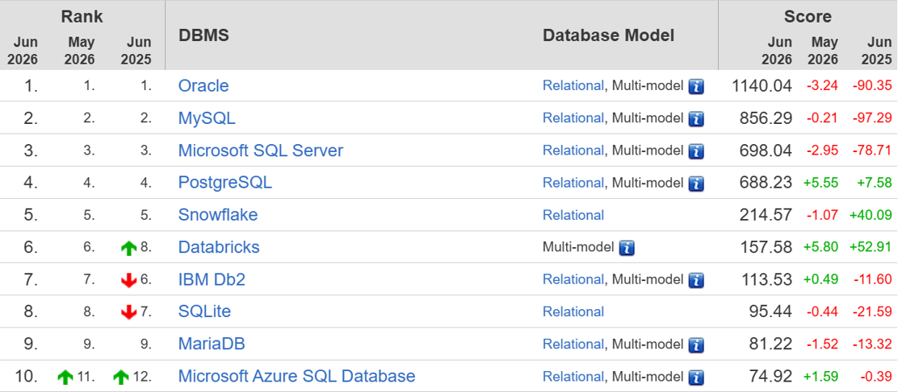
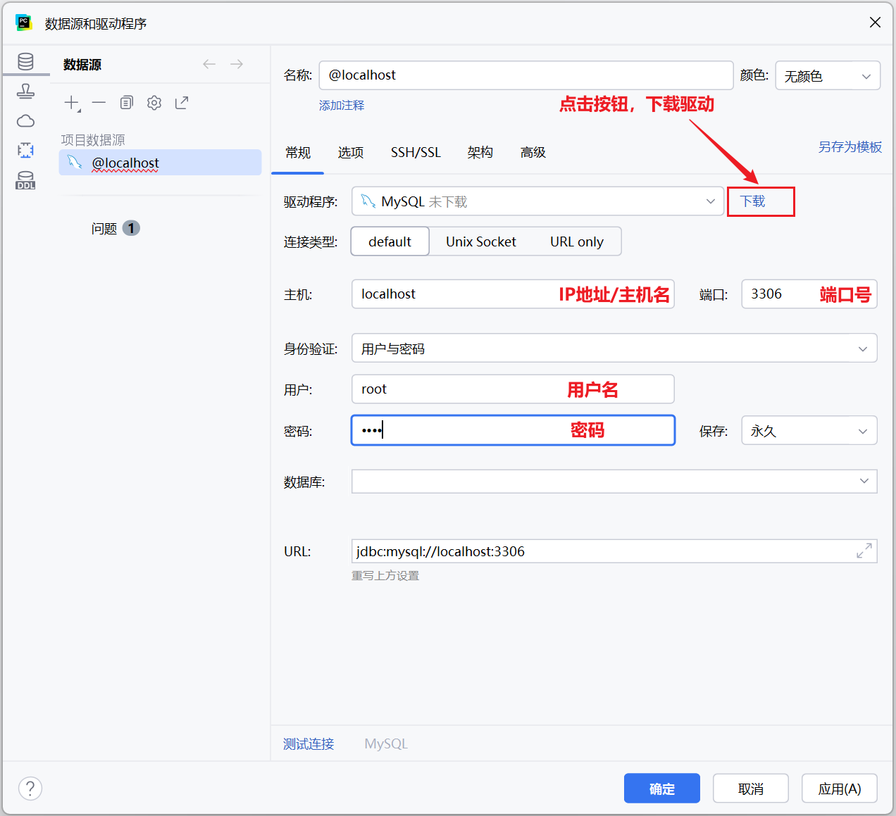

# 新建文件夹

```py
SESSION_DIR = "文件夹名称"
if not os.path.exists(SESSION_DIR):
	os.mkdir(SESSION_DIR)
```

# 判断文件是否存在

```py
if not os.path.exists("文件路径")
```

# 获取当前时间字符串

```py
file_name = datetime.now().strftime("%Y-%m-%d_%H-%M-%S")
```

# 获取某一个目录下的文件名（含后缀）

```py
list_paths = os.listdir(SESSION_DIR) #"文件名"
```
# 降序方法
```py
sort(reverse=True)
```
# 路由路径要和函数参数名相同
```py
@app.get("/api/sessions/{session_name}")
def load_session_by_name(session_name):
	...
```
# 删除文件

```py
os.remove("文件路径")
```

# Restful开发规范

**基于REST风格URL如下：**

- `http://localhost:8080/api/users/1` GET
- `http://localhost:8080/api/users` POST
- `http://localhost:8080/api/users` PUT
- `http://localhost:8080/api/users/1` DELETE

> [!note] 注意
>描述模块的功能通常使用复数，也就是加s的格式来描述，表示此类资源，而非单个资源。如：users、emps、books…

在REST风格的URL中，通过四种请求方式，来操作数据的增删改查。

- `GET` ： 查询
- `POST` ：新增
- `PUT` ： 修改
- `DELETE` ：删除

# 日志记录

**python官方:** 使用logging模块 【灵活控制开关、记录日志的输出时间】

三个步骤:
- 导入 logging 模块: import logging
- 配置 logging 的基础配置 （日志级别、日志格式）
```py
ogging.basicConfig(
	level=logging.INFO,
	format="%(asctime)s - %(levelname)s - [%(filename)s:%(lineno)d] - %(message)s" )
```
- 记录日志
```py
logging.info("访问首页~")

logging.error("msg")
```
**日志级别：**

- 日志级别就是日志信息贴上的"重要性标签"
- 常见级别有：DEBUG、INFO、WARNING、ERROR、FATAL（日志级别依次升高）。
- 常规日志: INFO
- 错误或异常日志: ERROR
- 关闭日志: FATAL

# 异常处理

## 自定义异常处理器

借助于FastAPI中的统一异常处理方案来处理异常。

**语法:**

1. 定义函数:<mark style="background:#d3f8b6"> handle_exception</mark>(request: <mark style="background:#d3f8b6">Request</mark>, e: <mark style="background:#d3f8b6">Exception</mark>)
2. 使用异常装饰器修饰: <mark style="background:#d3f8b6">@app.exception_handler(Exception)</mark>
3. 异常处理
4. 响应结果: return <mark style="background:#d3f8b6">JSONResponse(content={"code": 500, "message": "后端代码异常，请联系开发人员即时排查","data": None})</mark>

```Python
from fastapi import Request
from fastapi.responses import JSONResponse

#定义一个统一的异常处理器
# 1.定义异常装饰器
@app.exception_handler(Exception)
# 2.定义异常处理函数
def exception_handle(request:Request,e:Exception):

    #3.定义异常处理方式：
    logging.error(f"异常的原因为：{e}")
    logging.error(f"请求方式：{request.method}")
    logging.error(f"请求路径：{request.url}")
    logging.error(f"请求头信息：{request.headers}")

    #4.出现异常后，统一响应结果给前端
    return JSONResponse(content={"code": 500, "message": "后端代码异常，请联系开发人员即时排查","data": None})即时排查","data": None})
```

> [!NOTE] 注意
> 这个 `request` 参数是 FastAPI 框架中 `Request` 类的实例对象，它代表了客户端发来的HTTP请求，所有的请求相关的信息，都可以从该对象中获取。 比如：
> 
> - `request.url`：获取完整的请求的url地址。
>     
> - `request.method`：HTTP方法（如 `GET`、`POST`）。
>     
> - `request.headers`：请求头信息（如 `User-Agent`、`Authorization` 令牌）。
>     
> - `request.client`：客户端IP地址和端口（`host` 和 `port`）。
>     
> - `request.cookie`：获取Cookie信息。


# 为什么要用mysql而不用文件?

因为: 并发冲突, 查询统计性能低下, 数据维护困难, 数据不安全

<span style="color:#2DC26B">(了解)</span>
- 并发冲突：一个项目，是可能会多个人同时访问的，如果多个人同时操作同一份文件，就可能引发并发冲突问题。
- 查询统计性能低下：如果我们要对文件中的数据，进行统计、查询、分析，就需要读取所有的文件内容，然后逐步进行分析，这个效率是非常低的。
- 数据维护困难：如果我们要对数据进行增删改的操作，是比较繁琐的，数据难以维护。
- 数据不安全：基于普通文件存储数据，文件的读写权限限制低下。

# MySQL

## 介绍

- 数据库：英文为 DataBase，简称DB，它是<mark style="background:#d3f8b6">存储和管理数据的仓库。</mark>

- 数据库管理系统（DataBase Management System，简称DBMS），是操作和管理数据库的大型软件。

- SQL（Structured Query Language，简称SQL）：结构化查询语言，它是操作关系型数据库的编程语言，定义了一套操作关系型数据库的统一标准。

**十大主流数据库:**



## 数据模型

- 通过MySQL客户端连接数据库管理系统DBMS，然后通过DBMS操作数据库。
    
- 使用MySQL客户端，向数据库管理系统发送一条SQL语句，由数据库管理系统根据SQL语句指令去操作数据库中的表结构及数据。
    
- 一个数据库服务器中可以创建多个数据库，一个数据库中也可以包含多张表，而一张表中又可以包含多行记录。

# 在MySQL中存储数据的步骤

1. 创建数据库
2. 创建数据表
3. 存储数据

## **关系型数据库（RDBMS）**

概念：建立在<mark style="background:#d3f8b6">关系模型</mark>基础上，由多张<mark style="background:#d3f8b6">相互连接的**二维表**组成的数据库</mark>。而所谓二维表，指的是由行和列组成的表

二维表的优点：
- 使用表存储数据，格式统一，便于维护
- 使用SQL语言操作，标准统一，使用方便，可用于复杂查询

# SQL语句

| 分类  | 全称                         | 说明                          |
| --- | -------------------------- | --------------------------- |
| DDL | Data Definition Language   | 数据定义语言，用来定义数据库对象(数据库，表，字段)  |
| DML | Data Manipulation Language | 数据操作语言，用来对数据库表中的数据进行增删改     |
| DQL | Data Query Language        | 数据查询语言，用来查询数据库中表的记录         |
| DCL | Data Control Language      | 数据控制语言，用来创建数据库用户、控制数据库的访问权限 |
## DDL

### 库操作

```sql
# 查询所有数据库
show databases;

# 查询当前数据库
select database();

# 创建数据库
create database [ if not exists ] 数据库名  [default charset utf8mb4];     
create database 数据库名;

# 使用/切换数据库
use 数据库名;

# 删除数据库
drop database [ if exists ] 数据库名 ;
```

- 要操作某一个数据库，必须要切换到对应的数据库中。
- if not exists: 数据库不存在,则创建该数据库；如果存在则不创建
- 如果删除一个不存在的数据库，将会报错。
- 参数 if exists ，如果数据库存在，再执行删除，否则不执行删除。

> [!NOTE] 注意
> **说明：上述语法中的database，也可以替换成 schema**
> - 如：create schema db01;
> - 如：show schemas;

# PyCharm连接数据库



- 测试连接可以测试是否连通
- 展示左右数据库按钮
- 自带数据库别删除

### 表操作

```sql
# 创建
create table  表名(
        字段1  字段1类型 [约束]  [comment  字段1注释 ],
        字段2  字段2类型 [约束]  [comment  字段2注释 ],
        ......
        字段n  字段n类型 [约束]  [comment  字段n注释 ] 
) [ comment  表注释 ] ;
```

- 注意： [ ] 中的内容为可选参数； 最后一个字段后面没有逗号
- 注释用单引号
- 性别用char

## 约束

| 约束   | 描述                       | 关键字         |
| ---- | ------------------------ | ----------- |
| 非空约束 | 限制该字段值不能为null            | not null    |
| 唯一约束 | 保证字段的所有数据都是唯一、不重复的       | unique      |
| 主键约束 | 主键是一行数据的唯一标识，要求非空且唯一     | primary key |
| 默认约束 | 保存数据时，如果未指定该字段值，则采用默认值   | default     |
| 外键约束 | 让两张表的数据建立连接，保证数据的一致性和完整性 | foreign key |
- 可以在创建表/修改表的时候添加约束。
- 主键约束：一般一张表中只能有一个主键
- 关键字：auto_increment（自动增长）
```SQL
create table tb_user (
    id int primary key auto_increment comment 'ID,唯一标识', #主键自动增长
	...
) comment '用户表';
```

