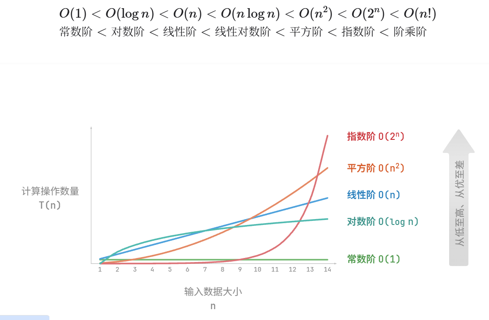
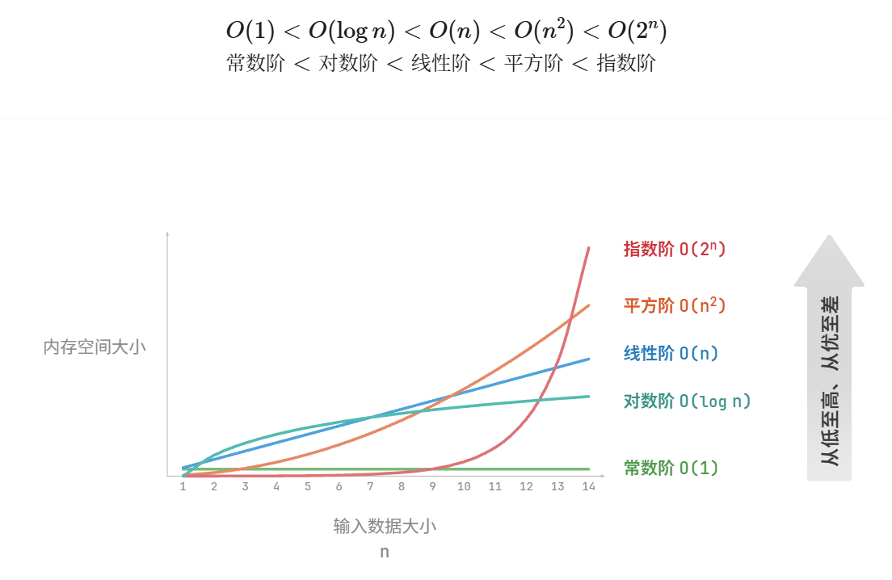

- 复杂度分析
	- 算法效率评估
		- 目标
			- 找到问题解法
			- 寻求最优解法
		- 两个维度
			- 时间效率
			- 空间效率
		- 方法
			- 实际测试
				- 难以排除测试环境的干扰因素
				- 展开完整测试非常耗费资源
			- 理论估算
				- 复杂度分析(又叫: 渐近复杂度分析)
				- 它描述了随着输入数据规模的增加，
				  算法执行所需时间和空间的增长趋势。
				- 分类
					- 时间复杂度
					- 空间复杂度
				- 克服了实际测试方法的弊端
				- 优点
					- 独立
					- 绿色节能
					- 能体现不同数据量下的算法效率
	- 迭代与递归
		- 迭代
			- for循环
			- while 循环
			- 嵌套循环
		- 递归
			- 三要素
				- 终止条件: 用于决定什么时候由“递”转“归”。
				- 递归调用: 对应“递”，函数调用自身，通常输入更小或更简化的参数。
				- 递归结果: 对应“归”，将当前递归层级的结果返回至上一层。
	- [时间复杂度](https://www.hello-algo.com/chapter_computational_complexity/time_complexity/#234)
		- 
		- 最差、最佳、平均时间复杂度
		- 通常使用最差时间复杂度O(n无穷大)
		- 很少使用最佳时间复杂度，因为通常只有在很小概率下才能达到
	- [空间复杂度](https://www.hello-algo.com/chapter_computational_complexity/space_complexity/#243)
		- 
		- 通常只关注最差空间复杂度
		- 因为要保证程序在所有输入数据下都有足够的内存空间预留
